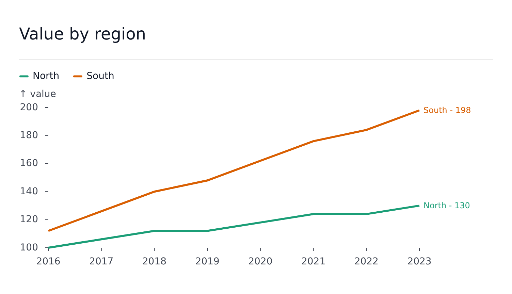

<div align="center">


</div>

---

[](https://www.npmjs.com/package/@fundar/data-chart-telling)
[](https://github.com/datos-Fundar/data-chart-telling/releases/latest)

[](https://circleci.com/gh/datos-Fundar/data-chart-telling)
[](https://www.codefactor.io/repository/github/datos-fundar/data-chart-telling)
[](https://codecov.io/gh/datos-Fundar/data-chart-telling)

## Introduction

Svelte 5 plots for data storytelling, built on [svelteplot](https://svelteplot.dev). A plot is one graph - axes and marks - that carries its own title, legend, tooltip, facets and timeline, so a finished, readable figure is one component with a handful of props.

It aims for a sweet spot between the flexibility of `d3`, the declarative spirit of the _grammar of graphics_ (data mapped to channels, scales and marks) and the convenience of a classic plotting library, where each plot kind is a first-class component.

```svelte
<script lang="ts">
	import { LinePlot } from '@fundar/data-chart-telling';

	const rows = [
		{ year: 2020, region: 'North', value: 3.1 },
		{ year: 2021, region: 'North', value: 3.8 },
		{ year: 2020, region: 'South', value: 2.2 },
		{ year: 2021, region: 'South', value: 2.9 }
	];
</script>

<LinePlot
	width={720}
	height={400}
	title="Value by region"
	data={rows}
	x="year"
	y="value"
	color="region"
	tooltip
	scales={{ x: { label: false } }}
	styles={{ values: { show: true } }}
/>
```



Eight plot kinds - line, area, bar, histogram, heatmap, pyramid, scatter and geographic maps - share one vocabulary: the same channels (`x`, `y`, `color`, `grouping`, `opacity`, `symbol`, `r`), the same `scales`, `styles`, `segments`, `markers`, `transforms`, `tooltip`, `legend`, `timeline` and `facet` props, and one global theme.

## Install

```bash
pnpm add @fundar/data-chart-telling svelte svelteplot
# only for GeoPlot fed with TopoJSON
pnpm add topojson-client
```

The package ships Svelte components, so the app needs the Svelte compiler (`@sveltejs/vite-plugin-svelte` or SvelteKit). Types ship with it.

## Stepping through time

`timeline` slices the rows by a field and steps through them. It draws as a **player** by default: play and pause, the current step and a slider, in the figure's chrome.

```svelte
<BarPlot {width} {height} data={rows} x="region" y="value" timeline={{ accessor: 'year' }} />
```


`type: 'rule'` draws a **rule** beside the plot instead, a line with the steps written along it. The page drives it through `progress` (`0` to `1`), from a slider, scroll position or anything else.

```svelte
<LinePlot
	{width}
	{height}
	data={rows}
	x="year"
	y="value"
	color="region"
	timeline={{ accessor: 'year', type: 'rule', progress }}
/>
```


See [Timeline](docs/timeline.md) for both in detail.

## Documentation

Start with the concepts; the rest is organised by what you want a plot to do.

| Topic                                                          | What it covers                                                                               |
| -------------------------------------------------------------- | -------------------------------------------------------------------------------------------- |
| [Getting started](docs/getting-started.md)                     | Installing, a first plot, sizing a plot to its container, loading data                       |
| [Concepts](docs/concepts.md)                                   | Plots and figures, rows and series, channels, the props every plot shares                    |
| [Plots](docs/plots.md)                                         | The eight plot kinds: what each one draws and what it needs                                  |
| [Scales](docs/scales.md)                                       | Axes (`x`, `y`) and channel scales (`color`, `grouping`, `opacity`, `symbol`, `r`, `length`) |
| [Styles and segments](docs/styles-and-segments.md)             | Value labels, frames, gap filling, and styling ranges of the data                            |
| [Markers](docs/markers.md)                                     | Extra marks on a plot: annotations, regions, hover highlights, custom components             |
| [Transforms and statistics](docs/transforms-and-statistics.md) | Stacking, binning, smoothing, regression and the other data transforms                       |
| [Tooltip and hover](docs/tooltip-and-hover.md)                 | Floating tooltips, in-plot highlights, syncing hover across plots                            |
| [Legend](docs/legend.md)                                       | The automatic legend, toggling series, custom sections                                       |
| [Timeline](docs/timeline.md)                                   | Stepping through the data by time, with a player bar (default) or a rule                     |
| [Chrome](docs/chrome.md)                                       | Title, subtitle, caption, header, footer, dividers and their order                           |
| [Facets](docs/facets.md)                                       | Small multiples: grids, carousels, pages                                                     |
| [Composer](docs/composer.md)                                   | Several plots in one figure, with shared hover, legend and timeline                          |
| [Reading plot state](docs/state.md)                            | `usePlot` and `useFigure`, to build custom UI around a plot                                  |
| [Maps](docs/geo.md)                                            | GeoPlot: data, projections, choropleths, camera and map markers                              |
| [Theming](docs/theming.md)                                     | The global configuration, themes, locale and CSS variables                                   |
| [Architecture](docs/architecture.md)                           | How a plot is assembled, for contributors                                                    |
| [Development](docs/development.md)                             | Building, testing, Storybook and publishing                                                  |

Working examples live in [examples/](examples/); the Storybook (`pnpm storybook`) shows every option live.

## For LLMs and coding agents

[llms.txt](llms.txt) is the index and [llms-full.txt](llms-full.txt) is a single-file guide with the rules that matter most. Both ship inside the npm package, next to the runnable [examples/](examples/).

## License

[MIT](LICENSE). Keep the copyright notice and license text in copies of the code.
