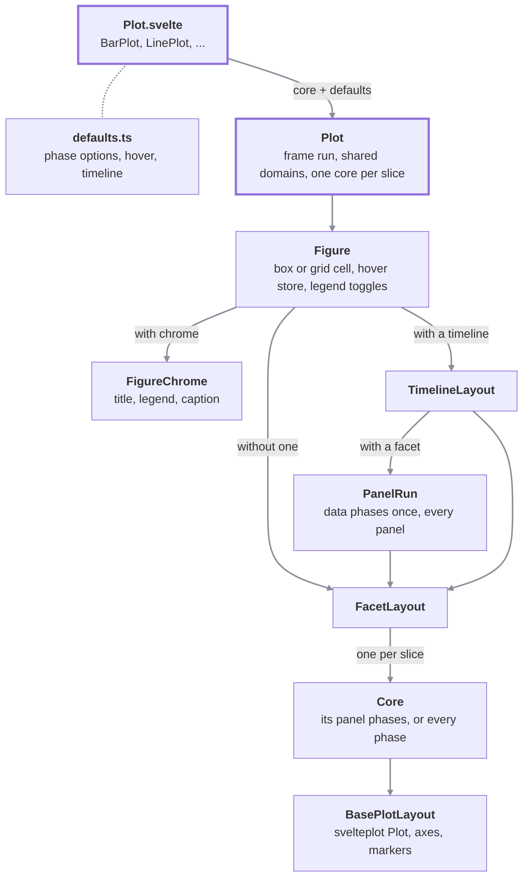
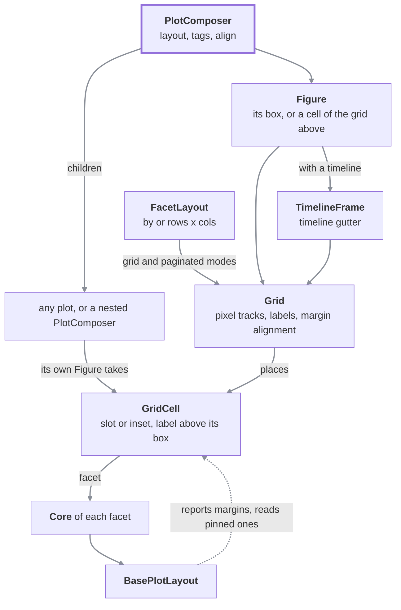

# data-chart-telling

A Svelte 5 component library for building data visualisation plots, built on top of [svelteplot](https://svelteplot.dev). Every **plot** is a single graph (axes + marks) that can optionally carry a title, caption, legend, facets, and a timeline.

---

## Build & publish

After making changes, rebuild the package distributable:

```bash
pnpm build
```

`prepack` runs `svelte-package` followed by `publint` automatically before packing, so a publish will always ship a clean build:

```bash
# dry-run - inspect what will be uploaded
pnpm pack

# publish to the npm registry
pnpm publish --access public
```

> Bump `version` in `package.json` before each publish.

---

## Tests

### Unit tests (node)

Pure logic tests - no browser required.

```bash
pnpm test
```

This runs both the **node unit** project and the **browser component** project (Chromium via Playwright).

To run only the node unit tests:

```bash
pnpm vitest run --project=unit
```

To run only the browser component tests:

```bash
pnpm vitest run --project=browser
```

### Storybook interaction tests

Run stories as Vitest tests (requires Storybook to boot internally):

```bash
pnpm test:stories
```

---

## Storybook

Serve the component explorer locally:

```bash
pnpm storybook
# → http://localhost:6006
```

Build a static Storybook for deployment:

```bash
pnpm build-storybook
```

---

## Plot types

> **Vocabulary**: a _plot_ is a graph (axes + marks). Every plot can optionally be framed by a title, subtitle, caption, legend, and sliced by facets and/or a timeline (see [Plot chrome props](#plot-chrome-props)).

| Component       | Import path                       | Description                                                                                             |
| --------------- | --------------------------------- | ------------------------------------------------------------------------------------------------------- |
| `AreaPlot`      | `$lib/plots/area/Plot.svelte`      | Filled area on continuous x/y axes. Supports multiple series and per-series range segments.             |
| `BarPlot`       | `$lib/plots/bar/Plot.svelte`       | Bar chart, vertical or horizontal depending on which axis holds the categories. Supports multiple series and per-series range segments. |
| `HeatmapPlot`   | `$lib/plots/heatmap/Plot.svelte`   | Grid of colour-coded cells. Colour domain is computed over the full dataset for cross-facet comparability. |
| `HistogramPlot` | `$lib/plots/histogram/Plot.svelte` | Distribution of a numeric field, binned along x (or along y alone, for horizontal bars).                |
| `LinePlot`      | `$lib/plots/line/Plot.svelte`      | Line chart. Supports multiple series and per-series range segments. Default timeline mode is `upTo` (cumulative reveal). |
| `PyramidPlot`   | `$lib/plots/pyramid/Plot.svelte`   | Diverging bar chart; each series is mirrored on either side of a shared zero baseline. Horizontal with categories on y, vertical with them on x. |
| `ScatterPlot`   | `$lib/plots/scatter/Plot.svelte`   | Point cloud on continuous x/y axes; `r` sizes each dot.                                                 |
| `GeoPlot`       | `$lib/plots/geo/Plot.svelte`       | Geographic map rendered from GeoJSON/TopoJSON with optional choropleth styling and interactive markers. |

All components accept explicit `width` and `height` in pixels (svelteplot does not auto-size).

---

### Plot props (x/y plots)

Plots accept either `series` (pre-built `Series[]`) or the `data` + `x`/`y`/`grouping`/`color` flat-rows path - these are mutually exclusive. `grouping` splits `data` into one series per distinct value; `color` is the value/colour channel and, when `grouping` is unset, doubles as the grouping key too (the common case - a single `color` accessor both groups _and_ colours series).

| Prop       | Type                     | Default | BarPlot | HeatmapPlot                       | LinePlot | PyramidPlot |
| ---------- | ------------------------ | ------- | ------- | --------------------------------- | -------- | ----------- |
| `width`    | `number`                 | -       | ✅      | ✅                                | ✅       | ✅          |
| `height`   | `number`                 | -       | ✅      | ✅                                | ✅       | ✅          |
| `series`   | `Series[]`               | -       | ✅      | ✅                                | ✅       | ✅          |
| `data`     | `TData[]`                | -       | ✅      | ✅                                | ✅       | ✅          |
| `x`        | `Accessor`               | -       | ✅      | ✅                                | ✅       | ✅          |
| `y`        | `Accessor`               | -       | ✅      | ✅                                | ✅       | ✅          |
| `grouping` | `Accessor`               | -       | ✅      | ❌                                | ✅       | ✅          |
| `color`    | `Accessor`               | -       | ✅      | ✅ (per-cell value, not grouping) | ✅       | ✅          |
| `segments` | `SegmentsConfig<TStyle>` | `[]`    | ✅      | ✅                                | ✅       | ✅          |
| `markers`  | `Marker[]`               | `[]`    | ✅      | ✅                                | ✅       | ✅          |
| `scales`   | `AxisBasedScalesConfig`  | `{}`    | ✅      | ✅                                | ✅       | ✅          |
| `margins`  | `MarginConfig`           | `{}`    | ✅      | ✅                                | ✅       | ✅          |
| `tooltip`  | `TooltipConfig`          |         | ✅      | ✅                                | ✅       | ✅          |
| `styles`   | `BasePlotStyles`         |         | ✅      | ✅                                | ✅       | ✅          |

#### GeoPlot props

Unlike x/y plots, `GeoPlot` uses GeoJSON/TopoJSON as its data source (no x/y axes, no `grouping`). It accepts either a `FeatureCollection`, a `Feature[]`, or a TopoJSON `Topology` (with the `object` key to specify which named object to extract).

| Prop           | Type                                                  | Default                                                            | Description                                                                                                       |
| -------------- | ----------------------------------------------------- | ------------------------------------------------------------------ | ----------------------------------------------------------------------------------------------------------------- |
| `width`        | `number`                                              | -                                                                  | Plot width in pixels.                                                                                             |
| `height`       | `number`                                              | -                                                                  | Plot height in pixels.                                                                                            |
| `data`         | `FeatureCollection \| Feature[] \| Topology`          | -                                                                  | GeoJSON (FeatureCollection or Feature array) or TopoJSON Topology.                                                |
| `object`       | `string`                                              | -                                                                  | Required when `data` is a TopoJSON Topology - the key under `topology.objects` to extract.                        |
| `featureId`    | `Accessor<GeoFeature, string>`                        | `feature.id ?? feature.properties?.id ?? feature.properties?.name` | Resolver for each feature's stable id (used for `segments` lookup and hover identification).                      |
| `color`        | `(feature: GeoFeature) => number \| undefined`        | -                                                                  | Optional continuous accessor for choropleth colouring (mirrors heatmap's `color`), configured via `scales.color`. |
| `excludeParts` | `(part: GeoGeometry, feature: GeoFeature) => boolean` | -                                                                  | Excludes matching geometry parts from rendering/hover (e.g. for inset markers). Return `true` to exclude.         |
| `segments`     | `SegmentsConfig<GeoSegmentStyle>`                     | `[]`                                                               | Per-feature styling (keyed by `featureId`).                                                                       |
| `markers`      | `GeoMarker[]`                                         | `[]`                                                               | Array of markers: `graticule`, `sphere`, `dot`, `vector`, `link`, `contour`, `inset`, or custom `component`.      |
| `scales`       | `GeoScalesConfig`                                     | `{}`                                                               | Projection and colour scale config.                                                                               |
| `margins`      | `MarginConfig`                                        | `{}`                                                               | Top/right/bottom/left margin overrides.                                                                           |
| `tooltip`      | `TooltipConfig<GeoFeature>`                           | -                                                                  | Hover/click tooltip configuration.                                                                                |
| `styles`       | `GeoStyles<TProps>`                                   | -                                                                  | Base map fill, choropleth ramp, tile layer, zoom, and click handlers.                                             |

#### `BasePlotStyles` sub-properties (x/y plots)

| Sub-prop                   | Type                                        | BarPlot default | HeatmapPlot default | LinePlot default                  | PyramidPlot default |
| -------------------------- | ------------------------------------------- | --------------- | ------------------- | --------------------------------- | ------------------- |
| `styles.values.show`       | `boolean`                                   | `false`         | `true`              | `false` (last point)              | `false`             |
| `styles.values.format`     | `(v: number, seriesName: string) => string` | `v => \`${v}\`` | `v => \`${v}\``     | `(v, name) => \`${name} - ${v}\`` | `v => \`${v}\``     |
| `styles.values.anchor`     | `'outside' \| 'start' \| 'middle' \| 'end'` | `'outside'`     | -                   | `'start'`                         | `'outside'`         |
| `styles.values.dx`         | `number`                                    |                 |                     |                                   |                     |
| `styles.values.dy`         | `number`                                    |                 |                     |                                   |                     |
| `styles.values.textAnchor` | `'start' \| 'end' \| 'middle'`              |                 | `'middle'`          |                                   |                     |
| `styles.values.lineAnchor` | `'top' \| 'bottom' \| 'middle'`             |                 | `'middle'`          |                                   |                     |
| `styles.values.rotate`     | `number`                                    |                 |                     |                                   |                     |
| `styles.values.class`      | `string`                                    |                 |                     |                                   |                     |
| `styles.values.textClass`  | `string`                                    |                 |                     |                                   |                     |

PyramidPlot has no `styles.colors` - its default coloring is the same per-series-name palette cycling every other axis-based plot kind uses (see [Channels: `color` and `grouping`](#channels-color-and-grouping) below). Override it with `scales.color` (a `Record<string, string>` scheme keyed by series name covers the common "one color per side" case) or a `segments` entry keyed by series name.

#### `GeoStyles` sub-properties (GeoPlot)

| Sub-prop                | Type                                          | Default          | Description                                                                             |
| ----------------------- | --------------------------------------------- | ---------------- | --------------------------------------------------------------------------------------- |
| `styles.fill`           | `string`                                      | palette[0]       | Base map fill for features not styled by `segments` or choropleth.                      |
| `styles.fillOpacity`    | `number`                                      | `1`              | Base map fill opacity.                                                                  |
| `styles.stroke`         | `string`                                      | cfg `axis.color` | Base map feature stroke colour.                                                         |
| `styles.strokeWidth`    | `number`                                      | `0.5`            | Base map feature stroke width.                                                          |
| `styles.tileLayer`      | `GeoTileLayerConfig`                          | -                | XYZ raster basemap config (URL, opacity, zoom range). Mercator-family projections only. |
| `styles.zoom`           | `boolean \| GeoZoomConfig`                    | `false`          | Enable/configure drag-pan + scroll-zoom (`false` = static map).                         |
| `styles.onFeatureClick` | `(feature: GeoFeature, event: Event) => void` | -                | Click handler for base-map features.                                                    |

#### Scales: `AxisBasedScalesConfig` (x/y plots) vs `GeoScalesConfig` (GeoPlot)

X/Y plots use `AxisBasedScalesConfig` with `x`/`y` axis configurations plus every _channel_ (see [Channels: `color` and `grouping`](#channels-color-and-grouping) below). GeoPlot uses `GeoScalesConfig` - just the channels, plus `projection` (no x/y axis pair). `ScalesConfig` is the union of both (`AxisBasedScalesConfig | GeoScalesConfig`) - each plot kind's own `scales` prop narrows to whichever one applies to it.

| Prop         | AxisBasedScalesConfig (x/y plots) | GeoScalesConfig (GeoPlot) |
| ------------ | ------------------------------------------------------------------- | ------------------------- |
| `x`          | ✅ (AxisScale)                                                      | ❌                        |
| `y`          | ✅ (AxisScale)                                                      | ❌                        |
| `projection` | ❌                                                                  | ✅ (GeoProjectionConfig)  |
| `color`      | ✅ (`ColorScaleConfig`)                                             | ✅ (`ColorScaleConfig`)   |
| `grouping`   | ✅ (`GroupingScaleConfig`)                                          | ❌                        |

#### Channels: `color` and `grouping`

Every axis-based plot kind (x/y plots) - and GeoPlot for `color` - accepts these two mapping-layer props, each configured by the matching `scales.<name>` entry:

- **`color`** - the value/colour channel. `scales.color` (`ColorScaleConfig`: `{ domain?, scheme?, pivot?, unknown? }`) configures the ramp: `domain` is `[min, max]` for a continuous value or a category list, `scheme` is a named [d3-scale-chromatic](https://d3js.org/d3-scale-chromatic) ramp (e.g. `'turbo'`), 2+ literal colours to interpolate across, or a `Record<string, string>` category → colour map, `pivot` splits an array `scheme` into a diverging ramp at that domain value, `unknown` is the fallback colour for a missing/unmapped value. This package always resolves its own ramp per consumer - it never routes through svelteplot's single shared `color` scale - so a plot's own `scales.color` and a `dot` marker's own `color`/`scales` (see the Markers section) can coexist as two fully independent ramps in the same plot.
- **`grouping`** - the structural series-splitting key for BarPlot/LinePlot/PyramidPlot (not HeatmapPlot/GeoPlot, which have no series concept). Splits flat `data` into one series per distinct value. **When `grouping` is unset but `color` is given, `color` is used as the grouping key too** - the common case, where one accessor both groups and colours series exactly like a single `z` prop used to in earlier versions. `scales.grouping` (`GroupingScaleConfig`: `{ reverse?, seriesLayout?, seriesPadding? }`) configures how the resulting groups are laid out - `reverse` flips which group sorts first (e.g. PyramidPlot's left/right side order), `seriesLayout`/`seriesPadding` control how BarPlot arranges multiple series sharing one category (`'overlap'` default, `'grouped'` side-by-side, or `'stacked'`). This is layout/ordering configuration, not a colour ramp - a different concern from `scales.color`, even when both apply to the same `grouping`-derived series.

Split them when you want to group by one field and colour by another - e.g. group a dataset by `region` (`grouping: 'region'`) while colouring each point by a continuous `temperature` value (`color: 'temperature'`, `scales: { color: { domain: [0, 40] } }`).

#### Props distribution across all plot kinds

| Prop           | BarPlot      | HeatmapPlot  | LinePlot     | PyramidPlot  | GeoPlot                                         | Notes                                                                                                                                                  |
| -------------- | ------------ | ------------ | ------------ | ------------ | ----------------------------------------------- | ------------------------------------------------------------------------------------------------------------------------------------------------------ |
| `width`        | ✅           | ✅           | ✅           | ✅           | ✅                                              | Common to all plots.                                                                                                                                   |
| `height`       | ✅           | ✅           | ✅           | ✅           | ✅                                              | Common to all plots.                                                                                                                                   |
| `segments`     | ✅           | ✅           | ✅           | ✅           | ✅                                              | Common to all plots; GeoPlot uses `SegmentsConfig<GeoSegmentStyle>`, others use their own `SegmentStyle` type.                                         |
| `markers`      | ✅           | ✅           | ✅           | ✅           | ✅                                              | Common to all plots; GeoPlot uses `GeoMarker[]`, others use `Marker[]`.                                                                                |
| `margins`      | ✅           | ✅           | ✅           | ✅           | ✅                                              | Common to all plots.                                                                                                                                   |
| `tooltip`      | ✅           | ✅           | ✅           | ✅           | ✅                                              | Common to all plots; row type varies per plot.                                                                                                         |
| `styles`       | ✅           | ✅           | ✅           | ✅           | ✅                                              | Common; type is `BasePlotStyles` for x/y plots, `GeoStyles<TProps>` for GeoPlot.                                                                       |
| `scales`       | ✅           | ✅           | ✅           | ✅           | ✅                                              | Common; type is `AxisBasedScalesConfig<TData>` for x/y plots, `GeoScalesConfig` for GeoPlot.                                                           |
| `series`       | ✅           | ✅           | ✅           | ✅           | ❌                                              | X/Y plots only (mutually exclusive with `data`/`x`/`y`/`grouping`/`color`).                                                                            |
| `data`         | ✅ (TData[]) | ✅ (TData[]) | ✅ (TData[]) | ✅ (TData[]) | ✅ (FeatureCollection \| Feature[] \| Topology) | Common; data shape differs - x/y plots use flat rows, GeoPlot uses geo features.                                                                       |
| `x`            | ✅           | ✅           | ✅           | ✅           | ❌                                              | X/Y plots only.                                                                                                                                        |
| `y`            | ✅           | ✅           | ✅           | ✅           | ❌                                              | X/Y plots only.                                                                                                                                        |
| `grouping`     | ✅           | ❌           | ✅           | ✅           | ❌                                              | Series selector - Bar/Line/Pyramid only; falls back to `color` when unset.                                                                             |
| `color`        | ✅           | ✅           | ✅           | ✅           | ✅ (optional)                                   | The value/colour channel everywhere - series selector-or-colourer in Bar/Line/Pyramid, per-cell value in Heatmap, per-feature choropleth value in Geo. |
| `object`       | ❌           | ❌           | ❌           | ❌           | ✅ (optional)                                   | GeoPlot only; required when `data` is a TopoJSON Topology.                                                                                             |
| `featureId`    | ❌           | ❌           | ❌           | ❌           | ✅ (optional)                                   | GeoPlot only; resolves feature identity for `segments` lookup and hover.                                                                               |
| `excludeParts` | ❌           | ❌           | ❌           | ❌           | ✅ (optional)                                   | GeoPlot only; filters geometry parts from rendering.                                                                                                   |

---

### Plot chrome props

Every plot also accepts these optional props, which draw content around the plot and slice its data. They are shared by all plot kinds.

| Prop       | Type               | Description                                                                                                  |
| ---------- | ------------------ | ------------------------------------------------------------------------------------------------------------ |
| `title`    | `string`           | Title above the plot.                                                                                        |
| `subtitle` | `string`           | Subtitle below the title.                                                                                    |
| `caption`  | `string`           | Caption below the plot.                                                                                      |
| `header`   | `Snippet`          | Replaces `title`/`subtitle` when richer markup is needed.                                                    |
| `footer`   | `Snippet`          | Replaces `caption` when richer markup is needed.                                                             |
| `legend`   | `LegendSection[]`  | Legend sections drawn above the plot.                                                                        |
| `order`    | `PlotChromeItem[]` | Top-to-bottom order of the blocks (`title`, `subtitle`, `header`, `legend`, `plot`, `caption`, `footer`, `divider`). |
| `facet`    | `FacetConfig`      | Splits the data rows into small multiples.                                                                   |
| `timeline` | `TimelineConfig`   | Steps through the data over time (e.g. cumulative reveal for `LinePlot`).                                    |

When `header` is provided it takes full precedence over `title`/`subtitle`; when `footer` is provided it takes full precedence over `caption`. Use the natural snippet syntax:

```svelte
<LinePlot ...>
	{#snippet header()}
		<div style="display:flex; justify-content:space-between">
			<h3 style="color:#2563eb">My Plot</h3>
			
		</div>
	{/snippet}

	{#snippet footer()}
		<small>Source: <a href="...">Dataset</a> · Updated Q3 2024</small>
	{/snippet}
</LinePlot>
```

---

### Segments

The `segments` prop separates data ranges from visual styling. Every plot kind shares the same underlying types; the style shape (`TStyle`) differs per mark.

| Plot                           | `segments` type                    | Key structure                            | Lookup                                                           |
| ------------------------------ | ---------------------------------- | ---------------------------------------- | ---------------------------------------------------------------- |
| `LinePlot`       | `SegmentsConfig<LineSegmentStyle>` | Named keys (series names) or `'default'` | By series name (`grouping`/`color` accessor or series index).    |
| `BarPlot`         | `SegmentsConfig<BarSegmentStyle>`  | Named keys (series names) or `'default'` | By series name (`grouping`/`color` accessor or series index).    |
| `PyramidPlot` | `SegmentsConfig<BarSegmentStyle>`  | Named keys (series names) or `'default'` | By series name (`grouping`/`color` accessor or series index).    |
| `HeatmapPlot` | `SegmentsConfig<CellSegmentStyle>` | `'default'` key only                     | All cells (can be restricted by `areas` coordinates).            |
| `GeoPlot`                      | `SegmentsConfig<GeoSegmentStyle>`  | Named keys (feature ids) or `'default'`  | By feature id (`featureId` accessor or derived from properties). |

**Segment styles by plot:**

| SegmentStyle type  | Supports                                       | Plot(s)                                                |
| ------------------ | ---------------------------------------------- | ------------------------------------------------------ |
| `LineSegmentStyle` | `stroke` (line), `dots` (endpoint markers)     | `LinePlot`                               |
| `BarSegmentStyle`  | `fill`, `fillOpacity`                          | `BarPlot`, `PyramidPlot` |
| `CellSegmentStyle` | `fill`, `fillOpacity`, `stroke`, `strokeWidth` | `HeatmapPlot`                         |
| `GeoSegmentStyle`  | `fill`, `fillOpacity`, `stroke`, `strokeWidth` | `GeoPlot`                                              |

#### Core types

```ts
type Range = { from?: AxisValue; to?: AxisValue }; // inclusive on both sides
type Area = { x?: Range; y?: Range }; // 2-D rectangular region
type Segment<TStyle> = { areas?: Area[]; styles?: TStyle };
```

A **`Segment`** matches a data point (or heatmap cell) when the point falls inside **any** of its `areas`. Omitting `areas` creates a **catch-all** that matches every data point - but catch-alls are always evaluated **last**, regardless of their position in the list, so area-specific segments always win. This lets a catch-all placed first act as a fallback baseline that highlighted ranges override.

An **`Area`** restricts by x, y, or both. Both bounds of a `Range` are **inclusive**. Omitting `x` or `y` leaves that axis unrestricted.

#### `Segments` structure

`segments` is a plain object: each key is a series name (or feature id, for `GeoPlot`) - or `'default'` - mapped to that key's own `Segment[]` list.

```ts
type SegmentsConfig<TStyle> = Record<string, Segment<TStyle>[]>;
```

`'default'`'s own segments apply to every series/feature; a named key's segments apply only to that one. Both can be present at once - a named key's segments are evaluated after `'default'`'s, so a series-specific entry wins over the shared baseline on a match, while everything `'default'` doesn't override still applies.

#### Examples

**Line chart - baseline colour with a highlighted range (catch-all as fallback):**

```svelte
<LinePlot
	{width}
	{height}
	series={[{ name: 'gdp', x: 'year', y: 'value', data: GDP }]}
	segments={{
		gdp: [
			{ styles: { stroke: { stroke: '#94a3b8', strokeWidth: 1 } } },
			{
				areas: [{ x: { from: 2008, to: 2010 } }],
				styles: { stroke: { stroke: '#ef4444', strokeWidth: 3 } }
			}
		]
	}}
/>
```

**Line chart - per-series baseline colours + shared dot markers (named keys plus `'default'` in the same object):**

```svelte
<LinePlot
	{width}
	{height}
	data={LIFE_EXPECTANCY}
	x="year"
	y="value"
	color="sex"
	segments={{
		// Per-series catch-all stroke colours.
		female: [{ styles: { stroke: { stroke: 'steelblue' } } }],
		male: [{ styles: { stroke: { stroke: 'tomato' } } }],
		// 'default' applies to every series - dots for both, in a shared range.
		default: [
			{
				areas: [{ x: { from: 2010, to: 2012 } }],
				styles: { dots: { dotRadius: 5, dotSymbol: 'circle' } }
			}
		]
	}}
/>
```

**Heatmap - highlight specific columns, rows, and individual cells:**

```svelte
<HeatmapPlot
	{width}
	{height}
	{data}
	{x}
	{y}
	{color}
	segments={{
		default: [
			{
				areas: [{ x: { from: 'Q1', to: 'Q1' } }, { x: { from: 'Q3', to: 'Q3' } }],
				styles: { stroke: '#f59e0b', strokeWidth: 2 }
			},
			{
				areas: [{ x: { from: 'Q2', to: 'Q2' }, y: { from: 1, to: 2 } }],
				styles: { fill: '#ef4444', fillOpacity: 0.8 }
			}
		]
	}}
/>
```

**GeoPlot - per-feature styling and catch-all fallback (note: GeoPlot keys are feature ids, not series names):**

```svelte
<GeoPlot
	{width}
	{height}
	data={COUNTRIES_GEOJSON}
	color={(f) => f.properties?.population}
	segments={{
		// Catch-all baseline (always evaluated first, so a feature-specific entry wins).
		default: [{ styles: { fillOpacity: 0.7, stroke: '#94a3b8' } }],
		// Per-feature overrides (matched by feature id)
		argentina: [{ styles: { fill: '#3b82f6', fillOpacity: 0.9 } }],
		brazil: [{ styles: { fill: '#ef4444', fillOpacity: 0.9 } }]
	}}
/>
```

Omitting `segments` (or passing `{}`) renders every mark in its default palette colour.

---

## Architecture: plots, shell, chrome, facets and composer

A figure is built from a few layers, each knowing only the one below it. A public **plot** (`BarPlot`, `LinePlot`, ...) hands its kind-specific **core** and **presentation** to the **shell**; the shell frames everything in a **chrome frame** and slices the data by **timeline** and **facet**. A **composer** reuses the same chrome frame and the same **panel grid** facets lay out on, so both share one implementation of the frame (title, legend, caption, theme variables, shared hover and legend toggles), of the grid (pixel tracks, labels, margin alignment) and of the cells.

### How a plot is built

Solid arrows are "renders"; the plot's `presentation` is handed to `Plot` alongside its core.



### Facets and the composer share one grid

The dotted arrow is "reads from": each plot reports its margins to its cell and reads back the pinned ones.



Every other dependency between layers goes through Svelte context, so a layer never imports the one that provides what it reads:

| Context         | Provided by                                               | Read by                                             |
| --------------- | --------------------------------------------------------- | --------------------------------------------------- |
| Hover store     | `Figure` (the outermost one; nested figures share it) | every core's tooltip and hover sync                 |
| Legend toggles  | `Figure` (a figure with its own `legend` scopes them) | legends and every core below                        |
| Shared timeline | `PlotComposer` with a `timeline`                          | `Plot`, which then draws no scrubber            |
| Hover scope     | `GridCell` in a composer's grid, and `HoverScope` around each facet | hover sync, to tell panels and facets apart |
| Grid            | `Grid`                                               | `GridCell` (registers, gets its box and tag), `Figure` (takes a cell) |
| Cell alignment  | `GridCell`                                                | `BasePlotLayout` (pinned margins), `MarginReporter` |

How a plot is assembled:

1. Each kind's `Plot.svelte` splits its props into chrome (`title`, `legend`, ...), `timeline`, `facet` and the core props, and renders the shared `Plot` with its kind's `Core` and the presentation its `defaults.ts` builds.
2. `Plot` renders a `Figure` - the plot's box (or its cell in a composer's grid), its hover and legend stores, and its chrome if it has any - whose body is the `TimelineLayout`, wrapping the `FacetLayout`, wrapping one `Core` per slice; without a timeline or a facet, its one cell is the whole plot. Each facet's cell gets its scales (shared or free, per `facet.scales`) and whether its axes draw (per `facet.axes` and its edges in the grid).
   - The phases that work on the rows (`facet`, `data`, `mapping`, `transforms`, `statistics`) run once for every facet panel: the kind's `presentation.dataRun`. `Plot` runs it over every row without the legend (the frame), which gives the shared axes their domains; `PanelRun` reuses the frame, or runs it again for a timeline step or a legend that omits a series.
   - Each cell gets its panel's part of that run (`buildPanelState`), and its `Core` runs only the phases that depend on its own box and interaction: `scales`, `markers` and `tooltip`. A plot without a facet runs every phase in its `Core`.
3. `FacetLayout` turns the rows into facets: one per `by` value, flowed into `columns` (all at once, a page at a time, or as a carousel), or one per `rows` x `cols` combination. It places them on a `Grid`, one `GridCell` each. The grid always aligns facets: every plot reports the margins it settled on, and once all have, each column and row pins its widest ones, so every plot area lines up.

How a composition is assembled: `PlotComposer` renders a `Figure` around a `Grid` (inside a `TimelineFrame` when it has a `timeline`, the same gutter `TimelineLayout` draws) laid out by `layout` (`columns` or named `areas`, `widths`/`heights` weights, `gap`). Every plot drawn straight in it - or another `PlotComposer` - takes a cell of its own through `Figure`: its `area`, an `inset` over it, or the next free one, with the composer's tag above it, drawn at the cell's size (`width`/`height` aren't needed there). Anything that isn't a plot goes in a `GridCell`. A `GridCell` marks what it draws as placed, so a plot inside one takes no other cell. `layout.align` turns on the same margin alignment facets use; it assumes the panels' plots draw no chrome of their own, since the grid only sees each plot's own margins.

---

## Theming & configuration

The whole package reads its default styling - fonts, colours, spacing, legend/tooltip/axis chrome, plot geometry - from one global, reactive config store (`src/lib/configuration/config.svelte.ts`). Overriding it re-themes every plot on screen; nothing needs to be passed prop-by-prop to each component.

```ts
import { setConfiguration, getConfiguration, resetConfiguration } from '@fundar/data-chart-telling';

setConfiguration({
	font: '"Inter", sans-serif',
	palette: ['#4f46e5', '#e6580d', '#16a34a'],
	legend: { continuous: { label: { size: '0.8125rem', weight: 400 } } }
});

getConfiguration(); // read the live, merged config
resetConfiguration(); // restore shipped defaults
```

- `setConfiguration` takes a **deep-partial** patch (`PlotStylesConfigInput`) and deep-merges it into the current config - you only specify the leaves you want to change, everything else keeps its previous value. It's reactive (`$state`-backed), so applying it re-renders every mounted plot.
- Call it once at app startup (or per-theme-switch); it's global, not per-plot. A single plot can still override specific visuals via its own props (`styles`, `scales`, a section's own `format`/`color`, etc.) - those always win over the global config.

### How values reach the DOM

The config feeds two different consumers, and a field is **one or the other**, never both:

1. **CSS custom properties** - `configToCssVars` flattens the relevant fields into `--dct-*` variables, which every `Figure` stamps on its root element (its `FigureChrome`, or a plain box without chrome); every component's scoped `<style>` block reads them with a hardcoded fallback (e.g. `font-size: var(--dct-continuous-label-size, 0.875rem)`). These are the fields listed with a **CSS variable** below - you can also override them directly with plain CSS on a wrapping element instead of going through `setConfiguration`, if you only need a one-off, non-reactive tweak.
2. **Plain JS values** - read directly by plot components as props svelteplot needs (numeric tick sizes, the categorical `palette` array, margins, gradient endpoints, hover geometry, per-mark defaults). These have **no** CSS variable - `setConfiguration` (or editing `DEFAULT_CONFIG`) is the only way to change them.

### Reference

All types live in `src/lib/types/configuration/styling.ts`; all defaults in `src/lib/configuration/config.svelte.ts`. "CSS variable" is `-` for JS-only fields.

#### Base

| Field        | Type     | Default          | CSS variable |
| ------------ | -------- | ---------------- | ------------ |
| `font`       | `string` | `'inherit'`      | `--dct-font` |
| `color`      | `string` | `'currentColor'` | `--dct-fg`   |
| `background` | `string` | `'transparent'`  | `--dct-bg`   |

#### Spacing

| Field                    | Type     | Default            | CSS variable        |
| ------------------------ | -------- | ------------------ | ------------------- |
| `spacing.headerPadding`  | `string` | `'0.75rem 0 1rem'` | `--dct-header-pad`  |
| `spacing.legendPadding`  | `string` | `'0.75rem 0'`      | `--dct-legend-pad`  |
| `spacing.captionPadding` | `string` | `'0.5rem 0'`       | `--dct-caption-pad` |
| `spacing.bleed`          | `string` | `'12px'`           | `--dct-bleed`       |

#### Divider

The line each `'divider'` in a plot's chrome `order` draws - by default, one below the title and subtitle (or header). Every divider shares this style.

| Field            | Type                                                               | Default                                               | CSS variable           |
| ---------------- | ------------------------------------------------------------------ | ----------------------------------------------------- | ---------------------- |
| `divider.color`  | `string`                                                           | `'color-mix(in srgb, currentColor 15%, transparent)'` | `--dct-divider-color`  |
| `divider.width`  | `string`                                                           | `'1px'`                                               | `--dct-divider-width`  |
| `divider.style`  | `DividerLineStyle` (`'solid' \| 'dashed' \| 'dotted' \| 'double'`) | `'solid'`                                             | `--dct-divider-style`  |
| `divider.margin` | `string` (CSS `margin` shorthand)                                  | `'0'`                                                 | `--dct-divider-margin` |

#### Text blocks: `title`, `subtitle`, `caption`

Each is a `TextStyle` - `{ font, size, weight, color, leading, spacing }` - mapped to `--dct-{title|subtitle|caption}-{font|size|weight|color|leading|spacing}`. Shared base before per-block overrides: `font: 'inherit'`, `size: '1rem'`, `weight: 400`, `color: 'inherit'`, `leading: '1.3'`, `spacing: 'normal'`.

| Block      | Overrides its own default                                                                   |
| ---------- | ------------------------------------------------------------------------------------------- |
| `title`    | `size: '1.5rem'`, `weight: 500`, `leading: '1.2'`                                           |
| `subtitle` | `size: '1rem'`, `weight: 400`, `color: 'color-mix(in srgb, currentColor 85%, transparent)'` |
| `caption`  | `size: '0.75rem'`, `color: 'color-mix(in srgb, currentColor 75%, transparent)'`             |

#### Legend

| Field                    | Type                           | Default         | CSS variable                                                                             |
| ------------------------ | ------------------------------ | --------------- | ---------------------------------------------------------------------------------------- |
| `legend.font`            | `string`                       | `'inherit'`     | `--dct-legend-font`                                                                      |
| `legend.size`            | `string`                       | `'0.875rem'`    | `--dct-legend-size`                                                                      |
| `legend.weight`          | `number \| string`             | `400`           | `--dct-legend-weight`                                                                    |
| `legend.color`           | `string`                       | `'inherit'`     | `--dct-legend-color`                                                                     |
| `legend.titleSize`       | `string`                       | `'0.875rem'`    | `--dct-legend-title-size`                                                                |
| `legend.titleWeight`     | `number \| string`             | `500`           | `--dct-legend-title-weight`                                                              |
| `legend.gap`             | `string` (CSS `gap` shorthand) | `'0.5rem 2rem'` | `--dct-legend-gap`                                                                       |
| `legend.swatchSize`      | `string`                       | `'1.25rem'`     | `--dct-legend-swatch`                                                                    |
| `legend.disabledOpacity` | `number`                       | `0.12`          | - (fallback for a legend-disabled series/value when a section doesn't set its own style) |

`legend.navButton` - prev/next arrows on an overflowing horizontal discrete section:

| Field                              | Type     | Default          | CSS variable                        |
| ---------------------------------- | -------- | ---------------- | ----------------------------------- |
| `legend.navButton.background`      | `string` | `'transparent'`  | `--dct-legend-nav-bg`               |
| `legend.navButton.color`           | `string` | `'currentColor'` | `--dct-legend-nav-color`            |
| `legend.navButton.size`            | `string` | `'1.5rem'`       | `--dct-legend-nav-size`             |
| `legend.navButton.fontSize`        | `string` | `'1rem'`         | `--dct-legend-nav-font-size`        |
| `legend.navButton.disabledOpacity` | `number` | `0.3`            | `--dct-legend-nav-disabled-opacity` |

`legend.continuous` - the gradient bar itself, its draggable handles, ticks, and labels:

| Field                                  | Type               | Default                 | CSS variable                           |
| -------------------------------------- | ------------------ | ----------------------- | -------------------------------------- |
| `legend.continuous.height`             | `number` (px)      | `20`                    | -                                      |
| `legend.continuous.barHeight`          | `number` (px)      | `12`                    | -                                      |
| `legend.continuous.barRadius`          | `number` (px)      | `2`                     | -                                      |
| `legend.continuous.handle.width`       | `string`           | `'6px'`                 | `--dct-continuous-handle-width`        |
| `legend.continuous.handle.height`      | `string`           | `'20px'`                | `--dct-continuous-handle-height`       |
| `legend.continuous.handle.radius`      | `string`           | `'3px'`                 | `--dct-continuous-handle-radius`       |
| `legend.continuous.handle.fill`        | `string`           | `'currentColor'`        | `--dct-continuous-handle-fill`         |
| `legend.continuous.handle.stroke`      | `string`           | `'var(--dct-bg, #fff)'` | `--dct-continuous-handle-stroke`       |
| `legend.continuous.handle.strokeWidth` | `string`           | `'1.5px'`               | `--dct-continuous-handle-stroke-width` |
| `legend.continuous.tick.color`         | `string`           | `'currentColor'`        | `--dct-continuous-tick-color`          |
| `legend.continuous.tick.width`         | `string`           | `'1px'`                 | `--dct-continuous-tick-width`          |
| `legend.continuous.tick.length`        | `string`           | `'6px'`                 | `--dct-continuous-tick-length`         |
| `legend.continuous.label.rotate`       | `string`           | `'0deg'`                | `--dct-continuous-label-rotate`        |
| `legend.continuous.label.size`         | `string`           | `'0.875rem'`            | `--dct-continuous-label-size`          |
| `legend.continuous.label.weight`       | `number \| string` | `600`                   | `--dct-continuous-label-weight`        |

`legend.continuous.label.overlap` - interactive mode only: once dragging brings the lo/hi handle labels too close to read side by side, both flip to read top-to-bottom instead of clipping or overlapping:

| Field                                     | Type          | Default   | CSS variable                                                                                                                                     |
| ----------------------------------------- | ------------- | --------- | ------------------------------------------------------------------------------------------------------------------------------------------------ |
| `legend.continuous.label.overlap.enabled` | `boolean`     | `true`    | - (`false` always keeps both labels horizontal, however close together)                                                                          |
| `legend.continuous.label.overlap.margin`  | `number` (px) | `4`       | - (horizontal slack the two labels need before they're considered overlapping)                                                                   |
| `legend.continuous.label.overlap.rotate`  | `string`      | `'90deg'` | `--dct-continuous-label-overlap-rotate` (lo rotates by this; hi by its negation, via `calc(... * -1)`, so both still grow inward toward the bar) |

#### Axis

Consumed as plain numeric/boolean props by the underlying svelteplot axes - only `color` is also exposed as a CSS variable (used by non-plot axis-adjacent chrome).

| Field                 | Type                | Default          | CSS variable             |
| --------------------- | ------------------- | ---------------- | ------------------------ |
| `axis.color`          | `string`            | `'currentColor'` | `--dct-axis-color`       |
| `axis.fontSize`       | `number`            | `14`             | -                        |
| `axis.labelFontSize`  | `number`            | `14`             | -                        |
| `axis.titleFontSize`  | `number`            | `14`             | -                        |
| `axis.xTickSize`      | `number`            | `5`              | -                        |
| `axis.yTickSize`      | `number`            | `5`              | -                        |
| `axis.xTickPadding`   | `number`            | `10`             | -                        |
| `axis.yTickPadding`   | `number`            | `10`             | -                        |
| `axis.grid`           | `boolean`           | `false`          | -                        |
| `axis.locale`         | `string`            | `'es-AR'`        | -                        |
| `axis.compactDisplay` | `'short' \| 'long'` | `'short'`        | - (`'1 M'` vs `'1 millón'`) |

`axis.locale`/`axis.compactDisplay` feed svelteplot's own automatic tick formatter - the one it falls back to on any axis without its own explicit `scales.x`/`scales.y.tickFormat`. Whether a given axis abbreviates at all (vs. spelling every digit out) stays svelteplot's own per-axis call, based on that axis's value range; these two only change the _wording_ once it decides to. A legend's size section writes its values the same way. `axis.locale` updates a plot already on screen; `axis.compactDisplay` is read once when a plot mounts (it goes through svelteplot's own `setPlotDefaults` context hook, not a per-instance prop) and needs a remount to pick up a later change.

#### Tooltip

| Field                | Type     | Default            | CSS variable           |
| -------------------- | -------- | ------------------ | ---------------------- |
| `tooltip.background` | `string` | `'#111827'`        | `--dct-tooltip-bg`     |
| `tooltip.color`      | `string` | `'#ffffff'`        | `--dct-tooltip-color`  |
| `tooltip.fontSize`   | `string` | `'0.8125rem'`      | `--dct-tooltip-size`   |
| `tooltip.padding`    | `string` | `'0.5rem 0.75rem'` | `--dct-tooltip-pad`    |
| `tooltip.radius`     | `string` | `'0.375rem'`       | `--dct-tooltip-radius` |
| `tooltip.border`     | `string` | `'none'`           | `--dct-tooltip-border` |

#### Plot geometry & colour (all JS-only - no CSS variables)

| Field                               | Type                       | Default                                                                                                                 |
| ----------------------------------- | -------------------------- | ----------------------------------------------------------------------------------------------------------------------- |
| `margins.top/right/bottom/left`     | `number \| 'auto'`         | `'auto'` each - lets svelteplot size that side to fit whatever it actually renders there; a number pins it exactly      |
| `palette`                           | `string[]`                 | `['#4f46e5', '#e6580d', '#16a34a', '#dc2626', '#0891b2', '#9333ea', '#ca8a04', '#db2777']` - categorical series colours |
| `continuous.min` / `continuous.max` | `string`                   | `'#e0e7ff'` / `'#4f46e5'` - heatmap/choropleth gradient endpoints                                                       |
| `continuous.labelColor`             | `string`                   | `'#111827'` - on-cell label colour                                                                                      |
| `line.strokeWidth`                  | `number`                   | `3`                                                                                                                     |
| `line.dotRadius`                    | `number`                   | `4`                                                                                                                     |
| `line.gap.stroke` / `line.gap.dots` | `StrokeStyle` / `DotStyle` | `{ strokeOpacity: 0.6, strokeDasharray: '4 4' }` / `{}` - fallback for `LinePlot`'s `styles.gaps`                       |
| `line.valueLabels.elbowGap`         | `number`                   | `10` - shortest leader-line lane distance before it bends                                                               |
| `line.valueLabels.laneStep`         | `number`                   | `7` - extra distance each subsequent lane sits out                                                                      |
| `line.valueLabels.labelGap`         | `number`                   | `6` - clearance between the outermost lane and its label                                                                |
| `line.valueLabels.connectorColor`   | `string`                   | `'#94a3b8'`                                                                                                             |
| `line.valueLabels.connectorWidth`   | `number`                   | `0.5`                                                                                                                   |
| `bar.gap`                           | `AreaStyle`                | `{ fillOpacity: 0.5 }` - fallback for `BarPlot`'s `styles.gaps`                                                         |
| `bar.seriesPadding`                 | `number` (0-1)             | `0.2` - fallback `scales.grouping.seriesPadding` for grouped series                                                     |
| `bar.paddingInner`                  | `number` (0-1)             | `0.15` - gap between category groups                                                                                    |
| `bar.paddingOuter`                  | `number` (0-1)             | `0.15` - gap before the first / after the last group                                                                    |
| `pyramid.gap`                       | `AreaStyle`                | `{ fillOpacity: 0.5 }` - fallback for `PyramidPlot`'s `styles.gaps`                                                     |
| `scatter.dotRadius`                 | `number`                   | `5`                                                                                                                     |
| `timeline.thickness`                | `number`                   | `60`                                                                                                                    |
| `hover.rule`                        | `StrokeStyle`              | `{ stroke: '#e6580d', strokeOpacity: 0.35, strokeWidth: 1.5, strokeDasharray: '4 4' }` - hover crosshair                |
| `hover.dot`                         | `DotStyle`                 | `{ dotRadius: 5, dotFill: 'currentColor' }`                                                                             |
| `hover.font`                        | `FontStyle`                | `{ fill: 'currentColor', fontSize: 12, dy: -18 }`                                                                       |
| `hover.area`                        | `AreaStyle`                | `{ fill: '#94a3b8', fillOpacity: 0.25 }` - band highlight on a band scale                                               |

`timeline.axisColor`, `timeline.activeColor` and `timeline.gap` are the exceptions in this group - they _do_ have CSS variables (see below), since the timeline gutter is HTML chrome, not an SVG plot mark. `timeline.gap` is the space between a plot (or a `PlotComposer`'s panels) and its timeline.

| Field                  | Type     | Default          | CSS variable            |
| ---------------------- | -------- | ---------------- | ----------------------- |
| `timeline.axisColor`   | `string` | `'currentColor'` | `--dct-timeline-axis`   |
| `timeline.activeColor` | `string` | `'#e6580d'`      | `--dct-timeline-active` |
| `timeline.gap`         | `string` | `'12px'`         | `--dct-timeline-gap`    |

#### Facet (small multiples)

| Field                             | Type     | Default             | CSS variable                       |
| --------------------------------- | -------- | ------------------- | ---------------------------------- |
| `facet.indicator.background`      | `string` | `'#111827'`         | `--dct-facet-indicator-bg`         |
| `facet.indicator.color`           | `string` | `'#ffffff'`         | `--dct-facet-indicator-color`      |
| `facet.indicator.fontSize`        | `string` | `'0.8125rem'`       | `--dct-facet-indicator-size`       |
| `facet.indicator.padding`         | `string` | `'0.125rem 0.5rem'` | `--dct-facet-indicator-pad`        |
| `facet.indicator.radius`          | `string` | `'999px'`           | `--dct-facet-indicator-radius`     |
| `facet.navButton.background`      | `string` | `'#111827'`         | `--dct-facet-nav-bg`               |
| `facet.navButton.color`           | `string` | `'#ffffff'`         | `--dct-facet-nav-color`            |
| `facet.navButton.size`            | `string` | `'2rem'`            | `--dct-facet-nav-btn-size`         |
| `facet.navButton.fontSize`        | `string` | `'1.1rem'`          | `--dct-facet-nav-font-size`        |
| `facet.navButton.disabledOpacity` | `number` | `0.3`               | `--dct-facet-nav-disabled-opacity` |

---

## Public API

```ts
import {
  ...
} from '@fundar/data-chart-telling';
```

### Reading a plot's state: `usePlot` and `useFigure`

A plot's state - its hover, legend, margins, scales, rows and size - can be read from anything drawn with it, like svelteplot's own `usePlot`, which stays reachable as `svelteplot`.

`usePlot()` works inside the plot. A `component` marker is a component the plot mounts in its SVG, so it can read the plot it is in:

```svelte
<!-- HoverReadout.svelte -->
<script lang="ts">
  import { usePlot } from '@fundar/data-chart-telling';

  const plot = usePlot();
  // plot.hover      strategy, activeX/activeY/activeSeries, points, activePoint, tooltip
  // plot.legend     entries, off, isOff(series), and turnOff / turnOn / toggle
  // plot.margins, plot.scales, plot.data, plot.width, plot.height
  // plot.svelteplot svelteplot's own plot state
  const point = $derived(plot.hover.activePoint);
</script>

<text x={plot.margins.left + 8} y={plot.margins.top + 16}>
  {point ? `${point.series} at ${point.x}: ${point.label}` : 'Hover the plot'}
</text>
```

```svelte
<LinePlot
  data={rows} x="year" y="value" color="sex" tooltip
  markers={[{ type: 'hover' }, { type: 'component', component: HoverReadout }]}
/>
```

`useFigure()` works anywhere inside the figure, its `header` and `footer` included, and gives its `hover` and `legend`. Here a footer turns series off through the legend:

```svelte
<!-- FigureReadout.svelte -->
<script lang="ts">
  import { useFigure } from '@fundar/data-chart-telling';

  const figure = useFigure();
  const series = $derived(
    (figure.legend?.entries ?? []).flatMap((e) => (e.type === 'series' ? [e] : []))
  );
</script>

{#each series as entry (entry.name)}
  <button onclick={() => figure.legend?.toggle(entry.name, { mode: 'omit' })}>
    {figure.legend?.isOff(entry.name) ? 'Show' : 'Hide'} {entry.name}
  </button>
{/each}
```

```svelte
{#snippet footer()}<FigureReadout />{/snippet}
<LinePlot data={rows} x="year" y="value" color="sex" tooltip {footer} />
```

Both are read-only, but for the legend, whose series can be turned on and off. Call them while the component initializes; outside a plot or a figure they throw. Both examples run in Storybook under *Configuration / State*.
