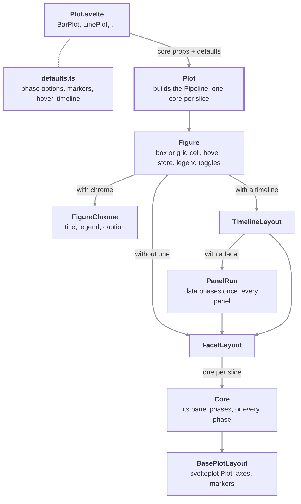
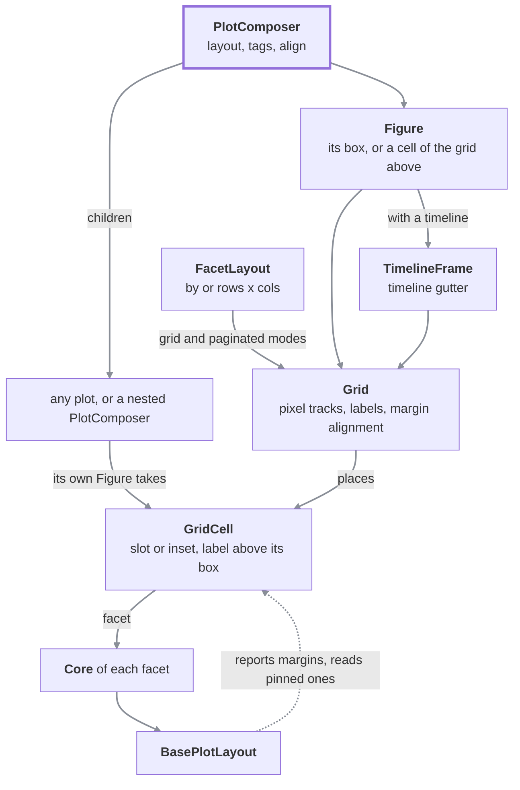

# Architecture

For contributors. A figure is built from a few layers, each knowing only the one below it. A public **plot** (`BarPlot`, `LinePlot`, ...) hands its kind's **defaults** to the generic **`Plot`**; `Plot` frames everything in a **`Figure`** (box, stores and chrome) and slices the data by **timeline** and **facet**. A **`PlotComposer`** reuses the same `Figure` and the same **`Grid`** that facets lay out on, so both share one implementation of the frame (title, legend, caption, theme variables, shared hover and legend toggles), of the grid (pixel tracks, labels, margin alignment) and of the cells.

## Source layout

| Folder (`src/lib/`) | Holds                                                                                                                                                                                                                                      |
| ------------------- | ------------------------------------------------------------------------------------------------------------------------------------------------------------------------------------------------------------------------------------------ |
| `plots/<kind>/`     | `Plot.svelte` (public component), `defaults.ts` (the kind's options for the shared phases), `markers.ts` (the kind's marks)                                                                                                                |
| `phases/`           | One class per pipeline phase, and `Pipeline`                                                                                                                                                                                               |
| `layout/`           | `plot` (generic `Plot`, `Core`, `PanelRun`, public context), `figure`, `grid`, `facet`, `timeline`, `composer`, `legend`, `hover`, `tooltip`, `margins`, `coordinates`, `scales`, `styles`, `base` (`BasePlotLayout`, the svelteplot plot) |
| `markers/`          | One component per marker type                                                                                                                                                                                                              |
| `configuration/`    | The global config store, defaults and themes                                                                                                                                                                                               |
| `types/`            | Every type another file imports                                                                                                                                                                                                            |
| `utils/`            | Color, grouping, merge, interpolation and other helpers                                                                                                                                                                                    |

## How a plot is built

Solid arrows are "renders"; the dotted line is "builds".

1. A kind's `Plot.svelte` splits its props into chrome (`title`, `legend`, ...), `timeline`, `facet` and the core props, and renders the shared `Plot` with its `defaults` builder.
2. `Plot` builds the kind's **`Pipeline`** once and renders a `Figure` whose body is the `TimelineLayout`, wrapping the `FacetLayout`, wrapping one `Core` per slice. Without a timeline or a facet, the one cell is the whole plot. Each facet's cell gets its scales (shared or free, per `facet.scales`) and whether its axes draw (per `facet.axes` and its edges in the grid).
3. `FacetLayout` turns the rows into facets - one per `by` value, flowed into `columns`, or one per `rows` x `cols` combination - and places them on a `Grid`, one `GridCell` each. Every plot reports the margins it settled on; once all have, each column and row pins its widest ones, so the plot areas line up.
4. `Core` runs the pipeline over its props and hands the result to `BasePlotLayout`, which draws the svelteplot plot, the axes and the markers.

## The pipeline

A `Pipeline` is an ordered list of **phase stages**, each a class in `phases/`. A kind's `defaults.ts` supplies the options each stage needs (its marks, its value labels, its hover strategy, its timeline behaviour); `Pipeline.ofAxisKind` assembles the shared stages around them. A kind that is not axis-based (the map) builds a pipeline of its own.

| Phase              | Runs          | Does                                                            |
| ------------------ | ------------- | --------------------------------------------------------------- |
| `facet`            | once per plot | Splits rows into panels                                         |
| `data`             | once per plot | Builds series from `data` or `series`, infers axes (`PlotAxes`) |
| `mapping`          | once per plot | Resolves channel accessors                                      |
| `transforms`       | once per plot | Runs the plot's `transforms` over all series                    |
| `statistics`       | once per plot | Derives markers from `statistics`                               |
| `sharedScales`     | once per plot | Domains the panels share                                        |
| `scales`           | per panel     | Final scales, in the panel's box                                |
| `styles`           | per panel     | `styles`, value labels, segments                                |
| `markers`          | per panel     | Composes the kind's marks, author markers and value labels      |
| `tooltip`, `hover` | per panel     | Tooltip text, hover points and strategy                         |

The first six are the **data phases** (`Pipeline.DATA_PHASES`). With a facet, `Plot` runs them once over every row (`PanelRun`, reused for a timeline step or a legend that omits a series), and each panel's `Core` runs only the rest. Without a facet, one `Core` runs every phase. Stages declared out of order still run in phase order, with a warning.

## Facets and the composer share one grid

The dotted arrow is "reads from": each plot reports its margins to its cell and reads back the pinned ones.

`PlotComposer` renders a `Figure` around a `Grid` (inside a `TimelineFrame` when it has a `timeline`), laid out by `layout` (`columns` or named `areas`, `widths`/`heights` weights, `gap`). Every plot drawn straight in it - or another `PlotComposer` - takes a cell through its own `Figure`: its `area`, an `inset` over it, or the next free one, with the composer's tag above it, drawn at the cell's size. Anything that is not a plot goes in a `GridCell`, which marks what it draws as placed so a plot inside takes no other cell. `layout.align` turns on the margin alignment facets use; it assumes the panels' plots draw no chrome of their own, since the grid only sees each plot's own margins.

## Context

Dependencies between layers go through Svelte context, so a layer never imports the one that provides what it reads:

| Context         | Provided by                                                         | Read by                                                               |
| --------------- | ------------------------------------------------------------------- | --------------------------------------------------------------------- |
| Hover store     | `Figure` (the outermost; nested figures share it)                   | every core's tooltip and hover sync                                   |
| Legend toggles  | `Figure` (a figure with its own `legend` scopes them)               | legends and every core below                                          |
| Timeline        | `Figure`                                                            | the plot's timeline layout, the player bar, `useFigure().timeline`    |
| Shared timeline | `PlotComposer` with a `timeline`                                    | `Plot`, which then draws no control of its own                        |
| Hover scope     | `GridCell` in a composer's grid, and `HoverScope` around each facet | hover sync, to tell panels and facets apart                           |
| Grid            | `Grid`                                                              | `GridCell` (registers, gets its box and tag), `Figure` (takes a cell) |
| Cell alignment  | `GridCell`                                                          | `BasePlotLayout` (pinned margins), `MarginReporter`                   |

The public readers of that state are `useFigure()` and `usePlot()` ([Reading plot state](state.md)).

## Adding a plot kind

1. Define its props and state types under `types/plots/<kind>/`.
2. Write `plots/<kind>/defaults.ts`: a builder returning the options of each phase it customises (`data`, `mapping`, `scales`, `styles`, `markers`, `hover`, `timeline`, ...).
3. Write `plots/<kind>/Plot.svelte`: split chrome, `timeline`, `facet` and core props and render the shared `Plot` with the builder.
4. Export it from `src/lib/index.ts`, add stories under `stories/plots/<kind>/`, tests under `tests/unit/plots/<kind>/`, and a page in `docs/plots/` with a row in the [Plots](plots.md) table.

## Conventions

- A type that another file imports lives under `src/lib/types`, not in its implementation file.
- Logic that belongs together is a class (`Margins`, `PlotAxes`, `ValueLabels`, `LegendState`), preferred over loose functions.
- The configuration is data only (it is cloned on write); behaviour is passed through plot props.
- Names of constructors and derivations use `build*`.
