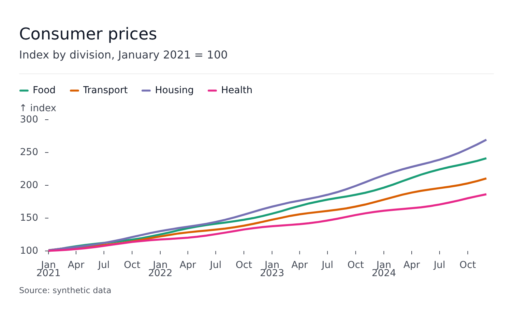
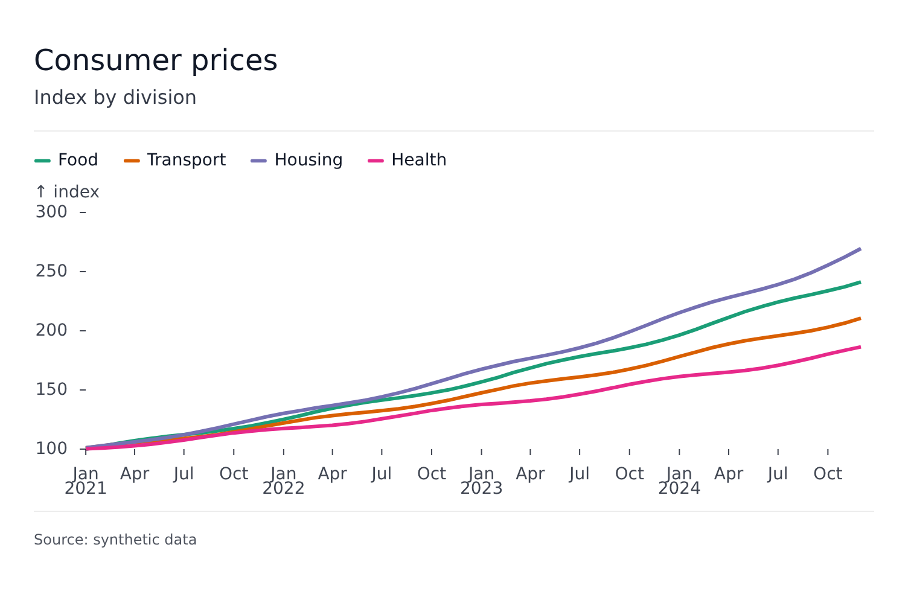

# Chrome

The chrome is everything a figure draws around its plot: title, subtitle, legend, timeline player, caption. Every plot and every [composer](composer.md) takes the same chrome props.

```svelte
<LinePlot
	{width}
	{height}
	title="Consumer prices"
	subtitle="Index by division, December 2016 = 100"
	caption="Source: national statistics office"
	data={rows}
	x="date"
	y="index"
	color="division"
/>
```



| Prop       | Type                    | Meaning                                          |
| ---------- | ----------------------- | ------------------------------------------------ |
| `title`    | `string`                | Heading                                          |
| `subtitle` | `string`                | Line under the title                             |
| `caption`  | `string`                | Note under the plot                              |
| `header`   | `Snippet`               | Replaces `title` and `subtitle` with your markup |
| `footer`   | `Snippet`               | Replaces `caption` with your markup              |
| `legend`   | see [Legend](legend.md) | The legend                                       |
| `order`    | `PlotChromeEntry[]`     | Which blocks draw, top to bottom                 |

`header` and `footer` are snippets declared inside the component:

```svelte
<LinePlot ...>
	{#snippet header()}
		<div style="display: flex; justify-content: space-between">
			<h3>My plot</h3>
			
		</div>
	{/snippet}

	{#snippet footer()}
		<small>Source: <a href="...">Dataset</a></small>
	{/snippet}
</LinePlot>
```

A `header` takes the place of `title` and `subtitle`, and a `footer` the place of `caption`; a component sets one or the other of each pair. Components inside the snippets can read the figure with [`useFigure()`](state.md).

## Order

`order` lists the blocks from top to bottom. The blocks are `'header'`, `'title'`, `'subtitle'`, `'legend'`, `'plot'`, `'timeline'` (a player bar, or a horizontal rule), `'caption'`, `'footer'` and `'divider'`.

- A block left out is not drawn - except `'plot'`, which then goes last.
- `'divider'` draws a line between the two blocks around it, and only when both are drawn. Several dividers may appear.
- A row puts two or three blocks side by side: `'(plot, timeline)'`, `'(legend, plot)'`. The `plot` takes the width the others leave; a row without `plot` shares its width among the blocks.

```svelte
<LinePlot ... order={['title', 'subtitle', 'divider', 'legend', 'plot', 'divider', 'caption']} />
```



The default order, from the configuration's `chrome.order`: `header`, `title`, `subtitle`, `divider`, `legend`, `plot`, `timeline`, `footer`, `caption`. It can be changed globally with `setConfiguration({ chrome: { order: [...] } })`.

## Look

Fonts, sizes, colors and spacing of each block come from the [configuration](theming.md): `title`, `subtitle`, `caption`, `legend`, `divider`, `spacing` and `chrome.rowGap`.
