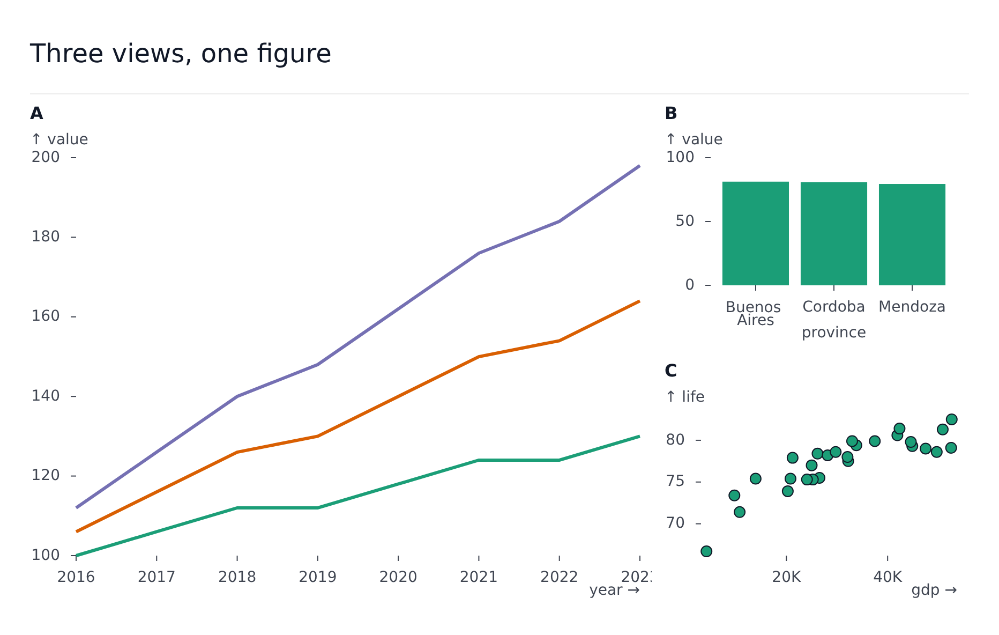

# Composer

`PlotComposer` puts several plots in one figure. It is a figure like any plot: it takes the same [chrome](chrome.md) (`title`, `subtitle`, `caption`, `legend`, `order`) and a `width` and `height`, and lays its children out on a grid.

```svelte
<PlotComposer
	width={900}
	height={560}
	title="Three views, one figure"
	tags="A"
	layout={{ areas: ['a a b', 'a a c'] }}
>
	<LinePlot area="a" data={series} x="year" y="value" color="metric" tooltip />
	<BarPlot area="b" data={bars} x="region" y="value" />
	<ScatterPlot area="c" data={points} x="gdp" y="life" />
</PlotComposer>
```



Plots drawn straight inside the composer take a cell of the grid and draw at the cell's size - they need no `width` or `height`.

## Layout

`layout` arranges the cells:

| Field | Meaning |
| --- | --- |
| `columns` | Flow children into this many columns |
| `areas` | Named cells: one string per row, names separated by spaces, `.` for an empty cell (`['a a b', 'a a c']`) |
| `widths`, `heights` | Relative track sizes |
| `gap` | Pixels between cells (default 12) |
| `align` | Line up every panel's plot area with its row and column, as facets do. Assumes the panels draw no chrome of their own |

## Placing a child

- `area="a"` puts a plot in a named cell of `areas`.
- `inset={{ left, bottom, right, top }}` floats a plot over its area, as fractions of it (from the left and bottom edges) - a small map over a larger chart, say.
- With neither, a plot takes the next free cell.
- Anything that is not a plot goes in a `GridCell`, which takes the same placement (`area`, or `row`/`col` with `rowSpan`/`colSpan`, or `inset`) and a `label`: `<GridCell area="b">{#snippet children({ width, height })}...{/snippet}</GridCell>`.
- A `PlotComposer` can be nested in a cell.

## Tags

`tags` stamps a label above each panel: `'A'` (A, B, C...), `'a'`, `'1'`, `'I'`, `'i'`, or an explicit list of strings.

## Shared hover, legend and timeline

- `hover={{ strategy, sync }}` sets how hover finds related points and whether one panel's hover shows in the others.
- The legend toggles are shared: a composer with a `legend` of its own scopes the toggles to it, and turning a series off dims it in every plot.
- `timeline={{ values, type, player, progress, ... }}` gives every panel one timeline. Plots inside with their own `timeline` follow its `progress`, and the figure draws no per-plot timeline control. The options are those of a [timeline](timeline.md), with `values` required.

Everything inside can read the figure with [`useFigure()`](state.md).
