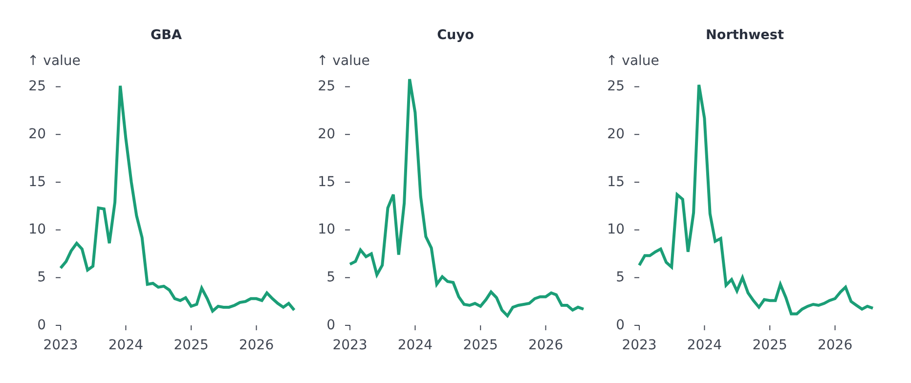
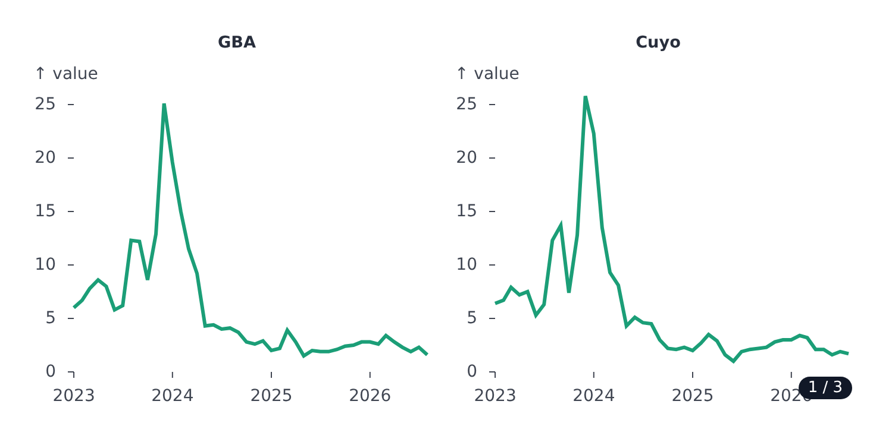
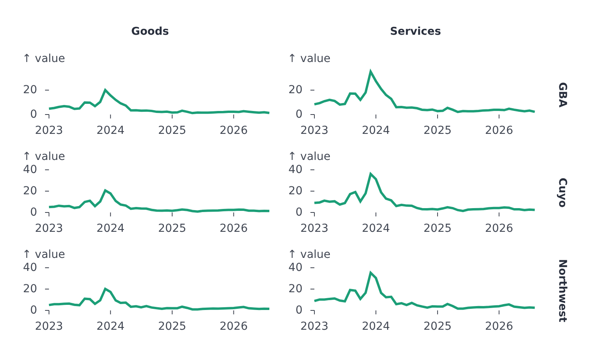

# Facets

`facet` splits a plot's rows into small multiples: one panel per value of a field, each drawn with the same plot configuration.

<!-- example: examples/Facets.svelte -->

```svelte
<script lang="ts">
	import { LinePlot } from '@fundar/data-chart-telling';
	import { REGION_VALUES } from './data';
</script>

<!-- One panel per region, three columns, sharing scales. A tooltip with `sync` shows in every panel on purpose. -->
<LinePlot
	width={900}
	height={360}
	data={REGION_VALUES}
	x="date"
	y="value"
	facet={{ by: 'region', columns: 3, gap: 12, scales: 'shared' }}
	tooltip={{ sync: true }}
/>
```

<!-- /example -->



The data phases (grouping, transforms, statistics, shared scales) run once for all panels; each panel then lays itself out in its own box. Panels share legend toggles and hover, so one legend controls them all.

## One facet per value

`{ by }` makes one panel per distinct value of the `by` field.

| Option                   | Meaning                                                                                                                                         |
| ------------------------ | ----------------------------------------------------------------------------------------------------------------------------------------------- |
| `by`                     | Field (or function) to split by                                                                                                                 |
| `values`                 | The facet values to show, in order. Default: every value, in data order                                                                         |
| `columns`                | Panels per row: a number, or `{ desktop, mobile }`                                                                                              |
| `mode`                   | `'grid'` (all at once, default), `'carousel'` (a few at a time with prev/next) or `'paginated'` (pages). Also `{ desktop, mobile }`             |
| `visible`                | Carousel: how many panels show at once                                                                                                          |
| `pageSize`               | Paginated: panels per page                                                                                                                      |
| `navLayout`              | `'overlay'` or `'below'` the navigation buttons                                                                                                 |
| `formatIndicator`        | `(current, total) => string` for the position badge                                                                                             |
| `indicator`, `navButton` | Snippets replacing the badge and the buttons                                                                                                    |
| `gap`                    | Pixels between panels                                                                                                                           |
| `scales`                 | `'shared'` (default), `'free'`, `'free-x'`, `'free-y'`                                                                                          |
| `axes`                   | `'all'` (default) draws every panel's axes; `'outer'` draws only the left column's y and the bottom row's x, with panels resized to equal boxes |

<!-- example: examples/FacetsCarousel.svelte -->

```svelte
<script lang="ts">
	import { LinePlot } from '@fundar/data-chart-telling';
	import { REGION_VALUES } from './data';
</script>

<!-- A carousel shows `visible` panels at a time, with navigation below. -->
<LinePlot
	width={720}
	height={340}
	data={REGION_VALUES}
	x="date"
	y="value"
	facet={{ by: 'region', columns: 3, mode: 'carousel', visible: 2, navLayout: 'below' }}
/>
```

<!-- /example -->



## Rows by columns

`{ rows, cols }` makes one panel per combination of a row field and a column field, with each value labelled. Combinations without data stay empty. `rowValues` and `colValues` choose and order the values. A free `x` scale is shared down each column and a free `y` along each row.

<!-- example: examples/FacetsRowsCols.svelte -->

```svelte
<script lang="ts">
	import { LinePlot } from '@fundar/data-chart-telling';
	import { REGION_VALUES } from './data';

	// Each region's value split into two sectors.
	const SECTORS = [
		{ sector: 'Goods', share: 0.8 },
		{ sector: 'Services', share: 1.4 }
	];
	const rows = REGION_VALUES.flatMap((row) =>
		SECTORS.map(({ sector, share }) => ({ ...row, sector, value: row.value * share }))
	);
</script>

<!-- One panel per region and sector; `scales: 'free'` fits each panel to its own data. -->
<LinePlot
	width={720}
	height={420}
	data={rows}
	x="date"
	y="value"
	facet={{ rows: 'region', cols: 'sector', scales: 'free' }}
/>
```

<!-- /example -->



## Alignment

Panels line up: each plot reports the margins it settled on, and once all have, every column and row pins its widest ones, so the plot areas align whatever their tick labels need.

## Hover and tooltips

`tooltip={{ sync: true }}` shows the hovered point in every panel, a feature for comparing the same x across panels. See [Tooltip and hover](tooltip-and-hover.md).

## Facets with a timeline

`facet` and [`timeline`](timeline.md) combine: each step shows its rows split into panels.

## Maps

`GeoPlot` takes `facet` and reads the field from each feature's `properties` (and from each marker row); features without the field are drawn in every panel.
