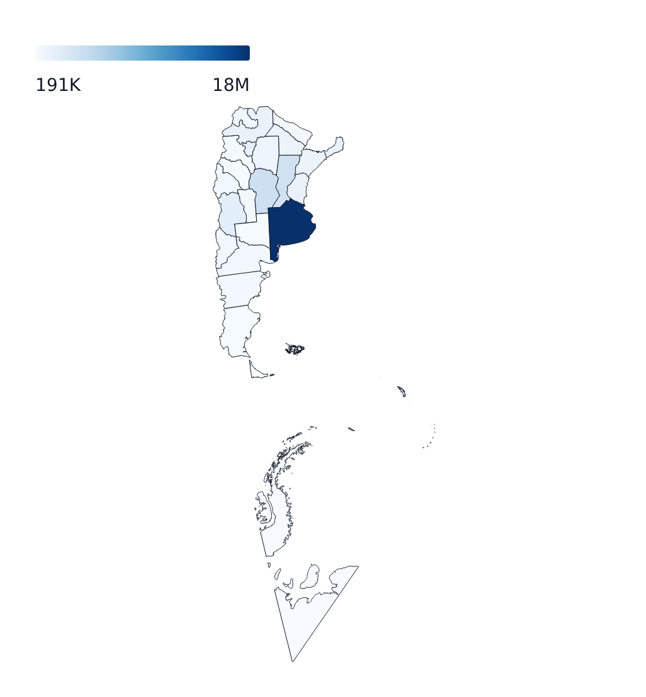
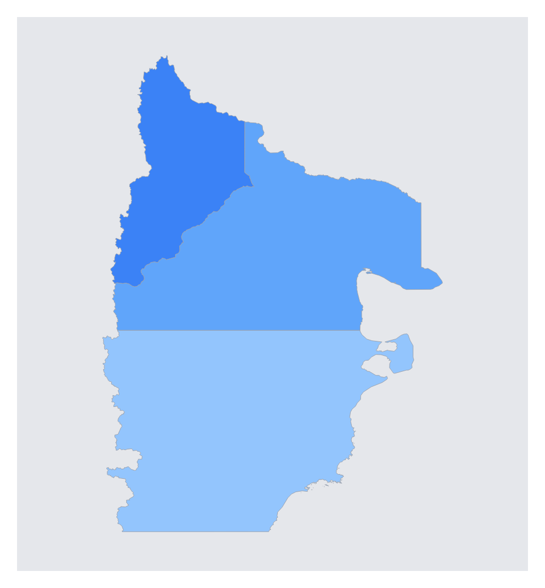

# Maps

`GeoPlot` draws GeoJSON or TopoJSON as a map. It shares chrome, `tooltip`, `legend`, `segments`, `markers`, `timeline`, `facet` and `margins` with the other plots; instead of `x`/`y` axes it has a projection (`coordinates`).

```svelte
<GeoPlot
	{width}
	{height}
	data={provinces}
	featureId={(f) => String(f.properties?.nombre)}
	color={(f) => Number(f.properties?.population)}
	scales={{ color: { scheme: 'blues' } }}
	coordinates={{ projection: { type: argentinaBicontinental } }}
	tooltip={{ format: (f) => String(f.properties?.nombre) }}
/>
```



## Data

| Prop           | Meaning                                                                                                                                                                                                      |
| -------------- | ------------------------------------------------------------------------------------------------------------------------------------------------------------------------------------------------------------ |
| `data`         | A GeoJSON `FeatureCollection`, an array of `Feature`s, or a TopoJSON `Topology`                                                                                                                              |
| `object`       | Required for a `Topology`: the key under `topology.objects` to draw. Needs the optional `topojson-client` package                                                                                            |
| `featureId`    | Accessor for each feature's stable id. Default: `feature.id ?? properties.id ?? properties.name`. It is the key of `segments`, and identifies features in hover and click                                    |
| `color`        | `(feature) => number \| undefined` - the value of a choropleth. Features without one use `styles.fill` or their `segments`                                                                                   |
| `excludeParts` | `(part, feature) => boolean`, where `part` is `{ centroid, geometry }` - drops geometry parts from drawing and hover (a distant territory drawn in an inset instead). `segments` still apply to what remains |

## Styles

`styles` for a map:

| Field                   | Meaning                                                                                                                            |
| ----------------------- | ---------------------------------------------------------------------------------------------------------------------------------- |
| `fill`, `fillOpacity`   | Base fill of features with no choropleth value or segment                                                                          |
| `stroke`, `strokeWidth` | Base outline                                                                                                                       |
| `tileLayer`             | A raster basemap under the features: `{ url, attribution, opacity, minZoom, maxZoom, tileSize }`. Mercator-family projections only |
| `onFeatureClick`        | `(feature, event) => void`                                                                                                         |
| `frame`                 | A border around the map                                                                                                            |

## Scales

`scales.color` configures the choropleth (domain, scheme, pivot, unknown - see [Scales](scales.md#color)); `scales.length` configures `vector` markers. A map has no `x`/`y`.

## Segments

Per-feature styling, keyed by feature id, with `'default'` as the baseline for every feature:

```svelte
<GeoPlot
	...
	segments={{
		default: [{ styles: { fillOpacity: 0.7 } }],
		argentina: [{ styles: { fill: '#3b82f6' } }]
	}}
/>
```

Style fields: `fill`, `fillOpacity`, `stroke`, `strokeWidth`.

## Coordinates

`coordinates` bundles the projection and the gestures.

| Field        | Meaning                                                                                                                                                                                                                                                                                                                       |
| ------------ | ----------------------------------------------------------------------------------------------------------------------------------------------------------------------------------------------------------------------------------------------------------------------------------------------------------------------------- |
| `projection` | A name - `'equal-earth'` (default), `'mercator'`, `'orthographic'`, `'albers'`, `'albers-usa'`, `'azimuthal-equal-area'`, `'conic-conformal'`, `'equirectangular'`, `'stereographic'`, `'transverse-mercator'` and the other svelteplot projections - or an object `{ type, rotate, center, parallels, inset, clip, domain }` |
| `zoom`       | `true` or `{ min, max, initial }`: wheel and pinch zoom                                                                                                                                                                                                                                                                       |
| `pan`        | `true`: drag to pan a flat projection                                                                                                                                                                                                                                                                                         |
| `rotate`     | `true`: drag to spin an `'orthographic'` globe                                                                                                                                                                                                                                                                                |
| `camera`     | A declarative viewpoint (below)                                                                                                                                                                                                                                                                                               |

`projection.type` can also be a custom factory. The package ships `argentinaBicontinental`, a projection fitted to Argentina's full territory (the mainland, the Antarctic sector and the islands):

```svelte
<GeoPlot ... coordinates={{ projection: { type: argentinaBicontinental } }} />
```

`projection.domain` fits the projection to a GeoJSON object (`'data'` fits to the plot's own `data`); it is also what sizes `'identity'` projections.

### Camera

`coordinates.camera` frames a target and animates to a new one when it changes:

```svelte
<GeoPlot
	...
	coordinates={{
		projection: 'mercator',
		camera: {
			target: { features: ['Neuquén', 'Río Negro', 'Chubut'] },
			zoom: 1,
			anchor: 'middle-middle',
			padding: 24,
			transition: { duration: 750, easing: 'cubicOut' }
		}
	}}
/>
```



- `target`: `{ features: [ids] }`, `{ center: [lon, lat] }` or `{ bounds: geoJsonObject }`.
- `zoom`: multiplier on the tight fit (for `center`, the pixel scale itself).
- `anchor` and `padding`: where the framed target lands in the plot, as for insets.
- `transition`: `duration` (ms), `easing`, a live `progress` (`0`-`1`) to drive it yourself, and `direction` (`'shortest'` or `'longest'` rotation, orthographic only).

## Markers

Map markers go in `markers`, like on other plots. `dot` and `text` work as on any plot; the map-specific ones:

| `type`          | Draws                                                                                                                                                           |
| --------------- | --------------------------------------------------------------------------------------------------------------------------------------------------------------- |
| `graticule`     | Longitude and latitude gridlines: `step`, `stepX`, `stepY`, `behind`                                                                                            |
| `sphere`        | The globe outline (for `'orthographic'`): `styles`, `behind`                                                                                                    |
| `vector`        | Arrows or spikes at points: `data`, `x`, `y`, `length`, `rotate`, `shape` (`'arrow'`, `'spike'`, `'arrow-filled'`), `anchor`                                    |
| `link`          | Lines between point pairs: `data`, `x1`, `y1`, `x2`, `y2`, `curve` (`'auto'` traces great-circle arcs, `'linear'`)                                              |
| `contour`       | Contour lines of a scalar field: `data` with `x`, `y`, `value`, or a sampler function; `thresholds`, `fill`, `stroke`, `clip` (`'land'` or `'ocean'`), `behind` |
| `inset`         | A small, separately projected map anchored to an edge of the plot (see below)                                                                                   |
| `geo-hover`     | Restyles the hovered feature: `styles` (an area style)                                                                                                          |
| `geo-component` | Your own Svelte component                                                                                                                                       |

### Insets

An `inset` draws part of the map (or other data) in its own small panel, such as an island or a distant territory:

```svelte
<GeoPlot
	...
	excludeParts={(part) => part.centroid[0] > 100}
	markers={[
		{
			type: 'inset',
			location: 'bottom-right',
			features: ['hawaii'],
			projection: 'mercator',
			width: 0.25,
			height: 0.25,
			margin: 8,
			tooltip: { format: (f) => String(f.properties.name) }
		}
	]}
/>
```

`location` is one of the 17 anchors (`'top-left'`, `'bottom-right'`, `'middle-left'`, ...); `features` filters by id from the plot's `data` (or give the inset its own `data`); `featurePartsFilter` narrows to geometry parts; `width` and `height` are fractions of the plot; an inset always fits its own content.

## Tooltip and hover

`tooltip` works as on other plots with the hovered feature as the row (`format: (feature) => string`, or a `content` snippet). Add `{ type: 'geo-hover' }` for an in-map highlight. Hover matches the browser's own SVG hit-testing, so a feature is hovered where it is drawn.
