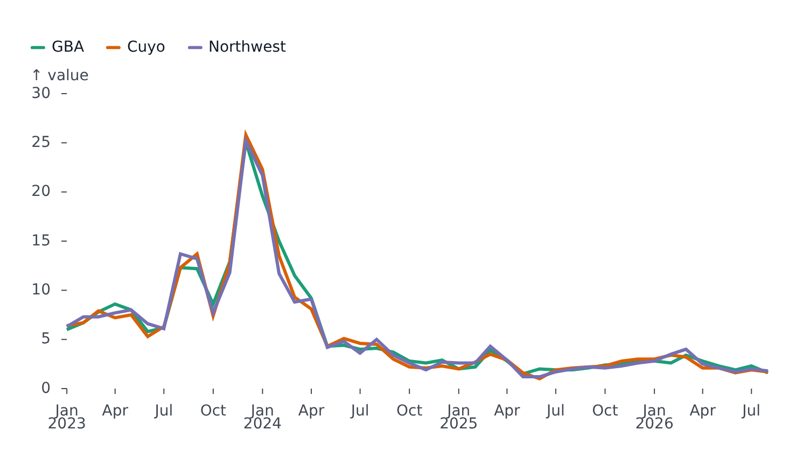

# Getting started

## Install

```bash
pnpm add @fundar/data-chart-telling svelte svelteplot
```

- `svelte` ^5 and `svelteplot` ^0.14 are peer dependencies.
- `topojson-client` is an optional peer, needed only to feed [GeoPlot](geo.md) a TopoJSON `Topology`.
- The package ships `.svelte` files, so the app builds with `@sveltejs/vite-plugin-svelte` or SvelteKit.
- Import everything from the package root: `import { LinePlot } from '@fundar/data-chart-telling'`.

## A first plot

<!-- example: examples/FirstPlot.svelte -->

```svelte
<script lang="ts">
	import { LinePlot } from '@fundar/data-chart-telling';
	import { REGION_VALUES } from './datasets';
</script>

<!-- The smallest useful plot: rows, the fields to map and a pixel size. -->
<LinePlot width={720} height={400} data={REGION_VALUES} x="date" y="value" color="region" />
```

<!-- /example -->



- `data` is an array of flat rows, here `{ date, region, value }` from [examples/datasets/inflation-by-region.ts](../examples/datasets/inflation-by-region.ts); `x` and `y` name the fields that position each row.
- `color="region"` splits the rows into one series per region and gives each its own color.
- `width` and `height` are pixels.

Everything else is an optional prop: `title`, `subtitle`, `caption`, `legend`, `tooltip`, `scales`, `styles`, `markers`, `timeline`, `facet`. See [Concepts](concepts.md) for the full picture.

## Sizing a plot to its container

A plot draws at the pixel size it is given. To fill a container or the window, bind the container's size and render the plot once both are known:

```svelte
<script lang="ts">
	import { LinePlot } from '@fundar/data-chart-telling';

	let { rows } = $props();
	let width = $state(0);
	let height = $state(0);
</script>

<div style="width: 100%; height: 100vh" bind:clientWidth={width} bind:clientHeight={height}>
	{#if width > 0 && height > 0}
		<LinePlot {width} {height} data={rows} x="year" y="value" color="region" />
	{/if}
</div>
```

The runnable version is [examples/ResponsiveLine.svelte](../examples/ResponsiveLine.svelte). Inside a [composer](composer.md) cell, a plot takes the cell's size and needs no `width` or `height`.

## Getting data in

A plot reads plain JavaScript values. Load a CSV or JSON with whatever the app already uses, convert dates to `Date` objects (UTC midnight avoids timezone shifts) and numbers to `number`, then pass the rows:

```ts
const rows = parsed.map((r) => ({
	date: new Date(Date.UTC(r.year, r.month - 1, 1)),
	division: r.division,
	index: Number(r.index)
}));
```

Sort rows by their x field when a line should connect them in order, or add a `sort` [transform](transforms-and-statistics.md).

## Next steps

- [Concepts](concepts.md) - how rows, series and channels fit together.
- [Plots](plots.md) - pick the plot kind.
- [examples/](../examples/) - small runnable components for the common cases.
