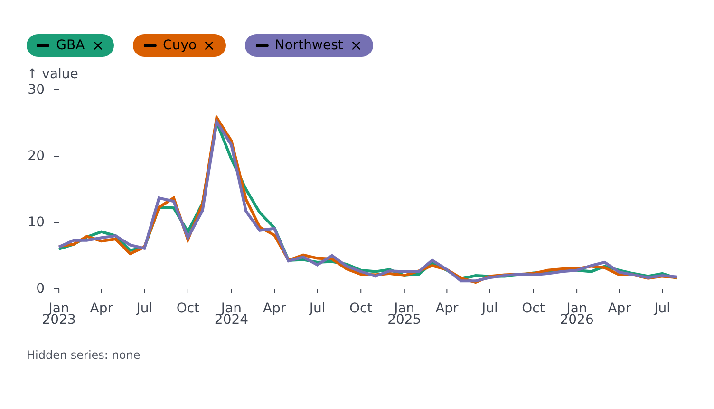
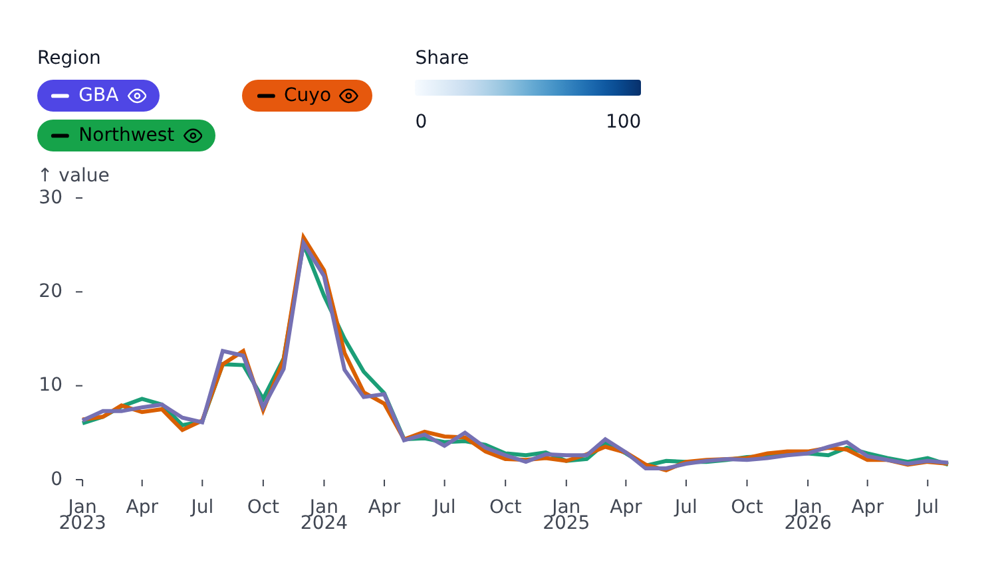

# Legend

A plot builds its legend from what it draws: its series, the scales its channels use, and the segments and markers that name themselves. Nothing needs configuring for the common case.

## The automatic legend

`legend` is unset or `true` for the automatic legend, `false` for none. The automatic legend can have these sections:

| Section            | Appears when                    | Content                                                    |
| ------------------ | ------------------------------- | ---------------------------------------------------------- |
| series (discrete)  | the plot has several series     | one item per series, in its color and mark                 |
| color (continuous) | `color` is a continuous value   | a ramp with its min and max                                |
| opacity            | `opacity` is a continuous value | a bar fading across the opacity range, over a checkerboard |
| size               | `r` is mapped                   | a few dots at representative values                        |
| symbol             | `symbol` is mapped              | each category next to its shape                            |

Segments and markers join the series section when they carry a `legend` label:

```svelte
<LinePlot
	...
	segments={{
		default: [
			{
				areas: [{ x: { from: 2020 } }],
				styles: { stroke: { strokeDasharray: '4 4' } },
				legend: 'Projection'
			}
		]
	}}
/>
```

`legend` on a segment or marker is a string, or `{ label, color, symbol, lineStyle, filled, opacity }` to override how the item looks.

## Toggling series

Items become clickable with `interactive` on the series section. `disabled` says what a hidden series becomes:

<!-- example: examples/LegendToggle.svelte -->

```svelte
<script lang="ts">
	import { LinePlot } from '@fundar/data-chart-telling';
	import { REGION_VALUES } from './datasets';
	import LegendReader from './LegendReader.svelte';
</script>

<!--
	The automatic legend can toggle series. `mode: 'omit'` drops a hidden series
	and refits the axes to what is left; 'dim' and 'hide' keep the axes.
	Anything inside the figure (here, the footer) reads the toggles through
	`useFigure().legend` - see LegendReader.
-->
<LinePlot
	width={720}
	height={400}
	data={REGION_VALUES}
	x="date"
	y="value"
	color="region"
	legend={{ series: { interactive: { enabled: true, disabled: { mode: 'omit' } } } }}
>
	{#snippet footer()}
		<LegendReader />
	{/snippet}
</LinePlot>
```

<!-- /example -->



| `disabled.mode`   | A hidden series...                                                                    |
| ----------------- | ------------------------------------------------------------------------------------- |
| `'dim'` (default) | stays, faded (`style` sets how: opacity, fill, ...; default `legend.disabledOpacity`) |
| `'hide'`          | becomes transparent, the axes keep its range                                          |
| `'omit'`          | is removed and the axes refit to the rest                                             |

`interactive.legendStyle` is `'badge'` (default: pills filled with the series color and an eye toggle) or `'basic'` (swatches). `showIcon` toggles the symbol in a badge.

A continuous section narrows with `interactive: { enabled: true, mode: 'filter' | 'rescale' }`: drag handles trim the range, `'filter'` hides what lies outside, `'rescale'` refits the ramp.

Series can be toggled from code too: `useFigure().legend` has `off`, `isOff(name)`, `toggle`, `turnOff`, `turnOn` (see [Reading plot state](state.md)).

## Adjusting the automatic legend

An object adjusts the automatic legend while keeping what the plots read:

```ts
legend={{
	items: [{ name: 'Target', color: '#000', symbol: 'line' }], // appended to the series section
	sections: [/* extra sections after the automatic ones */],
	series: { title: 'Division', layout: { type: 'flex' } },
	color: { title: 'Temperature', interactive: { enabled: true } },
	opacity: { title: 'Confidence' },
	r: { title: 'Population' },
	symbol: { title: 'Income group' }
}}
```

Each key is the name of the channel (the plot's own prop: `r` for the size section) and adjusts the section that channel draws: any section field except what the plots compute (items, ranges, domains). An entry with `match` adjusts only the section whose title matches; a list of entries adjusts several.

## Explicit sections

A list replaces the automatic legend with exactly those sections:

<!-- example: examples/LegendSections.svelte -->

```svelte
<script lang="ts">
	import { LinePlot } from '@fundar/data-chart-telling';
	import { REGION_VALUES } from './datasets';
</script>

<!-- An explicit legend: a discrete section of toggles and a continuous ramp. -->
<LinePlot
	width={720}
	height={400}
	data={REGION_VALUES}
	x="date"
	y="value"
	color="region"
	legend={[
		{
			type: 'discrete',
			title: 'Region',
			interactive: { enabled: true },
			items: [
				{ name: 'GBA', color: '#4f46e5', symbol: 'line' },
				{ name: 'Cuyo', color: '#e6580d', symbol: 'line' },
				{ name: 'Northwest', color: '#16a34a', symbol: 'line' }
			]
		},
		{ type: 'continuous', title: 'Share', min: 0, max: 100, scheme: 'blues' }
	]}
/>
```

<!-- /example -->



Section types:

- `discrete` - `items` (`name`, `label`, `color`, `symbol`, `filled`, `opacity`, `lineStyle`), `columns`, `layout` (`{ type: 'vertical' }`, `{ type: 'horizontal', maxRows }` paginated, `{ type: 'flex' }`), `interactive`, `navButton`.
- `continuous` - `min`, `max`, `colorMin`, `colorMax`, `scheme`, `pivot`, `opacity`, `ticks`, `width`, `format`, `interactive`.
- `size` - `domain`, `range`, `values`, `color`, `filled`, `symbol`, `format`.
- `symbol` - `items` of `{ name, symbol }`, `color`, `filled`, `layout`.

## Placement and look

An opacity section draws its bar as one color fading over a checkerboard, so it reads as transparency and not as a color ramp; the color is the marker's own when it has one, else `legend.continuous.opacity.color` (black by default), and `legend.continuous.opacity.checker` sets the squares.

The legend is a chrome block: `order` places it (`'legend'`, or in a row with the plot). Its fonts, gaps, swatch size and the continuous bar's geometry are `legend.*` in the [configuration](theming.md). A paginated section's prev/next arrows are replaceable with a `navButton` snippet.
