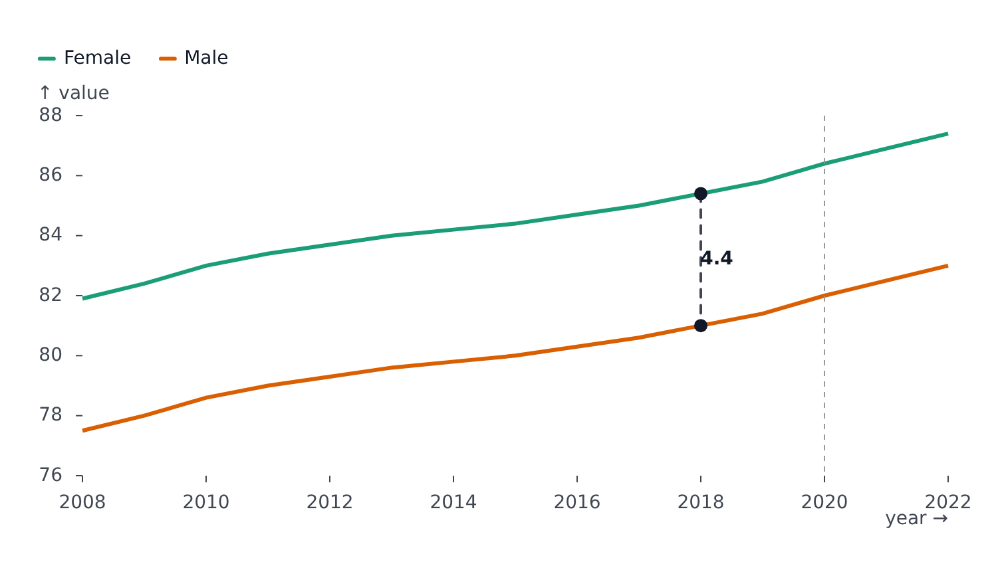

# Markers

`markers` adds marks to a plot beyond the ones its kind draws: annotations, regions, derived shapes, hover highlights, or any Svelte component. It is an array of objects; `type` picks the marker and the other fields configure it.

```svelte
<LinePlot
	{width}
	{height}
	data={lifeExpectancy}
	x="year"
	y="value"
	color="sex"
	markers={[
		{ type: 'hover' },
		{ type: 'rule', axis: 'x', value: 2020, styles: { stroke: '#999', strokeDasharray: '4 4' } },
		{
			type: 'delta',
			axis: 'x',
			at: 2018,
			from: { type: 'series', series: 'female' },
			to: { type: 'series', series: 'male' },
			formatDiff: (d) => d.toFixed(1)
		}
	]}
/>
```



Markers draw in array order. Type a markers array with `satisfies AxisBasedMarkersConfig[]` (or `GeoMarkersConfig[]`) to get completion.

## Fields every marker shares

| Field                      | Meaning                                                                                                                                                                                         |
| -------------------------- | ----------------------------------------------------------------------------------------------------------------------------------------------------------------------------------------------- |
| `data`                     | The marker's own rows. Unset, it draws the plot's rows                                                                                                                                          |
| `x`, `y`, `grouping`       | Accessors, when the marker reads other fields than the plot                                                                                                                                     |
| `series`                   | Draw over one series only (by name)                                                                                                                                                             |
| `scope`                    | With `series`: `'series'` (default) draws once over the whole series; `'segment'` draws once per [segment](styles-and-segments.md), in its color - a `selectMaxY` marks each segment's own peak |
| `scales`                   | The marker's own `color`/`opacity`/`symbol` scales, independent of the plot's                                                                                                                   |
| `transforms`, `statistics` | Derive rows for this marker ([Transforms](transforms-and-statistics.md))                                                                                                                        |
| `clip`                     | Clip to the plot's frame                                                                                                                                                                        |
| `legend`                   | Name the marker on the automatic [legend](legend.md)                                                                                                                                            |

Many markers also take channel fields (`color`, `fill`, `opacity`, `r`, `symbol`, `weight`, `x1`/`x2`/`y1`/`y2`) and a `styles` object (`StrokeStyle`, `AreaStyle`, `DotStyle` or `FontStyle` depending on the mark).

## Catalog for axis-based plots

| `type`                                                   | Draws                                                                                                        |
| -------------------------------------------------------- | ------------------------------------------------------------------------------------------------------------ |
| `dot`                                                    | A point per row; `r`, `color`, `symbol`, `styles` (`DotStyle`)                                               |
| `text`                                                   | A label per row; `text` (string or function), `styles` (`FontStyle`), `declutter`, `edgeAware`, `fitMargins` |
| `line`                                                   | A line through the rows                                                                                      |
| `rule`                                                   | A reference line: `axis: 'x' \| 'y'`, `value` (or a function with `data`), `styles`                          |
| `tick`                                                   | A short tick per row along one axis                                                                          |
| `bar`                                                    | A bar; `rect`, `cell`: rectangles and heatmap cells                                                          |
| `rect`                                                   | A rectangle from `x1`/`x2`/`y1`/`y2`; `interval` turns `x`/`y` into ranges                                   |
| `area`                                                   | A filled area under a curve, or between `y1` and `y2`; `curve`                                               |
| `difference`                                             | The area between two series, colored by which one is on top                                                  |
| `arrow`                                                  | An arrow from `x1,y1` to `x2,y2`; `bend`, `headAngle`, `headLength`                                          |
| `trail`                                                  | A variable-width ribbon along a path, its width set by `r`                                                   |
| `delta`                                                  | The distance between two series (or a series and a fixed value) at a position, as a line and a label         |
| `hull`                                                   | The convex hull around a cluster of points                                                                   |
| `density`                                                | 2D density contour bands                                                                                     |
| `box`                                                    | A box plot; sub-marks styled through `bar`, `rule`, `dot`, `tickMedian`, `tickMinMax`                        |
| `regression`, `bollinger`                                | A fitted curve, a moving-average band                                                                        |
| `waffle`                                                 | The value as a grid of unit squares; `unit`, `multiple`, `gap`                                               |
| `voronoi`, `voronoiMesh`, `delaunayLink`, `delaunayMesh` | Voronoi cells and Delaunay triangulation                                                                     |
| `image`                                                  | An image per row; `src`, `width`, `height`                                                                   |
| `raster`                                                 | A field sampled over a rectangle, drawn to a canvas                                                          |
| `brush`                                                  | A drag-to-select rectangle with `onbrushstart`, `onbrush`, `onbrushend`                                      |
| `hover`                                                  | The in-plot hover highlight (see below)                                                                      |
| `component`                                              | Your own Svelte component (see below)                                                                        |

## Hover highlight

`{ type: 'hover' }` draws a crosshair, a dot and a label at the hovered point. It makes the plot hoverable on its own; add `tooltip` for a floating box too. Fields: `strategy`, `sync`, `ruleX`, `ruleY`, `areaX`, `areaY` (a band highlight on band scales), `showLabels`, `format`, and the styles `rule`, `area`, `dot`, `text`. See [Tooltip and hover](tooltip-and-hover.md).

## Custom components

`{ type: 'component', component: MyMark, props: { ... } }` mounts a Svelte component inside the plot's SVG. It can read the plot it is in with [`usePlot()`](state.md), so it can draw from the plot's scales, margins, hover and rows.

```svelte
<!-- HoverReadout.svelte -->
<script lang="ts">
	import { usePlot } from '@fundar/data-chart-telling';
	const plot = usePlot();
	const point = $derived(plot.hover.activePoint);
</script>

<text x={plot.margins.left + 8} y={plot.margins.top + 16}>
	{point ? `${point.series} at ${point.x}: ${point.label}` : 'Hover the plot'}
</text>
```

```svelte
<LinePlot
	...
	tooltip
	markers={[{ type: 'hover' }, { type: 'component', component: HoverReadout }]}
/>
```

## Markers on maps

`GeoPlot` accepts `dot` and `text` plus map-specific markers: `graticule`, `sphere`, `vector`, `link`, `contour`, `inset`, `geo-hover` and `geo-component`. They are described in [Maps](geo.md#markers).
