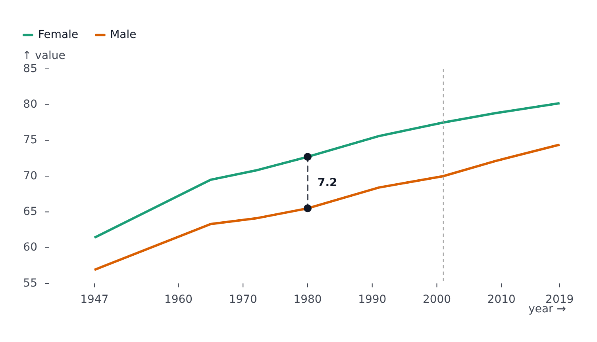

# Markers

`markers` adds marks to a plot beyond the ones its kind draws: annotations, regions, derived shapes, hover highlights, or any Svelte component. It is an array of objects; `type` picks the marker and the other fields configure it.

<!-- example: examples/Markers.svelte -->

```svelte
<script lang="ts">
	import { LinePlot } from '@fundar/data-chart-telling';
	import { LIFE } from './datasets';
</script>

<!-- Markers add marks to a plot: a hover highlight, a reference rule and a delta between two series. -->
<LinePlot
	width={720}
	height={400}
	data={LIFE}
	x="year"
	y="value"
	color="sex"
	scales={{ x: { edgeTicks: true } }}
	markers={[
		{ type: 'hover' },
		{ type: 'rule', axis: 'x', value: 2001, styles: { stroke: '#999', strokeDasharray: '4 4' } },
		{
			type: 'delta',
			axis: 'x',
			at: 1980,
			from: { type: 'series', series: 'female' },
			to: { type: 'series', series: 'male' },
			formatDiff: (difference) => difference.toFixed(1)
		}
	]}
/>
```

<!-- /example -->



Markers draw in array order. Type a markers array with `satisfies AxisBasedMarkersConfig[]` (or `GeoMarkersConfig[]`) to get completion.

### Numbers in `text` and `delta` markers

A `text` marker's `text` is a string, a number, the name of a field of its rows, or a function of the row giving a string or a number. A number - given, read from a field, or returned - is written as the marker's own `decimals`, `prefix`, `suffix` and `signDisplay` ask ([Number format](theming.md#number-format)); a string is drawn as it is.

```ts
{ type: 'text', data: rows, x: 'year', y: 'share', text: 'share', decimals: 1, suffix: ' %' }
```

A `delta` writes its distance the same way, with one decimal unless `decimals` or `numbers.decimals` says otherwise. `formatDiff` writes it by hand instead: a string it returns is shown as it is, and a number (a percentage of a baseline, say) is written as the display fields ask.

## Fields every marker shares

| Field                      | Meaning                                                                                                                                                                                         |
| -------------------------- | ----------------------------------------------------------------------------------------------------------------------------------------------------------------------------------------------- |
| `data`                     | The marker's own rows. Unset, it draws the plot's rows                                                                                                                                          |
| `x`, `y`, `grouping`       | Accessors, when the marker reads other fields than the plot (a `bollinger` marker takes the plot's own `x` and `y` when it sets none)                                                           |
| `series`                   | Draw over one series only (by name)                                                                                                                                                             |
| `scope`                    | With `series`: `'series'` (default) draws once over the whole series; `'segment'` draws once per [segment](styles-and-segments.md), in its color - a `selectMaxY` marks each segment's own peak |
| `scales`                   | The marker's own `color`/`opacity`/`symbol` scales, independent of the plot's                                                                                                                   |
| `transforms`, `statistics` | Derive rows for this marker ([Transforms](transforms-and-statistics.md))                                                                                                                        |
| `clip`                     | Clip to the plot's frame                                                                                                                                                                        |
| `dx`, `dy`                 | Move the marker this many pixels right and down, on a map too. A `dot`, `text` or `image` marker also takes a function of the row, to move each row on its own: `dy: (row) => row.side * 15`    |
| `legend`                   | Name the marker on the automatic [legend](legend.md)                                                                                                                                            |

Many markers also take channel fields (`color`, `fill`, `opacity`, `r`, `symbol`, `weight`, `x1`/`x2`/`y1`/`y2`) and a `styles` object (`StrokeStyle`, `AreaStyle`, `DotStyle` or `FontStyle` depending on the mark).

## Catalog for axis-based plots

| `type`                                                   | Draws                                                                                                                                                                                               |
| -------------------------------------------------------- | --------------------------------------------------------------------------------------------------------------------------------------------------------------------------------------------------- |
| `dot`                                                    | A point per row; `r`, `color`, `symbol`, `styles` (`DotStyle`)                                                                                                                                      |
| `text`                                                   | A label per row; `text` (string or function), `styles` (`FontStyle`), `declutter`, `edgeAware`, `fitMargins`, `fit`                                                                                 |
| `line`                                                   | A line through the rows                                                                                                                                                                             |
| `rule`                                                   | A reference line: `axis: 'x' \| 'y'`, `value` (a list draws a line at each, or a function with `data`), `styles` (`StrokeStyle`, and `inset`, `insetTop`, ... to pull it in from its ends)          |
| `band`                                                   | The band of a category across the whole other axis: `axis: 'x' \| 'y'`, `value` (a list, or a function with `data`), `slice`, `styles` (`AreaStyle`). Only on a band scale                          |
| `tick`                                                   | A short tick per row along one axis                                                                                                                                                                 |
| `bar`                                                    | A bar; `rect`, `cell`: rectangles and heatmap cells                                                                                                                                                 |
| `rect`                                                   | A rectangle from `x1`/`x2`/`y1`/`y2`; `interval` turns `x`/`y` into ranges; `styles` (`AreaStyle`, and `inset`, `insetLeft`, ...); `label`, a text in each (`cell`, `bar` and `waffle` take it too) |
| `area`                                                   | A filled area under a curve, or between `y1` and `y2`; `curve`                                                                                                                                      |
| `difference`                                             | The area between two series, colored by which one is on top                                                                                                                                         |
| `arrow`                                                  | An arrow from `x1,y1` to `x2,y2`; `bend`, `headAngle`, `headLength`, `styles` (`StrokeStyle`, and `inset`, `insetStart`, `insetEnd`)                                                                |
| `trail`                                                  | A variable-width ribbon along a path, its width set by `r`                                                                                                                                          |
| `delta`                                                  | The distance between two series (or a series and a fixed value) at a position - or at each of a list of them, `at: [1980, 2000]` - as a line and a label                                            |
| `hull`                                                   | The convex hull around a cluster of points                                                                                                                                                          |
| `density`                                                | 2D density contour bands                                                                                                                                                                            |
| `box`                                                    | A box plot; sub-marks styled through `bar`, `rule`, `dot`, `tickMedian`, `tickMinMax`; `thickness` sets its width in pixels, `slot` its share of a band                                             |
| `violin`                                                 | A violin per category of its rows: the mirrored density of `y` (or `x`), `kernel`, `bandwidth`, `trim`, `peak`, `slot`; add a narrow `box` over the same rows for the box inside                    |
| `regression`, `bollinger`                                | A fitted curve, a moving-average band                                                                                                                                                               |
| `waffle`                                                 | The value as a grid of unit squares; `unit`, `multiple`, `gap`                                                                                                                                      |
| `voronoi`, `voronoiMesh`, `delaunayLink`, `delaunayMesh` | Voronoi cells and Delaunay triangulation                                                                                                                                                            |
| `image`                                                  | An image per row; `src`, `width`, `height`                                                                                                                                                          |
| `raster`                                                 | A field sampled over a rectangle, drawn to a canvas                                                                                                                                                 |
| `brush`                                                  | A drag-to-select rectangle with `onbrushstart`, `onbrush`, `onbrushend`                                                                                                                             |
| `hover`                                                  | The in-plot hover highlight (see below)                                                                                                                                                             |
| `component`                                              | Your own Svelte component (see below)                                                                                                                                                               |

## Markers in some facets

On a plot with a [`facet`](facets.md#markers-and-segments-in-some-panels), every marker is drawn in every panel. A marker takes `facet`, a panel's value or a list of them, to be drawn only in the panels it names.

## Several positions at once

A `rule` and a `band` take a list as their `value`, and a `delta` a list as its `at`. One marker then draws one line, or one delta, at each position, all with the same style and the same ends - instead of one marker for each.

```ts
markers={[
	// A rule at each of the three years.
	{ type: 'rule', axis: 'x', value: [1991, 2001, 2010], styles: { strokeDasharray: '4 4' } },
	// The gap between the two series at each of the three.
	{ type: 'delta', axis: 'x', at: [1991, 2001, 2010], from: { type: 'series', series: 'female' }, to: { type: 'series', series: 'male' } }
]}
```

A delta's `stroke`, `text` and `dot` can be functions of the position, to style each one on its own - a label to the left of the last one, say, so it stays inside the plot:

```ts
{
	type: 'delta', axis: 'x', at: [1991, 2001, 2022], from: { type: 'series', series: 'female' }, to: { type: 'series', series: 'male' },
	text: (at) => (at === 2022 ? { dx: -20, textAnchor: 'end' } : { dx: 20 })
}
```

Every other marker draws from `data` rows, one mark per row, so it already takes many positions.

## Bands

`{ type: 'band', axis: 'x', value: 'Salta' }` fills the band of a category on a band scale, across the whole of the other axis: a column behind a bar plot's bars, a row across a horizontal one. With `data`, `value` is a field key or a function of the row, and the rows that name the same category draw one band. `slice` fills part of the band, as the fractions of its width left out at its start and its end (`{ start: 0.5, end: 0 }` is its second half), or a function of the row for each one's; a band several rows share fills what all of their slices do. `styles` take `AreaStyle`, each field a value or a function of the row, over `band` in the [configuration](theming.md). A band takes the pointer only with a handler of its own (`onclick`...), so one behind a plot's shapes leaves them their hover. On an axis that is not a band scale it draws nothing.

```ts
markers={[
	// The two provinces of the story, behind their bars.
	{ type: 'band', axis: 'x', value: ['Salta', 'Jujuy'], styles: { fill: '#fde68a', fillOpacity: 0.5 } }
]}
```

## Hover highlight

`{ type: 'hover' }` draws the plot's own hover: a crosshair, a dot and a label at the hovered point on most plots, the hovered category's band on a bar plot. It makes the plot hoverable on its own; add `tooltip` for a floating box too. Fields: `strategy`, `sync`, `series`, `scope`; `back` and `front`, the markers it draws behind the plot's shapes and in front of them, over the hovered points (they replace the plot's); `active` and `others`, which restyle the hovered shapes and the rest; and `format` and the number fields `decimals`, `prefix`, `suffix` and `signDisplay`, which write each point's label. See [Tooltip and hover](tooltip-and-hover.md#in-plot-hover).

```ts
// A crosshair only at the hovered point, and its value in bold, without a dot.
{ type: 'hover', back: [{ type: 'rule', axis: 'x', points: 'active' }], front: [{ type: 'text', styles: { fontWeight: 'bold' } }] }
```

Every marker takes `hover`, which links it to the plot's hover:

- `'trigger'` makes it a hit area: the pointer over one of its shapes hovers that shape's row.
- `'style'` has its shapes take the hover marker's `active` and `others`.
- `true` does both.

```ts
markers={[
	{ type: 'hover', active: { stroke: 'black', strokeWidth: 2 }, others: { fillOpacity: 0.3 } },
	{ type: 'rect', data: eras, x1: 'from', x2: 'to', y1: 0, y2: 100, hover: true }
]}
```

A plot's own shapes are linked already where its kind does it: the tiles, cells, bars, bins and dots of `TreemapPlot`, `HeatmapPlot`, `BarPlot`, `BulletPlot`, `PyramidPlot`, `HistogramPlot`, `ScatterPlot` and the Cleveland family. The `Layout/Hover` stories show every feature of the hover on every plot kind.

## Styles that depend on the row

Everything a marker is drawn with goes in its `styles` - its colors, strokes and insets - and none of it sits beside `type`, `data` and the channels.

On the markers that draw a shape for each row - `rect`, `bar`, `cell`, `waffle`, `dot`, `tick`, `rule`, `arrow`, `voronoi` and `delaunayLink` - any field of `styles` can be a function of the row in place of a value, so each shape gets its own (`rect`, `cell`, `rule` and `arrow` take the insets that way too; `bar`'s are fractions of its band, the same for all):

```ts
{ type: 'rect', data: eras, x1: 'from', x2: 'to', y1: 0, y2: 100,
  styles: { fill: 'steelblue', fillOpacity: (era) => (era.name === locked ? 0.55 : 0.12) } }
```

A color or an opacity the function returns is drawn as it is, not mapped through a scale. Where the function would only read a field, name the field: a number (`strokeWidth`, `fillOpacity`, an inset...) given as a string is the field of the rows, and so is a color when the rows have a field of that name - `fill: 'tint'` reads `row.tint`, but `fill: 'tomato'` is the color unless some row has a `tomato` field. A `text` marker does the same with `fill`, `fillOpacity`, `stroke`, `strokeWidth`, `fontWeight` and `fontStyle`; the other fields place and measure the labels, so they are one value for all. The markers that draw one shape for many rows (`line`, `area`, `density`, `hull`, a mesh) take plain values.

## A label in each shape

A `rect`, `cell`, `bar` or `waffle` marker takes a `label`: a text written in the middle of each shape, with every option of a `text` marker but `type`, `data`, `x` and `y`, which the shape sets. It never takes the pointer from the shape under it, so `onclick` and the hover go on as they were.

```ts
{ type: 'rect', data: tiles, x1: 'x1', x2: 'x2', y1: 'y1', y2: 'y2',
  label: { text: 'name', styles: { fill: 'white' }, fit: { fallback: 'value' } } }
```

`anchor` puts the label against an edge (`'top'`, `'bottom'`, `'left'`, `'right'`) or in a corner (`'top-left'`...) instead of the middle; `gap` is its distance from the edge. A list of labels writes each of them: `label: [{ text: 'value', anchor: 'top' }, { text: 'name', anchor: 'bottom' }]`. A label with a handler of its own (`onpointerenter`...) listens for the pointer; the others leave it to the shape. Its styles take functions of the row, to dim the label of a series, say. A label inside its shape with no `fill` of its own is written in the color that reads best on the shape's own - white on a dark one, near black on a light one - picked per row from the configuration's `text.label.contrast` (`['#ffffff', '#111827']`), or white or black where neither reaches the WCAG AA ratio of 4.5:1. The shape is read as it is seen: a `fillOpacity` under 1 blends it with the plot's `background`. One outside its shape keeps its plot's color.

The label is fitted to its shape unless `fit` is `false`. One too big is written smaller, down to `minFontSize`; at that size it breaks into the lines the shape holds and the last one is cut short with an ellipsis; when fewer than `minLetters` letters would show, `fallback` - a value, a field or a function of the row - is written instead; and when not even that fits, nothing is. `padding` is the room kept free inside each edge. The defaults of `gap`, `padding`, `minFontSize` (8) and `minLetters` (3) are the configuration's `text.label`: `setConfiguration({ text: { label: { gap: 6 } } })`. A `text` marker of your own takes the same `fit` with a box of its own (`x1`, `x2`, `y1`, `y2`), which is rarely what you want.

`layout: 'path'` writes the label along an edge of each shape instead, not fitted to it: `edge` is `'top'`, `'bottom'`, `'left'` or `'right'`, and on a `bar` or `waffle` also `'tip'`, the end its value runs to, or `'base'`, the one at zero - read per row, so a bar below zero has its tip at its bottom. `side` puts it beyond the edge (`'outside'`, the default), against it within the shape (`'inside'`) or centred on it (`'on'`); `offset` is where along the edge, `'start'`, `'middle'` (the default), `'end'` or a percentage from its left or top end; and `gap` its distance from the edge. `fitMargins: true` grows the plot's margins to hold one that would run past them:

```ts
{ type: 'bar', role: 'segment', data, x: 'name', y1: 0, y2: 'change',
  label: { layout: 'path', text: 'change', edge: 'tip', fitMargins: true } }
```

A `line` or `trail` marker writes a `'path'` label along each line it draws instead, one per `grouping`, curving with it - its `text` read from the line's first row, so a field names its group: `side` is `'above'` (the default), `'below'` or `'on'` the line, as the text reads (a line drawn right to left is written along its reverse), and `offset` is where along it from its left end. An `area` writes it along its top edge (`edge: 'top'`, the default, its `y2`) or its bottom one (`'bottom'`, its `y1`), and a `dot` around its rim, over its top - `offset` from its left side, `side` `'outside'`, `'inside'` or `'on'` it. A label `'on'` its curve is drawn over a halo of the plot's background:

```ts
{ type: 'line', data, x: 'year', y: 'value', grouping: 'country', curve: 'catmull-rom',
  label: { layout: 'path', text: 'country', offset: '80%' } }
```

A `line`, `area`, `trail` or `dot` marker writes its `label` beside a point instead (its `layout` is `'point'`): each row at its `x` and `y` (an area's at the top, its `y2`). `select` picks the rows labelled of each `grouping` of the marker - `'first'`, `'last'`, `'min'`, `'max'` or a list of them, or a function of the row - and rows without a place (a gap) are never labelled. `declutter` spreads labels that would overlap apart, and the point labels of every marker of a plot are laid out together, so the ends of several lines fan out as one. `declutter: 'around'` instead puts each label on a free spot around its point - its own side first, then the other sides and the corners - clear of the other labels and points, and leaves out one with no room, as a scatter's labels need:

```ts
{ type: 'line', data: rows, x: 'year', y: 'value', grouping: 'country',
  label: { text: 'country', select: 'last', declutter: true, styles: { dx: 6 } } }
```

A `rect`, `cell`, `bar` or `waffle` label takes `layout: 'point'` too: it starts at a point of each shape's box, its `anchor` (an edge's middle, `'top'`..., or a corner, `'top-left'`...; the middle by default), and is written away from it, `gap` beyond it. With `declutter`, its connector starts there:

```ts
{ type: 'bar', data: rows, x: 'province', y1: 0, y2: 'value',
  label: { layout: 'point', text: 'value', anchor: 'top', select: 'max', declutter: true } }
```

## Events

Every marker takes handlers for the pointer:

```svelte
<LinePlot
	...
	markers={[
		{
			type: 'rect',
			data: eras,
			x1: 'from',
			x2: 'to',
			y1: 0,
			y2: 100,
			onclick: (event, era) => select(era)
		}
	]}
/>
```

- `onclick`, `ondblclick`, `oncontextmenu`, `onpointerdown`, `onpointerup`, `onpointerenter`, `onpointerleave`, `onpointermove`, `onmouseenter` and `onmouseleave` are called with the event, the row the shape draws and its index.
- Every marker that draws a svelteplot shape takes them (`brush`, `hover`, `inset`, `delta` and the map's `features` and `geo-hover` have events of their own). svelteplot documents them on all its marks, but its code wires them up on some only today: `rect`, `bar`, `cell`, `area`, `arrow`, `dot`, `trail`, `vector`, `link`, `line`, `delaunayLink` and `voronoi`. On the others they do nothing yet.

## Custom components

`{ type: 'component', component: MyMark, props: { ... } }` mounts a Svelte component inside the plot's SVG. It can read the plot it is in with [`usePlot()`](state.md), so it can draw from the plot's scales, margins, hover and rows.

```svelte
<!-- HoverReadout.svelte -->
<script lang="ts">
	import { usePlot } from '@fundar/data-chart-telling';
	const plot = usePlot();
	const point = $derived(plot.hover.activePoint);
</script>

<text x={plot.margins.left + 8} y={plot.margins.top + 16}>
	{point ? `${point.series} at ${point.x}: ${point.label}` : 'Hover the plot'}
</text>
```

```svelte
<LinePlot
	...
	tooltip
	markers={[{ type: 'hover' }, { type: 'component', component: HoverReadout }]}
/>
```

## Markers on maps

`GeoPlot` accepts `dot` and `text` plus map-specific markers: `graticule`, `sphere`, `vector`, `link`, `contour`, `inset`, `geo-hover` and `geo-component`. They are described in [Maps](geo.md#markers).
