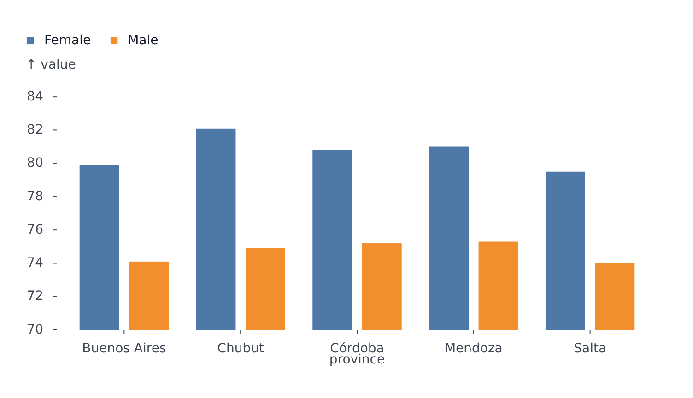
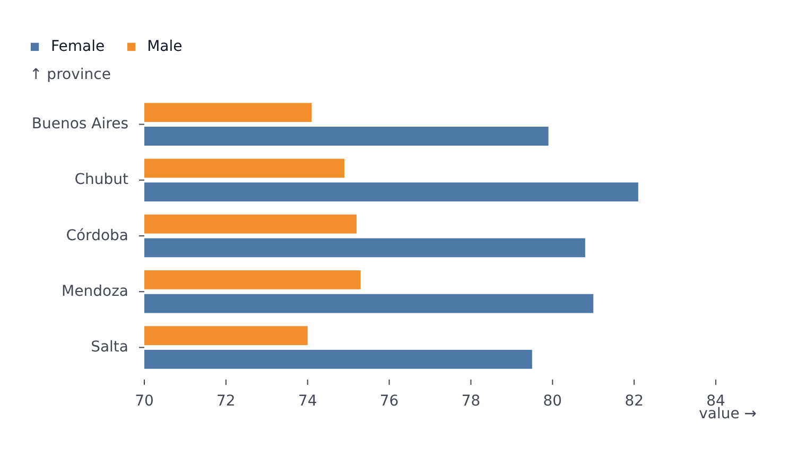
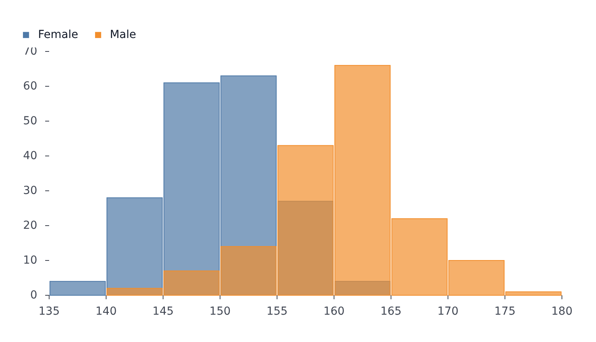
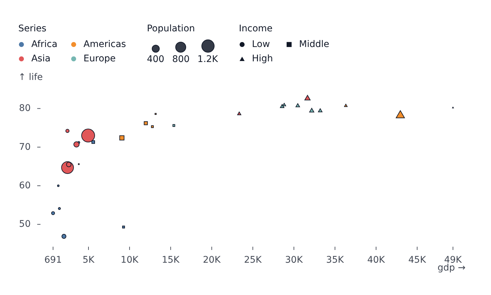

# Plots

Every plot kind shares one set of props (see [Concepts](concepts.md)). They differ in what they draw, which channels they need and how they hover.

| Plot                              | Draws                                   | Needs                                                 |
| --------------------------------- | --------------------------------------- | ----------------------------------------------------- |
| [`LinePlot`](#lineplot)           | A line per series                       | `x`, `y`                                              |
| [`AreaPlot`](#areaplot)           | A filled area per series                | `x`, `y`                                              |
| [`BarPlot`](#barplot)             | Bars, grouped, stacked or horizontal    | a category channel and a value channel                |
| [`HistogramPlot`](#histogramplot) | Counts of a numeric field in bins       | `x` or `y`                                            |
| [`BoxPlot`](#boxplot)             | The distribution of values per category | a category channel and a value channel                |
| [`LollipopPlot`](#lollipopplot)   | One dot on a stem per category          | a category channel and a value channel                |
| [`DumbbellPlot`](#dumbbellplot)   | Two dots per category, joined           | a category channel, a value channel, two series       |
| [`ClevelandPlot`](#clevelandplot) | Any number of dots per category, joined | a category channel, a value channel, a series per dot |
| [`HeatmapPlot`](#heatmapplot)     | A grid of colored cells                 | `x`, `y`, `color`                                     |
| [`PyramidPlot`](#pyramidplot)     | Two series mirrored around zero         | a category channel, a value channel, two series       |
| [`ScatterPlot`](#scatterplot)     | A point per row                         | `x`, `y`                                              |
| [`GeoPlot`](#geoplot)             | A map from GeoJSON or TopoJSON          | `data` (see [Maps](geo.md))                           |

All of them accept `data` with `grouping`/`color`, or pre-built `series`.

## LinePlot

One line per series. Rows with a missing value (`null`, `undefined`, `NaN`) break the line; `styles.gaps` can [bridge the break](styles-and-segments.md#gaps).

<!-- example: examples/LineDates.svelte -->

```svelte
<script lang="ts">
	import { LinePlot } from '@fundar/data-chart-telling';
	import { PRICES } from './data';
</script>

<!-- A line per commodity over a date axis, with end-of-line labels. -->
<LinePlot
	width={720}
	height={400}
	data={PRICES}
	x="date"
	y="index"
	color="commodity"
	styles={{ values: { show: true, format: (v, name) => `${name}: ${v}` } }}
/>
```

<!-- /example -->


- `styles.values.show` writes a label at the end of each series, with the series name and value. Overlapping labels spread apart automatically and the margin grows to fit them.
- Hover finds the points sharing the hovered `x`.
- With a [`timeline`](timeline.md), the line reveals itself up to the current step and interpolates `y` between steps.
- `segments` style ranges of a line; `markers` add `delta`, `rule`, `text` and the rest (see [Markers](markers.md)).

## AreaPlot

One filled area per series, under the line from `y` to the baseline. Default fill opacity comes from `area.fillOpacity` in the configuration.

<!-- example: examples/StackedArea.svelte -->

```svelte
<script lang="ts">
	import { AreaPlot } from '@fundar/data-chart-telling';
	import { AGE_SHARES } from './data';
</script>

<!-- Each age group's share of the population, stacked with `stackY` so the bands add up to 100%. -->
<AreaPlot
	width={720}
	height={400}
	data={AGE_SHARES}
	x="year"
	y="share"
	color="ageGroup"
	scales={{ x: { ticks: [1991, 2001, 2010, 2022] } }}
	transforms={[{ type: 'stackY' }]}
/>
```

<!-- /example -->


`transforms={[{ type: 'stackY' }]}` stacks the series.

## BarPlot

Bars where one axis holds the categories and the other the values. Categories on `x` give vertical bars; categories on `y` give horizontal bars.

<!-- example: examples/GroupedBars.svelte -->

```svelte
<script lang="ts">
	import { BarPlot } from '@fundar/data-chart-telling';
	import { PROVINCE_VALUES } from './data';
</script>

<!-- Vertical bars, grouped by `color`. -->
<BarPlot
	width={720}
	height={400}
	data={PROVINCE_VALUES}
	x="province"
	y="value"
	color="sex"
	scales={{ y: { domain: [70, 85] } }}
/>
```

<!-- /example -->



<!-- example: examples/HorizontalBars.svelte -->

```svelte
<script lang="ts">
	import { BarPlot } from '@fundar/data-chart-telling';
	import { PROVINCE_VALUES } from './data';
</script>

<!-- Horizontal bars: the categories go on `y`, the values on `x`. -->
<BarPlot
	width={720}
	height={400}
	data={PROVINCE_VALUES}
	x="value"
	y="province"
	color="sex"
	scales={{ x: { domain: [70, 85] } }}
/>
```

<!-- /example -->



- Several series sharing a category sit side by side, each in its slice of the category band. The gap between them is `bar.seriesPadding` in the configuration.
- `transforms={[{ type: 'stackY' }]}` stacks the series instead. Stacking is always `stackY`, also for horizontal bars, because the value channel is the one stacked.
- `scales.x.paddingInner` / `paddingOuter` set the spacing between category bands.
- `styles.values.show` labels each bar; `styles.values.anchor` places the label (`'outside'`, `'start'`, `'middle'`, `'end'`).
- The tooltip triggers anywhere over a bar's whole band, not just over the visible bar.

## HistogramPlot

Bins the rows of each series along one axis and draws the count per bin. Give `x` alone for vertical bars or `y` alone for horizontal bars.

<!-- example: examples/Histogram.svelte -->

```svelte
<script lang="ts">
	import { HistogramPlot } from '@fundar/data-chart-telling';
	import { HEIGHTS } from './data';
</script>

<!-- Two overlapping distributions, one per `grouping` value. -->
<HistogramPlot
	width={720}
	height={400}
	data={HEIGHTS}
	x="height"
	grouping="group"
	segments={{ default: [{ styles: { fillOpacity: 0.7 } }] }}
/>
```

<!-- /example -->



- `grouping` (or `color`) draws one histogram per group.
- Override the default binning with a `binX` (or `binY`) transform: `transforms={[{ type: 'binX', thresholds: 20 }]}`. A transform given here is merged over the default one.
- `transforms={[{ type: 'stackY' }]}` stacks groups in each bin.
- `segments={{ default: [{ styles: { fillOpacity: 0.7 } }] }}` makes overlapping groups translucent.

## BoxPlot

Summarizes the values of each series per category as a box: it spans the middle half of the values (25th to 75th percentile), the line across it is the median, the whiskers reach the farthest values within 1.5 times the box's height, and dots mark the values past them. String values on `x` stand the boxes upright; on `y` they lie sideways.

<!-- example: examples/Box.svelte -->

```svelte
<script lang="ts">
	import { BoxPlot } from '@fundar/data-chart-telling';
	import { HEIGHTS } from './data';
</script>

<!-- One box per group: quartiles, median, whiskers and outliers of each height distribution. -->
<BoxPlot width={720} height={400} data={HEIGHTS} x="group" y="height" color="group" />
```

<!-- /example -->


- `grouping` (or `color`) draws one box per group and category. Groups that share categories draw their boxes on top of each other, so split them with `facet` instead, or color by the category field itself.
- Categories keep the order the data gives them; `scales.x.domain` (or `y`) orders them.
- The value axis fits the values without reaching for zero; pin `scales.y.domain` to start it at zero.
- `scales.x.paddingInner` / `paddingOuter` set how wide the boxes are; the defaults come from `box` in the [configuration](theming.md).
- The tooltip reads one box at a time, not every value inside it: the hovered row carries `category`, `min`, `p25`, `median`, `p75`, `max`, `count` and `outliers`.
- `segments` restyle whole categories (`areas: [{ x: { from: 'Bus', to: 'Bus' } }]`). A segment that splits one category's values draws two boxes.

## LollipopPlot

One value per category, drawn as a dot on a thin stem that rises from the baseline: a lighter alternative to bars when there are many categories. String values on `x` stand the lollipops upright; on `y` they lie sideways.

<!-- example: examples/Lollipop.svelte -->

```svelte
<script lang="ts">
	import { LollipopPlot } from '@fundar/data-chart-telling';
	import { PROVINCE_VALUES } from './data';

	const female = PROVINCE_VALUES.filter((row) => row.sex === 'female');
</script>

<!-- One dot on a stem per province: female life expectancy at birth, with its value beside it. -->
<LollipopPlot
	width={720}
	height={400}
	data={female}
	x="value"
	y="province"
	scales={{ x: { domain: [70, 85] } }}
	styles={{ values: { show: true } }}
/>
```

<!-- /example -->


- `grouping` (or `color`) draws one set of lollipops per group, as long as each category has a value in only one of them - coloring by the category field itself is the usual case. A category with values in several groups warns: that is a [`DumbbellPlot`](#dumbbellplot) (two) or a [`ClevelandPlot`](#clevelandplot) (any number).
- Categories keep the order the data gives them; `scales.x.domain` (or `y`) orders them.
- The value axis reaches zero, where the stems start; pinning `scales.y.domain` moves the baseline to the nearest end of it, and a negative value hangs below zero.
- `scales.x.paddingInner` / `paddingOuter` set the room around each lollipop; the defaults, with the dot radius and the stem width, come from `lollipop` in the [configuration](theming.md).
- `styles.values` writes each value just past its dot.
- `segments` restyle whole categories: `styles: { stroke: {...}, dots: {...} }` restyle their stems and dots (`areas: [{ x: { from: 'Salta', to: 'Salta' } }]`).
- The tooltip reads one lollipop at a time, along the category axis.

## DumbbellPlot

Two dots per category, one for each of two series, joined by a connector: the gap between them is what the eye reads, such as a before and an after, or two groups. Categories on `x` stand the rows upright; on `y` they lie sideways. A plot with any other number of series warns and points to [`LollipopPlot`](#lollipopplot) (one) or [`ClevelandPlot`](#clevelandplot) (any number).

<!-- example: examples/Dumbbell.svelte -->

```svelte
<script lang="ts">
	import { DumbbellPlot } from '@fundar/data-chart-telling';
	import { PROVINCE_VALUES } from './data';
</script>

<!-- Two dots per province, one per sex, joined by a connector: the gap in life expectancy at birth. -->
<DumbbellPlot
	width={720}
	height={400}
	data={PROVINCE_VALUES}
	x="value"
	y="province"
	color="sex"
	scales={{ x: { domain: [70, 85] } }}
	styles={{ values: { show: true } }}
/>
```

<!-- /example -->


- `grouping` (or `color`) names the two series; the legend toggles them like any other.
- The value axis fits the values without reaching for zero; pin `scales.y.domain` to start it at zero.
- Categories keep the order the data gives them; `scales.x.domain` (or `y`) orders them.
- `r` sizes the dots by a field (`r="population"`; area follows the value, and the legend gets a size section) or fixes their radius in pixels (`r={8}`).
- The connector is a neutral gray; its color and width, the dot radius and the padding come from `dumbbell` in the [configuration](theming.md).
- `styles.values` writes each value past its dot, away from the other one. A label past the lowest dot can reach the axis labels when that dot sits at the edge of the axis; pin `scales.y.domain` (or `x`) wide enough to leave it room.
- `segments` restyle the dots of chosen categories (`styles: { dots: { dotRadius: 9 } }`, `areas: [{ x: { from: 'Salta', to: 'Salta' } }]`).
- The tooltip reads one category at a time, listing its two values.

## ClevelandPlot

The general form of the family: per category, one dot for each series that has a value there, joined by a connector from the lowest to the highest. A [`LollipopPlot`](#lollipopplot) is its one-series case and a [`DumbbellPlot`](#dumbbellplot) its two-series case, which check their series and point here when they need more. Categories on `x` stand the rows upright; on `y` they lie sideways.

<!-- example: examples/Cleveland.svelte -->

```svelte
<script lang="ts">
	import { ClevelandPlot } from '@fundar/data-chart-telling';
	import { AGE_SHARES } from './data';
</script>

<!-- One dot per census year in each age group, joined from the lowest share to the highest. -->
<ClevelandPlot width={720} height={400} data={AGE_SHARES} x="share" y="ageGroup" grouping="year" />
```

<!-- /example -->


- `grouping` (or `color`) gives one dot per group in each category. Numeric fields need `grouping` to split into series; `color` on a number draws a continuous ramp instead.
- `scales.color.scheme: 'blues'` colors the series on a sequential ramp, which reads better than the default palette when the series follow one another, such as years; `schemeRange: [0.3, 1]` skips the ramp's near-white start.
- The connector spans the lowest and the highest dot of each category, so a series the legend omits leaves the range.
- The value axis fits the values without reaching for zero; pin `scales.y.domain` to start it at zero.
- Its defaults come from `cleveland` in the [configuration](theming.md).
- `styles.values` writes each value: past the highest dot and the lowest of its category, and beside those between them.
- `segments` restyle the dots of chosen categories, as in [`DumbbellPlot`](#dumbbellplot).
- The tooltip reads one category at a time, listing every series.

## HeatmapPlot

A grid of cells, `x` and `y` being the categories of the columns and rows and `color` the value that colors each cell.

<!-- example: examples/Heatmap.svelte -->

```svelte
<script lang="ts">
	import { HeatmapPlot } from '@fundar/data-chart-telling';
	import { HOUSEHOLDS } from './data';
</script>

<!-- One cell per number of rooms and of people, colored by the share of households. -->
<HeatmapPlot width={560} height={360} data={HOUSEHOLDS} x="rooms" y="people" color="share" />
```

<!-- /example -->


- The color domain spans the whole dataset, so it stays comparable across [facets](facets.md).
- Cell value labels are on by default (`styles.values.show` turns them off).
- `segments` restyle chosen columns, rows or single cells (see [Styles and segments](styles-and-segments.md)).
- Hover matches one cell at a time.

## PyramidPlot

Two series mirrored around a shared zero baseline, such as a population pyramid. Categories on `y` give horizontal bars; categories on `x` give vertical ones.

<!-- example: examples/Pyramid.svelte -->

```svelte
<script lang="ts">
	import { PyramidPlot } from '@fundar/data-chart-telling';
	import { AGES } from './data';
</script>

<!-- A population pyramid: one side per `color` value. -->
<PyramidPlot width={720} height={400} data={AGES} x="share" y="ageGroup" color="sex" />
```

<!-- /example -->


- `scales.grouping.reverse` swaps which series sits on which side.
- Hover finds the points sharing the hovered category.

## ScatterPlot

A dot per row.

<!-- example: examples/Scatter.svelte -->

```svelte
<script lang="ts">
	import { ScatterPlot } from '@fundar/data-chart-telling';
	import { COUNTRIES } from './data';
</script>

<!-- Points sized by `r`, colored by `color` and shaped by `symbol`. -->
<ScatterPlot
	width={720}
	height={420}
	data={COUNTRIES}
	x="gdp"
	y="life"
	r="population"
	color="continent"
	symbol="income"
/>
```

<!-- /example -->



- `r` sizes the dots (area follows the value; configure with `scales.r`). The legend gets a size section.
- `symbol` varies the dot shape by category (`scales.symbol`), `opacity` varies transparency, `color` colors by category or by a continuous ramp.
- A literal number for `r` is a fixed radius in pixels.
- `dotRadius` defaults come from `scatter.dotRadius` in the configuration.

## GeoPlot

Draws GeoJSON or TopoJSON as a map: base features, a choropleth through `color`, per-feature `segments`, projections, camera and map-specific markers. It has its own page: [Maps](geo.md).
