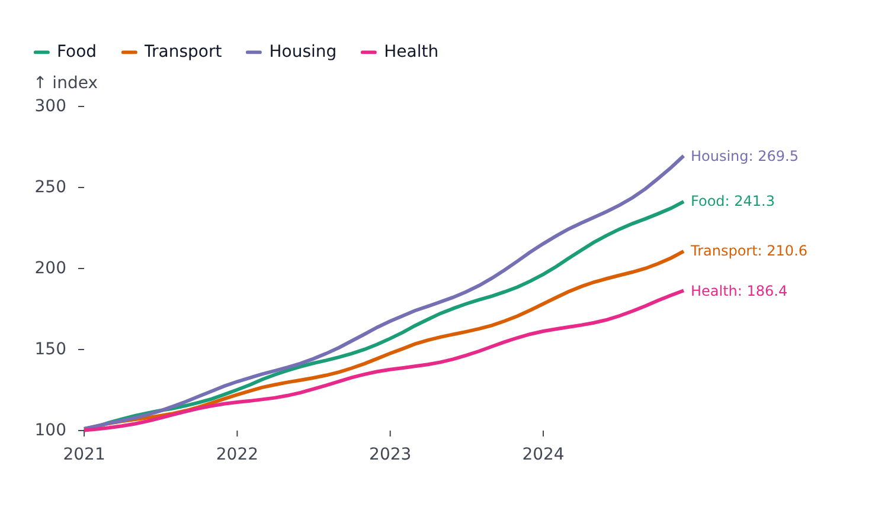
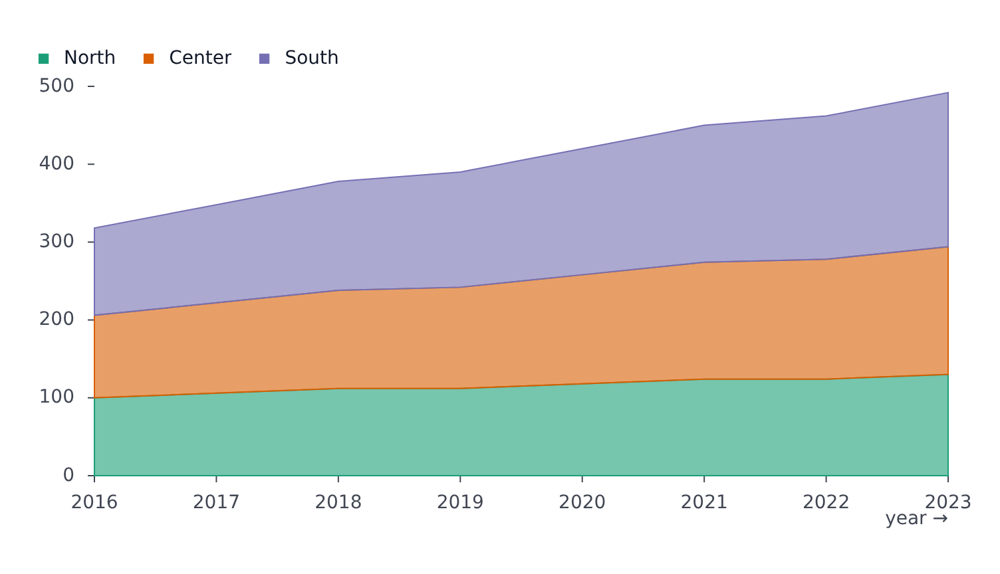
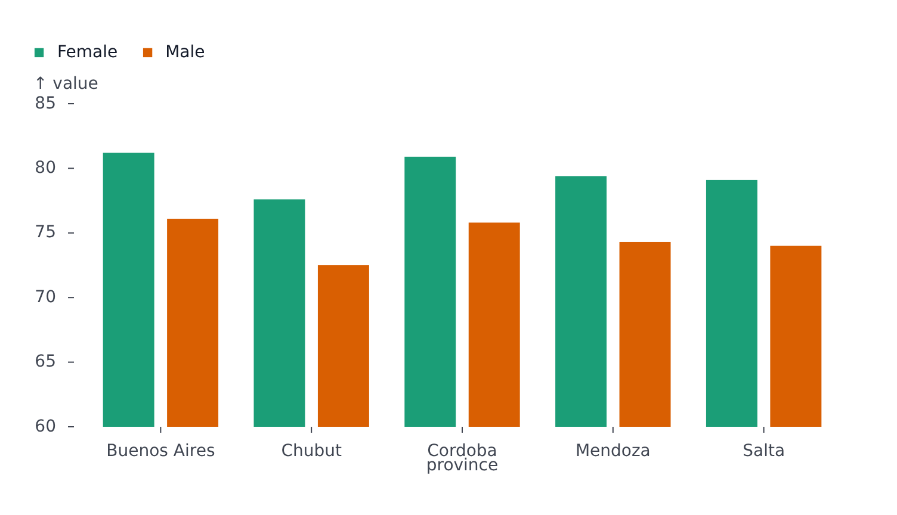
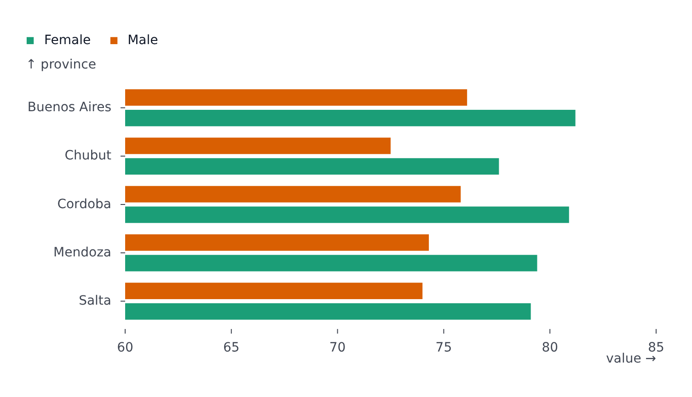
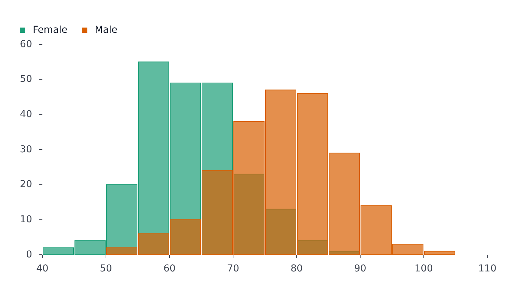
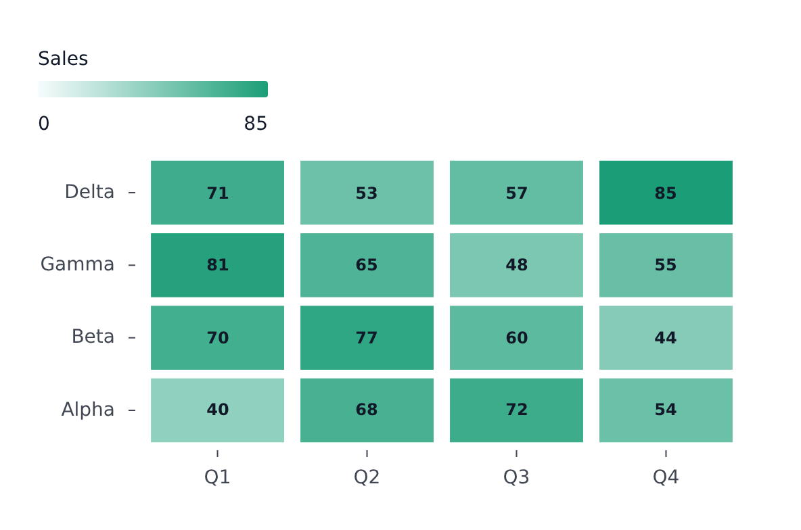
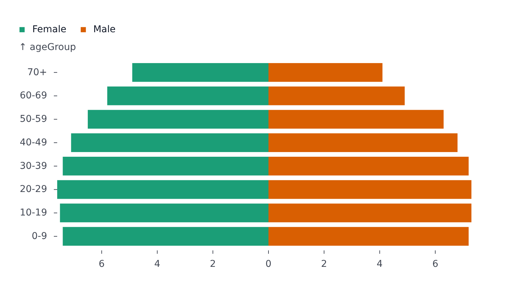
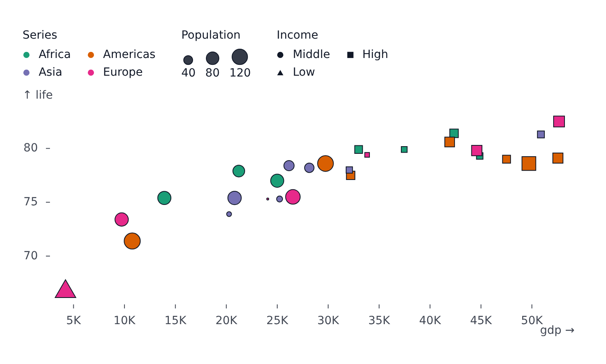

# Plots

Eight plot kinds share one set of props (see [Concepts](concepts.md)). They differ in what they draw, which channels they need and how they hover.

| Plot                              | Draws                                | Needs                                           |
| --------------------------------- | ------------------------------------ | ----------------------------------------------- |
| [`LinePlot`](#lineplot)           | A line per series                    | `x`, `y`                                        |
| [`AreaPlot`](#areaplot)           | A filled area per series             | `x`, `y`                                        |
| [`BarPlot`](#barplot)             | Bars, grouped, stacked or horizontal | a category channel and a value channel          |
| [`HistogramPlot`](#histogramplot) | Counts of a numeric field in bins    | `x` or `y`                                      |
| [`HeatmapPlot`](#heatmapplot)     | A grid of colored cells              | `x`, `y`, `color`                               |
| [`PyramidPlot`](#pyramidplot)     | Two series mirrored around zero      | a category channel, a value channel, two series |
| [`ScatterPlot`](#scatterplot)     | A point per row                      | `x`, `y`                                        |
| [`GeoPlot`](#geoplot)             | A map from GeoJSON or TopoJSON       | `data` (see [Maps](geo.md))                     |

All of them accept `data` with `grouping`/`color`, or pre-built `series`.

## LinePlot

One line per series. Rows with a missing value (`null`, `undefined`, `NaN`) break the line; `styles.gaps` can [bridge the break](styles-and-segments.md#gaps).

```svelte
<LinePlot
	{width}
	{height}
	data={rows}
	x="date"
	y="index"
	color="division"
	styles={{ values: { show: true, format: (v, name) => `${name}: ${v}` } }}
/>
```



- `styles.values.show` writes a label at the end of each series, with the series name and value. Overlapping labels spread apart automatically and the margin grows to fit them.
- Hover finds the points sharing the hovered `x`.
- With a [`timeline`](timeline.md), the line reveals itself up to the current step and interpolates `y` between steps.
- `segments` style ranges of a line; `markers` add `delta`, `rule`, `text` and the rest (see [Markers](markers.md)).

## AreaPlot

One filled area per series, under the line from `y` to the baseline. Default fill opacity comes from `area.fillOpacity` in the configuration.

```svelte
<AreaPlot
	{width}
	{height}
	data={rows}
	x="year"
	y="value"
	color="region"
	transforms={[{ type: 'stackY' }]}
/>
```



`transforms={[{ type: 'stackY' }]}` stacks the series.

## BarPlot

Bars where one axis holds the categories and the other the values. Categories on `x` give vertical bars; categories on `y` give horizontal bars.

```svelte
<!-- vertical -->
<BarPlot {width} {height} data={rows} x="province" y="value" color="sex" />
<!-- horizontal -->
<BarPlot {width} {height} data={rows} x="value" y="province" color="sex" />
```





- Several series sharing a category sit side by side, each in its slice of the category band. The gap between them is `bar.seriesPadding` in the configuration.
- `transforms={[{ type: 'stackY' }]}` stacks the series instead. Stacking is always `stackY`, also for horizontal bars, because the value channel is the one stacked.
- `scales.x.paddingInner` / `paddingOuter` set the spacing between category bands.
- `styles.values.show` labels each bar; `styles.values.anchor` places the label (`'outside'`, `'start'`, `'middle'`, `'end'`).
- The tooltip triggers anywhere over a bar's whole band, not just over the visible bar.

## HistogramPlot

Bins the rows of each series along one axis and draws the count per bin. Give `x` alone for vertical bars or `y` alone for horizontal bars.

```svelte
<HistogramPlot
	{width}
	{height}
	data={rows}
	x="weight"
	grouping="group"
	segments={{ default: [{ styles: { fillOpacity: 0.7 } }] }}
/>
```



- `grouping` (or `color`) draws one histogram per group.
- Override the default binning with a `binX` (or `binY`) transform: `transforms={[{ type: 'binX', thresholds: 20 }]}`. A transform given here is merged over the default one.
- `transforms={[{ type: 'stackY' }]}` stacks groups in each bin.
- `segments={{ default: [{ styles: { fillOpacity: 0.7 } }] }}` makes overlapping groups translucent.

## HeatmapPlot

A grid of cells, `x` and `y` being the categories of the columns and rows and `color` the value that colors each cell.

```svelte
<HeatmapPlot {width} {height} data={cells} x="quarter" y="product" color="sales" />
```



- The color domain spans the whole dataset, so it stays comparable across [facets](facets.md).
- Cell value labels are on by default (`styles.values.show` turns them off).
- `segments` restyle chosen columns, rows or single cells (see [Styles and segments](styles-and-segments.md)).
- Hover matches one cell at a time.

## PyramidPlot

Two series mirrored around a shared zero baseline, such as a population pyramid. Categories on `y` give horizontal bars; categories on `x` give vertical ones.

```svelte
<PyramidPlot {width} {height} data={ages} x="share" y="ageGroup" color="sex" />
```



- `scales.grouping.reverse` swaps which series sits on which side.
- Hover finds the points sharing the hovered category.

## ScatterPlot

A dot per row.

```svelte
<ScatterPlot
	{width}
	{height}
	data={countries}
	x="gdp"
	y="life"
	r="population"
	color="continent"
	symbol="income"
/>
```



- `r` sizes the dots (area follows the value; configure with `scales.r`). The legend gets a size section.
- `symbol` varies the dot shape by category (`scales.symbol`), `opacity` varies transparency, `color` colors by category or by a continuous ramp.
- A literal number for `r` is a fixed radius in pixels.
- `dotRadius` defaults come from `scatter.dotRadius` in the configuration.

## GeoPlot

Draws GeoJSON or TopoJSON as a map: base features, a choropleth through `color`, per-feature `segments`, projections, camera and map-specific markers. It has its own page: [Maps](geo.md).
