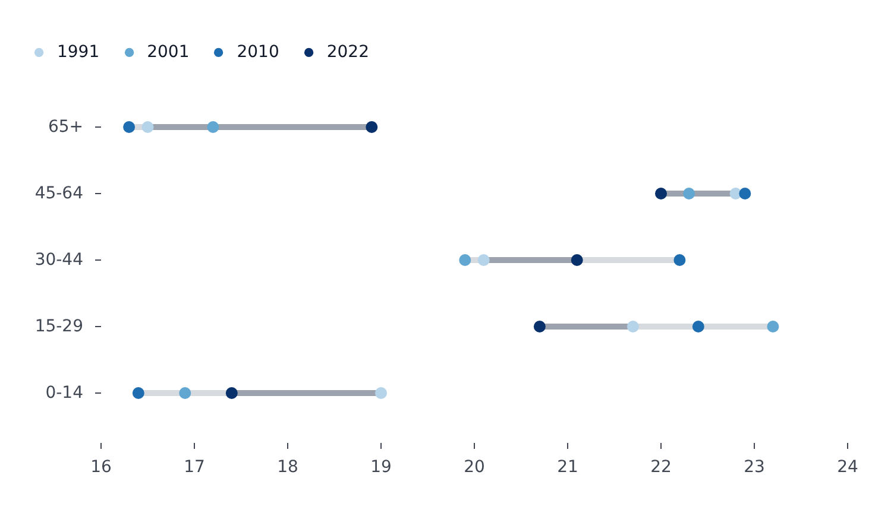

# ClevelandPlot

Part of [Plots](../plots.md).

The general form of the family: per category, one dot for each series that has a value there, joined by a connector from the lowest to the highest. A [`LollipopPlot`](lollipop.md) is its one-series case and a [`DumbbellPlot`](dumbbell.md) its two-series case, which check their series and point here when they need more. Categories on `x` stand the rows upright; on `y` they lie sideways.

<!-- example: examples/Cleveland.svelte -->

```svelte
<script lang="ts">
	import { ClevelandPlot } from '@fundar/data-chart-telling';
	import { AGE_SHARES } from './data';
</script>

<!-- One dot per census year in each age group, joined from the lowest share to the highest. The years follow one another, so they take a sequential blues ramp. -->
<ClevelandPlot
	width={720}
	height={400}
	data={AGE_SHARES}
	x="share"
	y="ageGroup"
	grouping="year"
	scales={{ color: { scheme: 'blues', schemeRange: [0.3, 1] } }}
/>
```

<!-- /example -->



- `grouping` (or `color`) gives one dot per group in each category. Numeric fields need `grouping` to split into series; `color` on a number draws a continuous ramp instead.
- `scales.color.scheme: 'blues'` colors the series on a sequential ramp, which reads better than the default palette when the series follow one another, such as years; `schemeRange: [0.3, 1]` skips the ramp's near-white start.
- The connector spans the lowest and the highest dot of each category, so a series the legend omits leaves the range.
- The value axis fits the values without reaching for zero; pin `scales.y.domain` to start it at zero.
- Its defaults come from `cleveland` in the [configuration](../theming.md): the connector is a neutral gray, 5 px thick.
- `styles.values` writes each value: past the highest dot and the lowest of its category, and beside those between them. `select` (`'first'`, `'last'`, `'min'`, `'max'`, or a list) labels only those dots of each category, `series` only those series, and `color: 'series'` writes each label in its dot's series color. `format(value, seriesName, row)` also gets the row, so a label can name its category (see [Styles and segments](../styles-and-segments.md#value-labels)).
- `segments` restyle the dots of chosen categories, as in [`DumbbellPlot`](dumbbell.md).
- The tooltip reads one category at a time, listing every series.

## Connectors

`styles.connector` styles the line each category draws between its dots, on `DumbbellPlot`, `ClevelandPlot` and `LollipopPlot`:

| Field        | Meaning                                                                                                                                                                                                                                                                                        |
| ------------ | ---------------------------------------------------------------------------------------------------------------------------------------------------------------------------------------------------------------------------------------------------------------------------------------------- |
| `from`, `to` | Where a difference runs between: `to` minus `from`. Each is a series name, `'first'` or `'last'` (the defaults), or `'min'` or `'max'` for the category's lowest and highest dot - `from: 'min', to: 'max'` makes the whole connector the stretch. On a lollipop, the value minus the baseline |
| `width`      | Thickness in px, `'dots'` for a band as thick as the dots are wide, or a function of the connector                                                                                                                                                                                             |
| `color`      | One color; `{ by: 'sign', positive, negative, zero }`; `{ by: 'difference' \| 'length', scheme, pivot, ... }` (a color scale, diverging around `pivot: 0` by default for a difference); or a function                                                                                          |
| `opacity`    | 0-1, or a function of the connector                                                                                                                                                                                                                                                            |
| `arrow`      | `true`, or `{ headLength, headAngle }`: draws the `from`-`to` stretch as an arrow pointing at the `to` dot, the way the value moved, instead of a line. It is as thick as `width` says, else `connector.arrow.width` in the configuration (2 px)                                               |
| `outside`    | How the part of a connector outside the `from`-`to` stretch looks, where the dots of the other series lie: a color, or `{ color, opacity }`. Default: the neutral connector color, faded                                                                                                       |
| `label`      | `true`, or `{ text, format, anchor, fontStyle }`: `text` is the `'difference'` (signed, the default), the `'length'`, or a function; `anchor` is `'outside'` (beside the connector) or `'middle'` (on it, for a thick one)                                                                     |

With more than two series, the connector spans the lowest and the highest dot, but only the stretch between the `from` and `to` dots takes `color`, `opacity` and the label (centered on it); the rest is `outside`. A function gets the connector: `{ category, from, to, length, difference, span, series }`, `span` being that stretch. A lone dot's stem keeps its series' color unless `color` is set, and a segment's own `stroke` wins over both.
