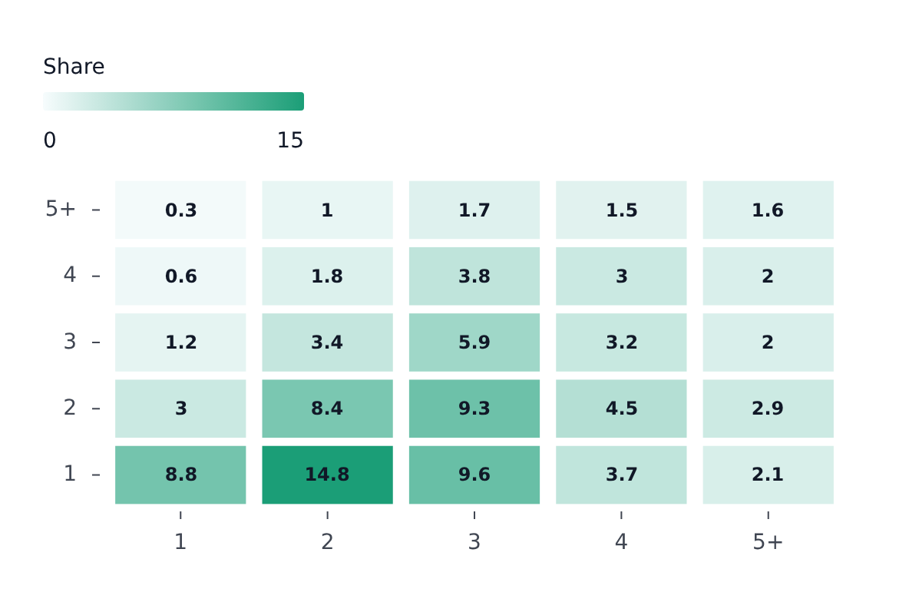

# HeatmapPlot

Part of [Plots](../../plots.md).

A grid of cells, `x` and `y` being the categories of the columns and rows and `color` the value that colors each cell.

<!-- example: examples/Heatmap.svelte -->

```svelte
<script lang="ts">
	import { HeatmapPlot } from '@fundar/data-chart-telling';
	import { HOUSEHOLDS } from './datasets';
</script>

<!-- One cell per number of rooms and of people, colored by the share of households. -->
<HeatmapPlot width={560} height={360} data={HOUSEHOLDS} x="rooms" y="people" color="share" />
```

<!-- /example -->



- The color domain spans the whole dataset, so it stays comparable across [facets](../../facets.md).
- Cell value labels are on by default (`styles.values.show` turns them off).
- `segments` restyle chosen columns, rows or single cells (see [Styles and segments](../../styles-and-segments.md)).
- Hover matches one cell at a time.
