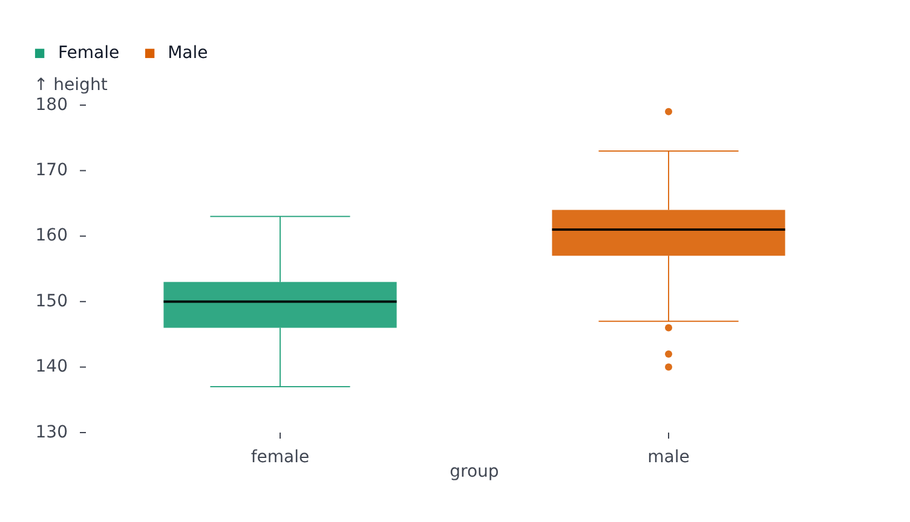

# BoxPlot

Part of [Plots](../../plots.md).

Summarizes the values of each series per category as a box: it spans the middle half of the values (25th to 75th percentile), the line across it is the median, the whiskers reach the farthest values within 1.5 times the box's height, and dots mark the values past them. String values on `x` stand the boxes upright; on `y` they lie sideways.

<!-- example: examples/Box.svelte -->

```svelte
<script lang="ts">
	import { BoxPlot } from '@fundar/data-chart-telling';
	import { HEIGHTS } from './datasets';
</script>

<!-- One box per group: quartiles, median, whiskers and outliers of each height distribution. -->
<BoxPlot width={720} height={400} data={HEIGHTS} x="group" y="height" color="group" />
```

<!-- /example -->



- `grouping` (or `color`) draws one box per group and category. Groups that share categories draw their boxes on top of each other, so split them with `facet` instead, or color by the category field itself.
- Categories keep the order the data gives them; `scales.x.domain` (or `y`) orders them.
- The value axis fits the values without reaching for zero; pin `scales.y.domain` to start it at zero.
- `scales.x.paddingInner` / `paddingOuter` set how wide the boxes are; the defaults come from `box` in the [configuration](../../theming.md).
- The tooltip reads one box at a time, not every value inside it: the hovered row carries `category`, `min`, `p25`, `median`, `p75`, `max`, `count` and `outliers`.
- `segments` restyle whole categories (`areas: [{ x: { from: 'Bus', to: 'Bus' } }]`). A segment that splits one category's values draws two boxes.
