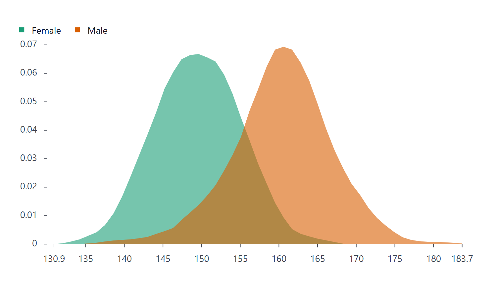

# DensityPlot

Part of [Plots](../../plots.md).

Smooths the rows of each series along one axis into a kernel density estimate, the continuous pair of [HistogramPlot](histogram.md). Give `x` alone for a vertical curve or `y` alone for a horizontal one.

<!-- example: examples/Density.svelte -->

```svelte
<script lang="ts">
	import { DensityPlot } from '@fundar/data-chart-telling';
	import { HEIGHTS } from './data';
</script>

<!-- A smoothed distribution per `grouping` value, the continuous pair of a histogram. -->
<DensityPlot width={720} height={400} data={HEIGHTS} x="height" grouping="group" />
```

<!-- /example -->



- `grouping` (or `color`) draws one curve per group.
- `styles={{ mark: 'line' }}` draws lines instead of filled areas; `styles.curve` sets how a curve joins its points.
- Override the estimate with a `densityX` (or `densityY`) transform: `transforms={[{ type: 'densityX', bandwidth: 2 }]}`. A transform given here is merged over the default one; see [Transforms and statistics](../../transforms-and-statistics.md) for its options.
- `segments={{ default: [{ styles: { fillOpacity: 0.3 } }] }}` restyles the areas.
