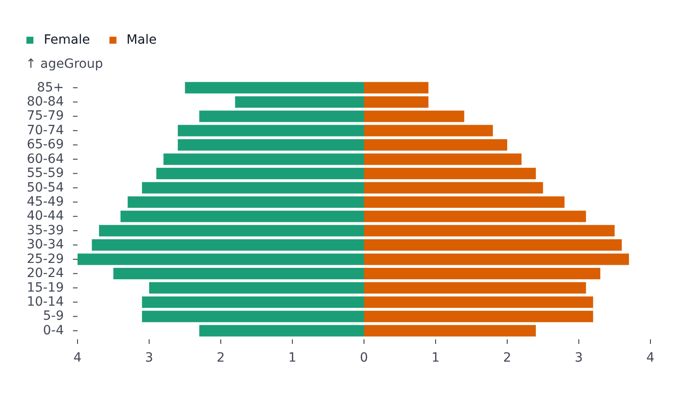

# PyramidPlot

Part of [Plots](../../plots.md).

Two series mirrored around a shared zero baseline, such as a population pyramid. Categories on `y` give horizontal bars; categories on `x` give vertical ones.

<!-- example: examples/Pyramid.svelte -->

```svelte
<script lang="ts">
	import { PyramidPlot } from '@fundar/data-chart-telling';
	import { AGES } from './data';
</script>

<!-- A population pyramid: one side per `color` value. -->
<PyramidPlot width={720} height={400} data={AGES} x="share" y="ageGroup" color="sex" />
```

<!-- /example -->



- `scales.grouping.reverse` swaps which series sits on which side.
- Hover finds the points sharing the hovered category.
