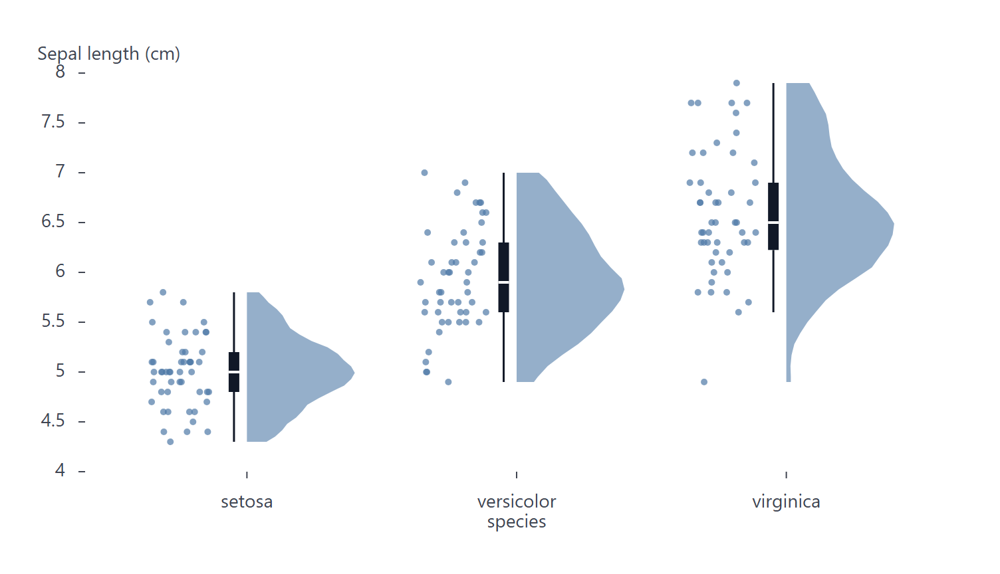

# RaincloudPlot

Part of [Plots](../../plots.md).

Draws, for each category, half the density estimate of its values (the cloud), every value as a dot scattered beside it (the rain) and a box: the shape, the summary and the raw values of a distribution together. Give the category on `x` and the values on `y`, or swap them for horizontal rainclouds, the cloud above the rain.

<!-- example: examples/Raincloud.svelte -->

```svelte
<script lang="ts">
	import { RaincloudPlot } from '@fundar/data-chart-telling';
	import { IRIS } from './datasets/iris-flower';
</script>

<!-- The sepal length of the flowers of each species: half its density, a box, and every flower as a dot. -->
<RaincloudPlot
	width={720}
	height={400}
	data={IRIS}
	x="species"
	y="sepalLength"
	scales={{ y: { label: 'Sepal length (cm)' } }}
/>
```

<!-- /example -->



- `grouping` (or `color`) draws one raincloud per group inside each category's band, side by side.
- `styles.kernel`, `styles.bandwidth`, `styles.trim` and `styles.scale` set the cloud, as on [ViolinPlot](violin.md).
- `styles.box.position` puts the box between the cloud and the rain (`'between'`, the default), over the cloud (`'cloud'`) or over the rain (`'rain'`). `styles.box` also takes the box options of a violin plot: `false`, a width in pixels, or an object with `width`, `quartiles`, `median`, `whiskers`, `caps` and `outliers`.
- `styles.rain` sets the dots' radius (`r`) and `opacity`; `false` leaves them out.
- The dots are scattered by a `jitterX` (`jitterY` when horizontal) across their band, which the plot runs before its own `transforms`. A `jitterX` of your own in `transforms` is merged over it: its `seed`, `distribution` and `width` (in bands) change the scatter.
- Hovering a raincloud reads the same summary as a box plot: quartiles, whisker ends and the values past them.
