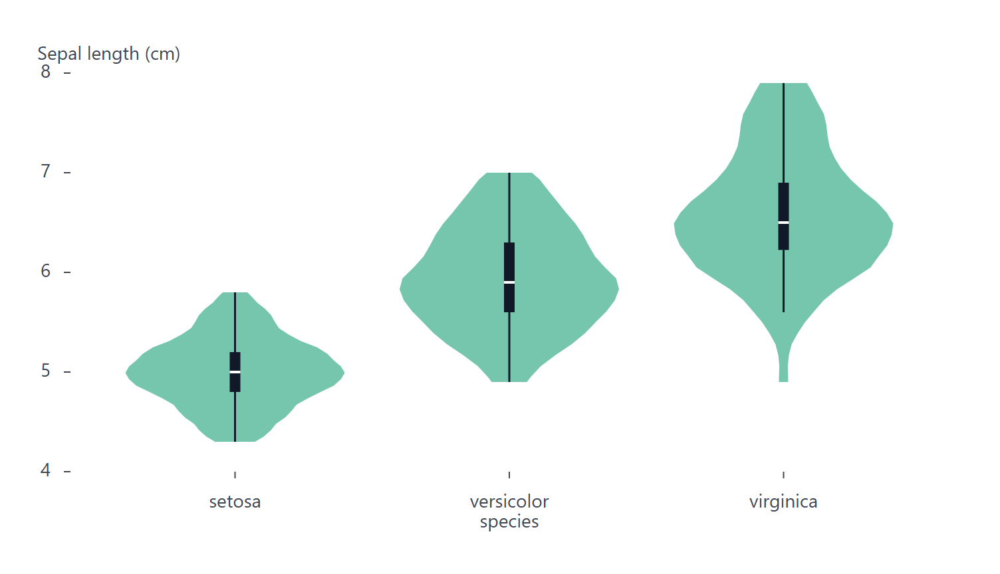

# ViolinPlot

Part of [Plots](../../plots.md).

Draws, for each category, the density estimate of its values mirrored around the middle of its band, with a box inside: the shape of the distribution that [BoxPlot](box.md) summarizes. Give the category on `x` and the values on `y`, or swap them for horizontal violins.

<!-- example: examples/Violin.svelte -->

```svelte
<script lang="ts">
	import { ViolinPlot } from '@fundar/data-chart-telling';
	import { IRIS } from './datasets';
</script>

<!-- The sepal length of the flowers of each species: its density, mirrored, with a box inside. -->
<ViolinPlot
	width={720}
	height={400}
	data={IRIS}
	x="species"
	y="sepalLength"
	scales={{ y: { label: 'Sepal length (cm)' } }}
/>
```

<!-- /example -->



- `grouping` (or `color`) draws one violin per group inside each category's band, side by side. A category with fewer than two values in a group draws no violin.
- `styles.kernel` and `styles.bandwidth` set the estimate; Silverman's rule picks each violin's bandwidth when unset.
- `styles.trim` (default `true`) cuts each violin at its values' own extent. With `false` the tails fade out past it, beyond what the value axis reaches.
- `styles.scale: 'shared'` draws every violin on one density scale, so their areas compare; the default gives each the same full width.
- `styles.box: false` leaves the inner box out, and a number sets its width in pixels. An object sets its `width` and which parts show: `quartiles`, `median` and `whiskers` (on by default), `caps` and `outliers` (off).
- Hovering a violin reads the same summary as a box plot: quartiles, whisker ends and the values past them.
