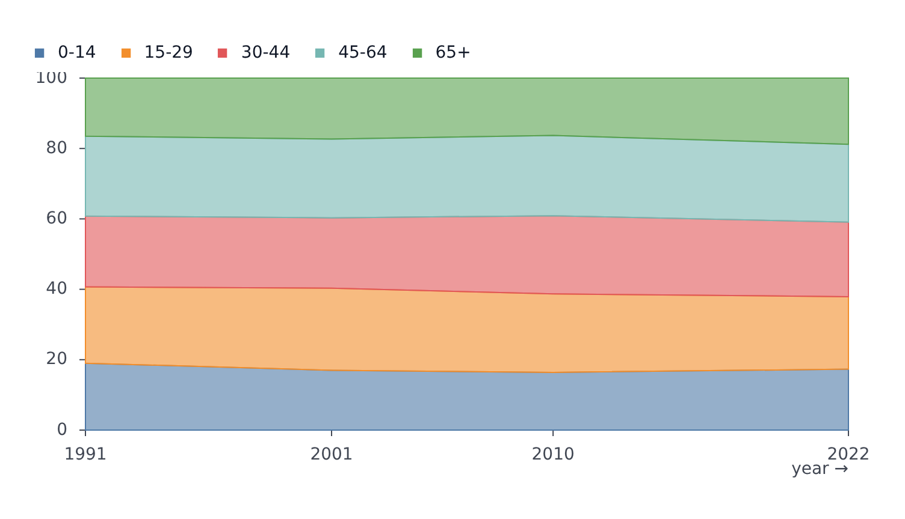

# AreaPlot

Part of [Plots](../../plots.md).

One filled area per series, under the line from `y` to the baseline. Default fill opacity comes from `area.fillOpacity` in the configuration.

<!-- example: examples/StackedArea.svelte -->

```svelte
<script lang="ts">
	import { AreaPlot } from '@fundar/data-chart-telling';
	import { AGE_SHARES } from './datasets';
</script>

<!-- Each age group's share of the population, stacked with `stackY` so the bands add up to 100%. -->
<AreaPlot
	width={720}
	height={400}
	data={AGE_SHARES}
	x="year"
	y="share"
	color="ageGroup"
	scales={{ x: { ticks: [1991, 2001, 2010, 2022] } }}
	transforms={[{ type: 'stackY' }]}
/>
```

<!-- /example -->



`transforms={[{ type: 'stackY' }]}` stacks the series.
