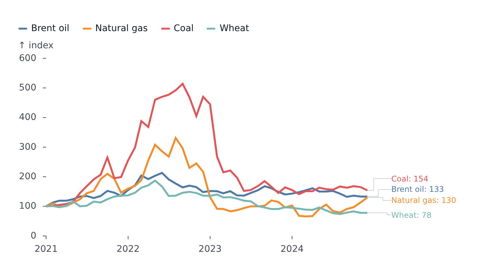

# LinePlot

Part of [Plots](../../plots.md).

One line per series. Rows with a missing value (`null`, `undefined`, `NaN`) break the line; `styles.gaps` can [bridge the break](../../styles-and-segments.md#gaps).

<!-- example: examples/LineDates.svelte -->

```svelte
<script lang="ts">
	import { LinePlot } from '@fundar/data-chart-telling';
	import { PRICES } from './data';
</script>

<!-- A line per commodity over a date axis, with end-of-line labels. -->
<LinePlot
	width={720}
	height={400}
	data={PRICES}
	x="date"
	y="index"
	color="commodity"
	styles={{ values: { show: true, format: (v, name) => `${name}: ${v}` } }}
/>
```

<!-- /example -->



- `styles.values.show` writes a label at the end of each series, with the series name and value. Overlapping labels spread apart automatically and the margin grows to fit them. `styles.values.select` labels another point instead - or besides: `'first'`, `'min'`, `'max'`, or a list such as `['first', 'last']`.
- Hover finds the points sharing the hovered `x`.
- With a [`timeline`](../../timeline.md), the line reveals itself up to the current step and interpolates `y` between steps.
- `segments` style ranges of a line; `markers` add `delta`, `rule`, `text` and the rest (see [Markers](../../markers.md)).
