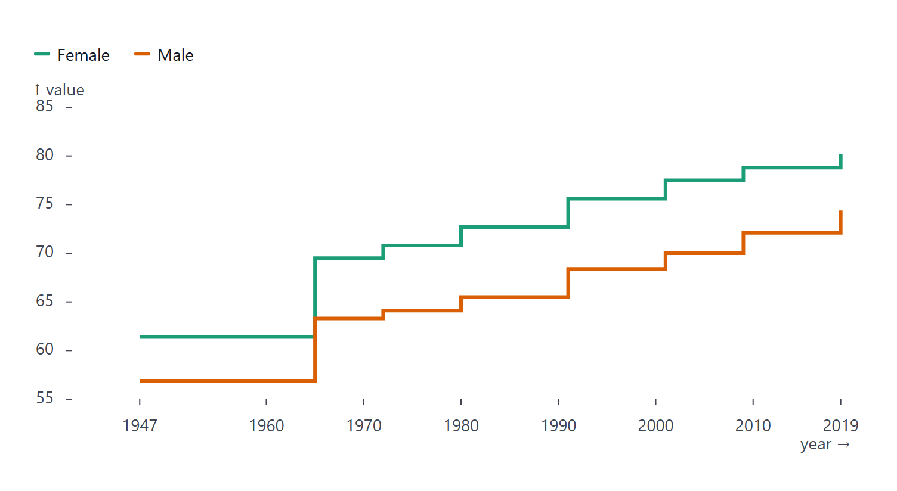
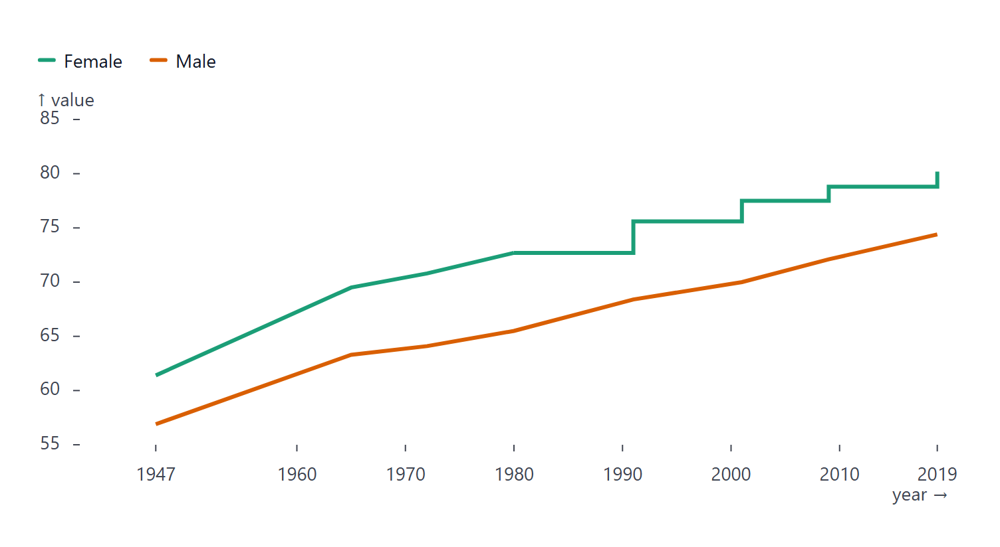

# LinePlot

Part of [Plots](../../plots.md).

One line per series. Rows with a missing value (`null`, `undefined`, `NaN`) break the line; `styles.gaps` can [bridge the break](../../styles-and-segments.md#gaps).

<!-- example: examples/LineDates.svelte -->

```svelte
<script lang="ts">
	import { LinePlot } from '@fundar/data-chart-telling';
	import { PRICES } from './datasets';
</script>

<!-- A line per commodity over a date axis, with end-of-line labels. -->
<LinePlot
	width={720}
	height={400}
	data={PRICES}
	x="date"
	y="index"
	color="commodity"
	styles={{ values: { show: true, format: (v, name) => `${name}: ${v}` } }}
/>
```

<!-- /example -->


- `styles.values.show` writes a label at the end of each series, with the series name and value. Overlapping labels spread apart automatically and the margin grows to fit them. `styles.values.select` labels another point instead - or besides: `'first'`, `'min'`, `'max'`, or a list such as `['first', 'last']`.
- Hover finds the points sharing the hovered `x`.
- With a [`timeline`](../../timeline.md), the line reveals itself up to the current step and interpolates `y` between steps.
- `styles.curve` joins the points with another curve than the straight one: `'step'`, `'step-after'` and `'step-before'` draw stairs (a step plot), `'monotone-x'`, `'basis'` and `'catmull-rom'` smooth the line. The default is `'auto'` (straight segments), which `line.curve` in the [configuration](../../theming.md) sets for every line. There is no separate step plot: it is this one.
- `segments` style ranges of a line; `markers` add `delta`, `rule`, `text` and the rest (see [Markers](../../markers.md)).

## Step lines

A step plot suits a value that holds until something changes it (a rate, a price list, a life table). `styles.curve` takes any svelteplot curve; `'step-after'` holds each value until the next point, `'step-before'` reaches it at the previous one and `'step'` changes halfway.

<!-- example: examples/LineStep.svelte -->

```svelte
<script lang="ts">
	import { LinePlot } from '@fundar/data-chart-telling';
	import { LIFE } from './datasets';
</script>

<!-- A step plot is a line plot with a step curve: each life table holds its value until the next one. -->
<LinePlot
	width={720}
	height={380}
	data={LIFE}
	x="year"
	y="value"
	color="sex"
	scales={{ x: { edgeTicks: true } }}
	styles={{ curve: 'step-after' }}
/>
```

<!-- /example -->



A segment's own `curve` wins over `styles.curve`, so one stretch of a line can step while the rest stays straight.

<!-- example: examples/LineStepSegment.svelte -->

```svelte
<script lang="ts">
	import { LinePlot } from '@fundar/data-chart-telling';
	import { LIFE } from './datasets';
</script>

<!-- A segment sets its own curve: the female line is straight until 1980 and steps from then on. -->
<LinePlot
	width={720}
	height={380}
	data={LIFE}
	x="year"
	y="value"
	color="sex"
	scales={{ x: { edgeTicks: true } }}
	segments={{
		female: [{ areas: [{ x: { from: 1980 } }], styles: { curve: 'step-after' } }]
	}}
/>
```

<!-- /example -->


