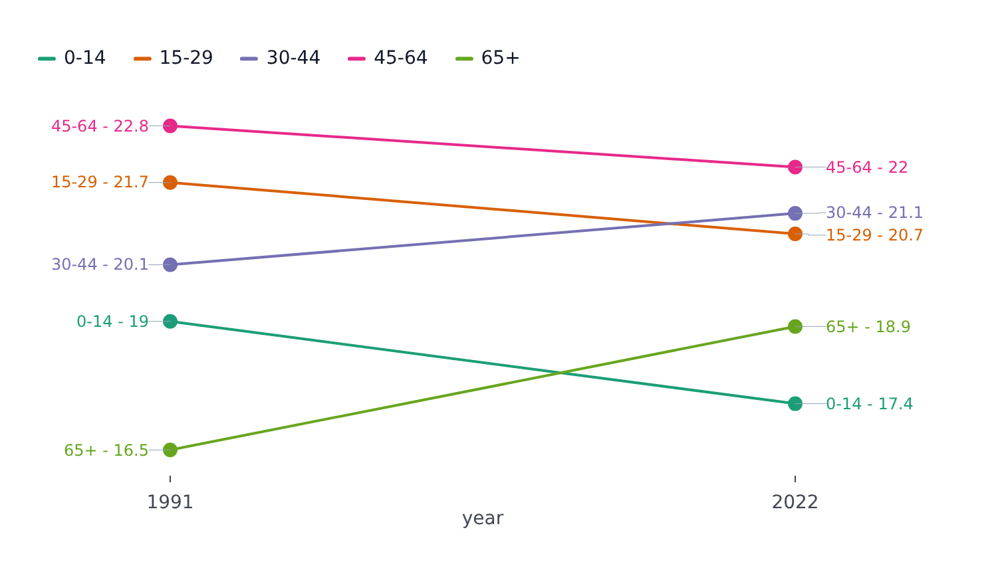

# SlopePlot

Part of [Plots](../../plots.md).

A line per series between two positions of a category axis, a dot on each end, to read how every series changed between two moments - and how they changed against one another. Its first and last points are labelled before and after the dots, spread apart where they would overlap. It is a [`LinePlot`](line.md) over a category axis, so any number of positions works, but the plot is made for two.

<!-- example: examples/Slope.svelte -->

```svelte
<script lang="ts">
	import { SlopePlot } from '@fundar/data-chart-telling';
	import { AGE_SHARES } from './datasets';

	const censuses = AGE_SHARES.filter(({ year }) => year === 1991 || year === 2022);
</script>

<!-- Each age group's share of Buenos Aires City's population between two censuses, labelled at both ends. -->
<SlopePlot
	width={720}
	height={400}
	data={censuses}
	x="year"
	y="share"
	color="ageGroup"
	styles={{ values: { show: true } }}
/>
```

<!-- /example -->



- `x` is always a category axis (a point scale, so the first and last positions reach the plot's edges), even for numbers or dates: each distinct value is a position, in the order the data gives them (`scales.x.domain` sets it).
- `grouping` (or `color`) names the series; the legend toggles them like any other.
- `styles.values` writes each series' first and last value (`select` picks others: `'first'`, `'last'`, `'min'`, `'max'`). Each label sits out in the margin on a lane, joined to its dot by a connector. The text is `format` of the value and series name.
- The value axis is hidden, since the labels carry the values; `scales.y.axisDisplay: 'visible'` brings it back. It fits the values without reaching for zero; pin `scales.y.domain` to start it there.
- The stroke width, dot radius and padding come from `slope` in the [configuration](../../theming.md); `padding` leaves room outside the first and last position. The positions sit at the plot's edges, and the margins grow to fit the labels.
- `segments` restyle chosen series (`styles: { stroke: { strokeWidth: 4 } }`), as in a line plot.
- The tooltip reads the position under the pointer, listing every series' value there.
