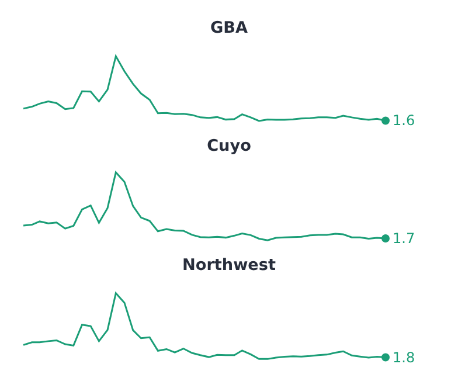

# SparklinePlot

Part of [Plots](../../plots.md).

A small line plot to read a trend at a glance: no axes, no legend, a thin line, and a dot on each series' last point with its value beside it. It is a [`LinePlot`](line.md), so it takes the same data, `segments`, gaps and transforms; with `facet` it draws one sparkline per category, the usual way to use it.

<!-- example: examples/Sparkline.svelte -->

```svelte
<script lang="ts">
	import { SparklinePlot } from '@fundar/data-chart-telling';
	import { REGION_VALUES } from './datasets';
</script>

<!-- One sparkline per region: monthly inflation as a thin line, with its last value beside a dot. -->
<SparklinePlot
	width={360}
	height={300}
	data={REGION_VALUES}
	x="date"
	y="value"
	facet={{ by: 'region', columns: 1, gap: 4 }}
/>
```

<!-- /example -->



- The axes are left out (`scales.x.axisDisplay` and `scales.y.axisDisplay` take `'visible'` back) and so is the legend (`legend: true` shows it). The margins are small; `margins` sets them.
- The last point's value is `styles.values`: `format` writes its text, `show: false` leaves it out, and `select` labels other points (`'first'`, `'min'`, `'max'`).
- The y axis fits the values without reaching for zero; pin `scales.y.domain` to compare sparklines on one scale, or share it across facets with `facet.scales: 'shared'`.
- The line's width and the dot's radius come from `sparkline` in the [configuration](../../theming.md).
- With a `tooltip` or a `hover` marker the sparkline answers the pointer like a line plot does.
