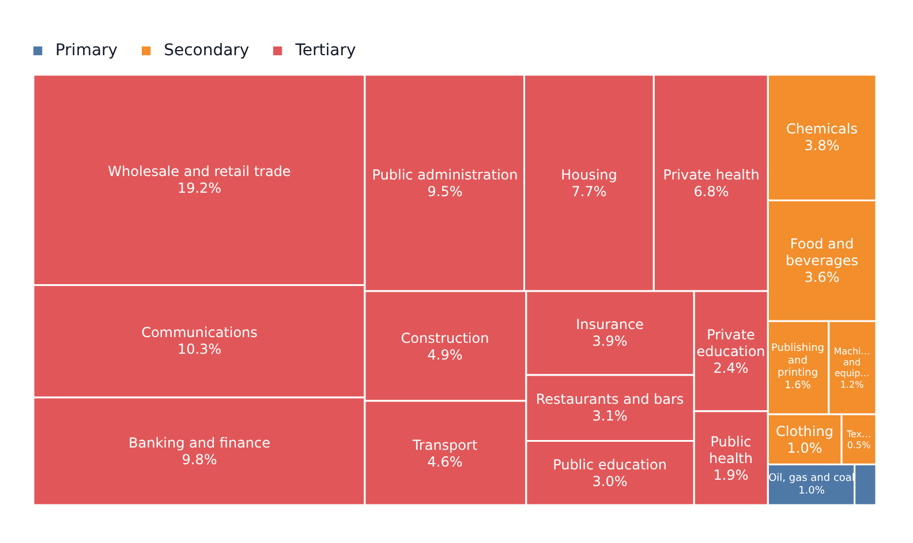

# TreemapPlot

Part of [Plots](../../plots.md).

A part-to-whole made of rectangles: each row is a tile whose **area** is its `value`, and the tiles are nested by `grouping`, so a group's tiles sit together. `value` is the field (or function) giving a tile's size; the last level of `grouping` names it. The plot is the [`treemap` transform](../../transforms-and-statistics.md) drawn as `rect` markers, each with a `label`.

<!-- example: examples/Treemap.svelte -->

```svelte
<script lang="ts">
	import { TreemapPlot } from '@fundar/data-chart-telling';
	import { ACTIVITY_BRANCHES } from './datasets';
</script>

<!-- One tile per branch, sized by its value and colored by its sector. -->
<TreemapPlot
	width={760}
	height={440}
	data={ACTIVITY_BRANCHES}
	value="value"
	grouping="sector.branch"
/>
```

<!-- /example -->



- A row without a positive `value` has no tile.
- `grouping` is the **whole path** of a tile, its fields joined by dots, outermost first: `grouping="sector.kind.branch"` nests the tiles by sector, then by kind, and names each one after its branch. A function is a single level. Rows with the same path are one tile, their values added up, so `grouping="sector"` alone makes three big tiles. The outermost level colors the tiles and is what the [legend](../../legend.md) lists; `scales.color` sets the colors, as in any plot. Without `grouping`, `color` groups the tiles, as it groups the series of any plot. `scales.color.depth` colors deeper levels as tones of their sector's color: `2` a tone per kind, `3` per branch (see [Scales](../../scales.md#color)).
- How a rectangle is split among its tiles is an option of the plot's own `treemap` transform: `transforms={[{ type: 'treemap', tile: 'binary' }]}` sets it over the one the plot builds from `value` and `grouping`. `tile` is `'squarify'` (the default, which keeps them close to squares), `'binary'`, `'slice'`, `'dice'` or `'sliceDice'`.
- Tiles have no axes.

## Labels

Each tile is labelled with its name and its **share of the whole**, in percent, as `styles.values` asks (`decimals`, `prefix`, `suffix`, `signDisplay`; one decimal and a `%` suffix unless you set otherwise, or `numbers.decimals` says). A label is fitted to the tile it is written on:

1. The name over the value, in as many lines as the tile has room for - at a smaller font size first, when that writes the whole name.
2. The name cut short with an ellipsis on its last line, when it still does not fit.
3. The value alone, when almost none of the name would show.
4. Nothing, when not even the value fits.

`styles.values.format(value, number, context)` writes the tile's whole text instead (`value` is the share, in percent; `number` writes it as the display fields ask; `context` holds the tile's `series`, `name`, `path` and `share`), and `styles.values.show: false` leaves the tiles bare. The label's `fontStyle` sets `fontSize` (the biggest it takes), `fontWeight` and `fill`; `treemap` in the [configuration](../../theming.md) sets the lines between tiles, the label color and the room kept around it.

## Style

`styles.area` styles every tile - `fillOpacity`, `stroke`, `strokeWidth`, `strokeDasharray`, `borderRadius` - over the color of its group (a `fill` there wins over it). A group turned off in the [legend](../../legend.md) dims its tiles and their labels. With `disabled: { mode: 'omit' }` its tiles are gone and the rest keep their place and share, and with `{ mode: 'rescale' }` the rest fill the plot as the new whole, each share of what is left.

## Segments

`segments` are keyed by series - the outermost `grouping` level - or `default` for every one, and style a group's tiles together: a highlighted sector against the rest faded, an outlined one, a recolored one. A key can also be the **path** of a tile, its levels joined by dots - `'Tertiary.Finance'`, `'Tertiary.Finance.Insurance'` - and the most specific one wins. A segment sets no `areas`, as a tile has no position on an axis. A named key wins over `default`, and both over `styles.area` (see [Styles and segments](../../styles-and-segments.md)).

```svelte
<!-- Tertiary at some strength, its Finance tiles at full strength and outlined, every other sector faded. -->
<TreemapPlot
	{data}
	value="value"
	grouping="sector.kind.branch"
	segments={{
		default: [{ styles: { fillOpacity: 0.25 } }],
		Tertiary: [{ styles: { fillOpacity: 0.6 } }],
		'Tertiary.Finance': [{ styles: { fillOpacity: 1, stroke: 'gold' } }]
	}}
/>
```

## Hover and tooltip

Hovering a tile matches it alone - an invisible `rect` over each tile drives the plot's hover - and `tooltip` shows its name and share. `tooltip.format(row, number, context)` writes it by hand: `row` is the tile's row, with the fields of every level and its summed `value`, and `context` what the library works out about it - its `series` (the outermost level), its `name`, `path`, summed `value` and `share` of the whole, from 0 to 100 (see [Row context](../../state.md#row-context)). The share is worked out from the values, in whatever unit they are, so a dataset whose `value` is a percentage already reads the same.

A `hover` marker draws no crosshair, dot or label over a treemap, since a tile has no axes and writes its own label: it outlines the hovered tile, in the configuration's `hover.active`. The tiles are linked to the hover, so its `active` and `others` restyle them: the hovered tile lightened and outlined, the rest faded, each label still on its tile and written in the color that reads best on its new one. A tile the legend dims stays hoverable and keeps its dimmed fill; one it hides, omits or rescales away is never hovered. See [Tooltip and hover](../../tooltip-and-hover.md#restyling-the-hovered-shapes).

<!-- example: examples/TreemapHover.svelte -->

```svelte
<script lang="ts">
	import { TreemapPlot } from '@fundar/data-chart-telling';
	import { ACTIVITY_BRANCHES } from './datasets';
</script>

<!--
	The hover marker restyles the tiles themselves: the hovered one at full strength and outlined, every other
	faded. Each label is still written on its tile, in the color that reads best on it.
-->
<TreemapPlot
	width={760}
	height={440}
	data={ACTIVITY_BRANCHES}
	value="value"
	grouping="sector.branch"
	styles={{ area: { fillOpacity: 0.85 } }}
	tooltip
	markers={[
		{
			type: 'hover',
			active: { fillOpacity: 1, stroke: '#111827', strokeWidth: 2 },
			others: { fillOpacity: 0.35 }
		}
	]}
/>
```

<!-- /example -->
