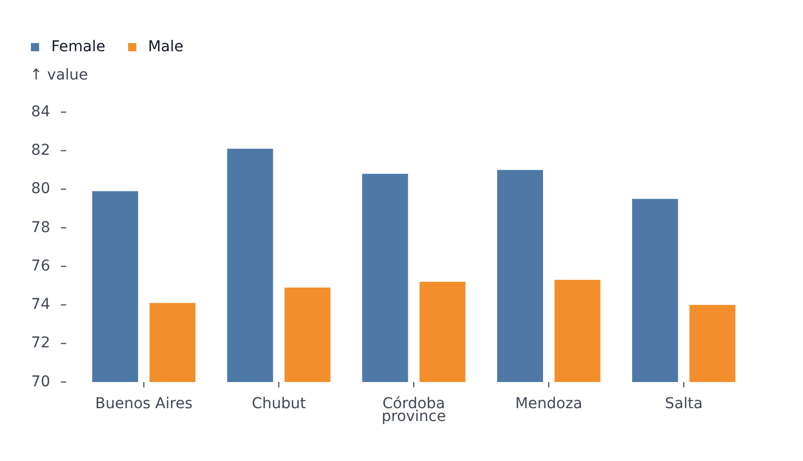
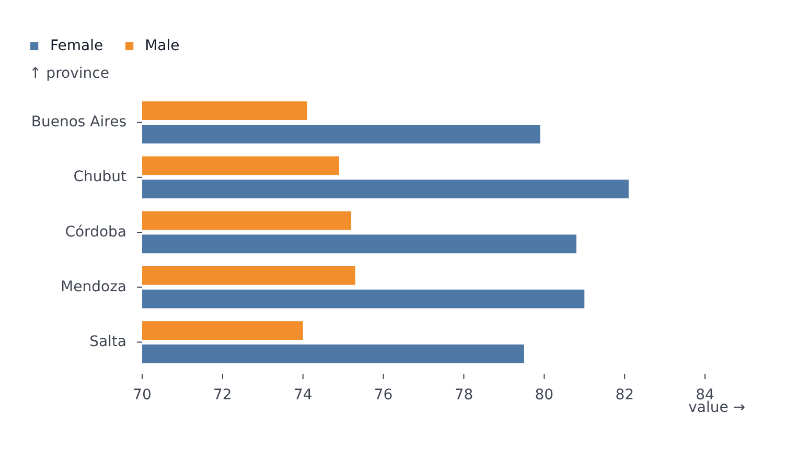

# BarPlot

Part of [Plots](../../plots.md).

Bars where one axis holds the categories and the other the values. Categories on `x` give vertical bars; categories on `y` give horizontal bars.

<!-- example: examples/GroupedBars.svelte -->

```svelte
<script lang="ts">
	import { BarPlot } from '@fundar/data-chart-telling';
	import { PROVINCE_VALUES } from './datasets';
</script>

<!-- Vertical bars, grouped by `color`. -->
<BarPlot
	width={720}
	height={400}
	data={PROVINCE_VALUES}
	x="province"
	y="value"
	color="sex"
	scales={{ y: { domain: [70, 85] } }}
/>
```

<!-- /example -->



<!-- example: examples/HorizontalBars.svelte -->

```svelte
<script lang="ts">
	import { BarPlot } from '@fundar/data-chart-telling';
	import { PROVINCE_VALUES } from './datasets';
</script>

<!-- Horizontal bars: the categories go on `y`, the values on `x`. -->
<BarPlot
	width={720}
	height={400}
	data={PROVINCE_VALUES}
	x="value"
	y="province"
	color="sex"
	scales={{ x: { domain: [70, 85] } }}
/>
```

<!-- /example -->



- Several series sharing a category sit side by side, each in its slice of the category band. The gap between them is `bar.seriesPadding` in the configuration.
- `transforms={[{ type: 'stackY' }]}` stacks the series instead of putting them side by side. The stack runs along the value axis: `stackY` for vertical bars (values on `y`), `stackX` for horizontal ones (values on `x`, categories on `y`). The other one turns the category axis into a numeric one and the bars come out empty.
- `scales.x.paddingInner` / `paddingOuter` set the spacing between category bands.
- `styles.values.show` labels each bar; `styles.values.anchor` places the label (`'outside'`, `'middle'`, `'top'`, `'bottom'`, `'left'`, `'right'`, a corner such as `'top-left'`, or `'tip'` and `'base'`, the ends of the bar away from zero and on it).
- The tooltip triggers anywhere over a bar's whole band, not just over the visible bar.
- A `hover` marker draws the hovered category's band behind its bars (its series' slice, when grouped and the bar alone is hovered), and with `active` and `others` restyles the hovered bars and the rest. See [Tooltip and hover](../../tooltip-and-hover.md#in-plot-hover).
