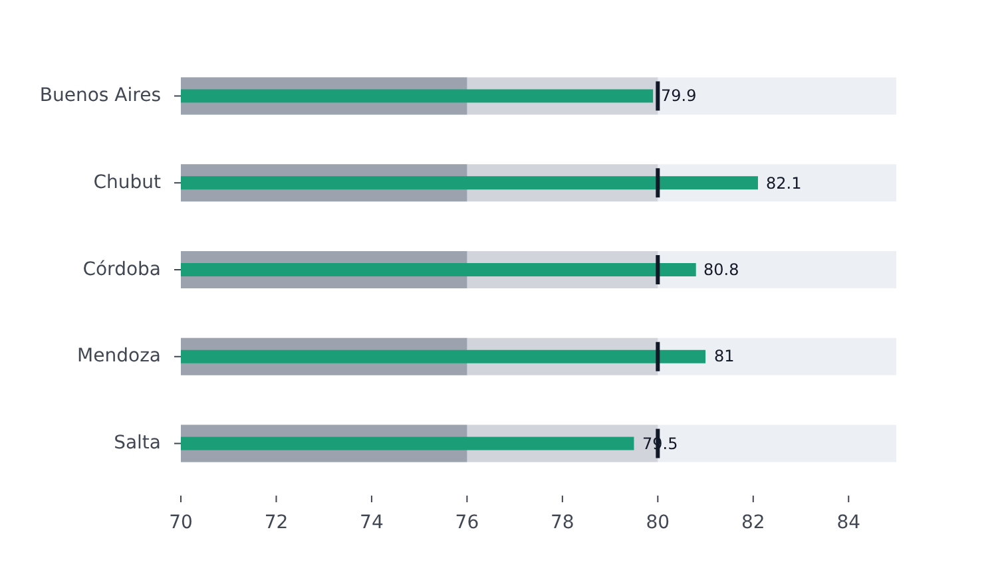

# BulletPlot

Part of [Plots](../../plots.md).

Per category, a bar for its value, a tick for its `target` and bands behind it - the `ranges` - that grade it: a compact way to read a measure against a goal. It is a [`BarPlot`](bar.md) with the references drawn around its bars. Categories on `x` stand the plot upright; on `y` they lie sideways.

<!-- example: examples/Bullet.svelte -->

```svelte
<script lang="ts">
	import { BulletPlot } from '@fundar/data-chart-telling';
	import { PROVINCE_LIFE } from './data';
</script>

<!-- Female life expectancy at birth by province: the bar, against a target of 80 years, over bands for under 76, 76 to 80 and over 80. -->
<BulletPlot
	width={720}
	height={400}
	data={PROVINCE_LIFE}
	x="female"
	y="province"
	target={80}
	ranges={[76, 80, 85]}
	scales={{ x: { domain: [70, 85] } }}
	styles={{ values: { show: true } }}
/>
```

<!-- /example -->



- `target` is a field of the row, a function of it, or a number the same for every category. A row whose target is not a number has no tick.
- `ranges` lists the upper bounds of the bands, each a field, a function or a number, in any order. Each band runs from the baseline to its bound; the smallest is the darkest, and a band is drawn over the larger ones.
- The value axis reaches the bars, the targets and the largest range; pin `scales.x.domain` (or `y`) to start it elsewhere - the bars and bands start at its nearest end.
- The bar is `barThickness` pixels thick, the bands `rangeWidth` in the colors of `rangeColors`, and the target tick is `targetLength` by `targetWidth` pixels, all from `bullet` in the [configuration](../../theming.md). `styles.bar` (`thickness`), `styles.ranges` (`colors`, `width`) and `styles.target` (`color`, `width`, `length`) override the bar, the bands and the tick for one plot.
- It takes what a bar plot takes: `styles.values` writes each value (see [Scales](../../scales.md) for `sort`), `segments` restyle the bars of chosen categories, and the tooltip reads the hovered category. It draws one bar per category: for several series, use `facet`.
