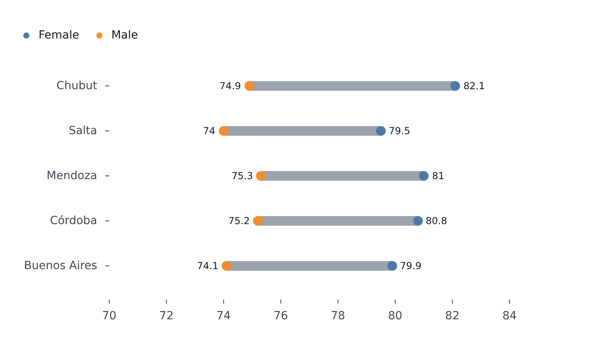

# DumbbellPlot

Part of [Plots](../../plots.md).

Two dots per category, one for each of two series, joined by a connector: the gap between them is what the eye reads, such as a before and an after, or two groups. Categories on `x` stand the rows upright; on `y` they lie sideways. A plot with any other number of series warns and points to [`LollipopPlot`](lollipop.md) (one) or [`ClevelandPlot`](cleveland.md) (any number).

<!-- example: examples/Dumbbell.svelte -->

```svelte
<script lang="ts">
	import { DumbbellPlot } from '@fundar/data-chart-telling';
	import { PROVINCE_VALUES } from './data';
</script>

<!-- Two dots per province, one per sex, joined by a connector: the gap in life expectancy at birth. -->
<DumbbellPlot
	width={720}
	height={400}
	data={PROVINCE_VALUES}
	x="value"
	y="province"
	color="sex"
	scales={{ x: { domain: [70, 85] } }}
	styles={{ values: { show: true } }}
/>
```

<!-- /example -->



- `grouping` (or `color`) names the two series; the legend toggles them like any other.
- The value axis fits the values without reaching for zero; pin `scales.y.domain` to start it at zero.
- Categories keep the order the data gives them; `scales.x.domain` (or `y`) orders them, and `scales.x.sort` orders them by what they hold: `{ by: 'range' }` by the gap between their dots, `{ by: 'value', series }` by one series' value (see [Scales](../../scales.md)).
- `r` sizes the dots by a field (`r="population"`; area follows the value, and the legend gets a size section) or fixes their radius in pixels (`r={8}`).
- The connector is a neutral gray as thick as the dots are wide (`stemWidth: 'dots'`), a band; its default color and width, the dot radius and the padding come from `dumbbell` in the [configuration](../../theming.md). `styles.connector` restyles it per category (see [Connectors](cleveland.md#connectors)). `styles.connector.arrow` draws it as an arrow from one series to the other, pointing the way the value moved.
- `styles.values` writes each value past its dot, away from the other one. A label past the lowest dot can reach the axis labels when that dot sits at the edge of the axis; pin `scales.y.domain` (or `x`) wide enough to leave it room.
- `segments` restyle the dots of chosen categories (`styles: { dots: { dotRadius: 9 } }`, `areas: [{ x: { from: 'Salta', to: 'Salta' } }]`).
- The tooltip reads one category at a time, listing its two values.
