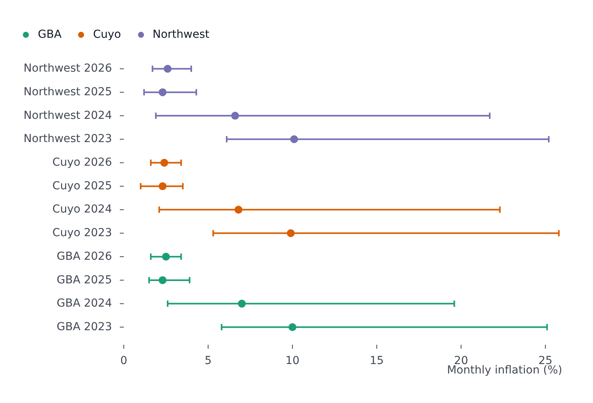

# ForestPlot

Part of [Plots](../../plots.md).

Per row, a dot - an estimate - on a stem that spans its interval: a mean with its range, a coefficient with its confidence interval. Each row gives its interval as `lower` and `upper` fields, or as an `error` that reaches that far either side of its value. Categories on `y` lie sideways, the usual way of a forest plot; on `x` they stand upright. It is a mode of [`ClevelandPlot`](cleveland.md): one row per category, and a plot with several warns and points to [`facet`](../../concepts.md) or `ClevelandPlot`.

<!-- example: examples/Forest.svelte -->

```svelte
<script lang="ts">
	import { ForestPlot } from '@fundar/data-chart-telling';
	import { INFLATION_RANGES } from './data';
</script>

<!-- One row per region and year: the mean monthly inflation as a dot, on a stem from its lowest to its highest month. -->
<ForestPlot
	width={720}
	height={480}
	data={INFLATION_RANGES}
	x="mean"
	y="period"
	lower="min"
	upper="max"
	color="region"
	scales={{ x: { label: 'Monthly inflation (%)' } }}
/>
```

<!-- /example -->



- `lower` and `upper` name the fields of the interval's ends, `error` the half-width of an interval centered on the value. When both are given, `lower` and `upper` win; a row without an interval draws its dot alone, and an interval is widened to hold its value.
- The value axis fits the intervals, not the estimates alone, without reaching for zero; pin `scales.x.domain` (or `y`) to start it at zero.
- Rows keep the order the data gives them; `scales.y.sort` orders them: `{ by: 'value' }` by their estimate, `{ by: 'range' }` by the width of their interval, each across all rows or, with `grouped: true`, within each region (see [Scales](../../scales.md)).
- The stem and its caps - a short tick across each end, on by default - come from `forest` and `connector` in the [configuration](../../theming.md). `styles.connector` restyles them (see [Connectors](cleveland.md#connectors)); `styles.connector.caps` is `false` to leave the stems open, or `{ length }` in pixels.
- A reference line, such as the line of no effect, is a `rule` marker: `markers={[{ type: 'rule', axis: 'x', value: 0 }]}`.
- `styles.values` writes each estimate beside its dot.
- `segments` restyle the stems and dots of chosen rows.
- The tooltip reads the hovered row.
