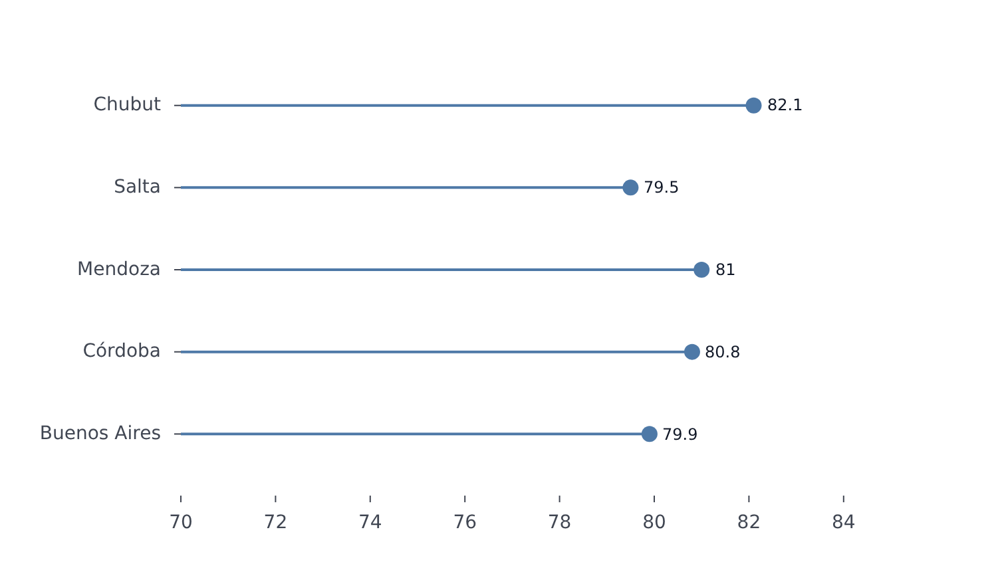

# LollipopPlot

Part of [Plots](../../plots.md).

One value per category, drawn as a dot on a thin stem that rises from the baseline: a lighter alternative to bars when there are many categories. String values on `x` stand the lollipops upright; on `y` they lie sideways.

<!-- example: examples/Lollipop.svelte -->

```svelte
<script lang="ts">
	import { LollipopPlot } from '@fundar/data-chart-telling';
	import { PROVINCE_VALUES } from './datasets';

	const female = PROVINCE_VALUES.filter((row) => row.sex === 'female');
</script>

<!-- One dot on a stem per province: female life expectancy at birth, with its value beside it. -->
<LollipopPlot
	width={720}
	height={400}
	data={female}
	x="value"
	y="province"
	scales={{ x: { domain: [70, 85] } }}
	styles={{ values: { show: true } }}
/>
```

<!-- /example -->



- `grouping` (or `color`) draws one set of lollipops per group, as long as each category has a value in only one of them - coloring by the category field itself is the usual case. A category with values in several groups warns: that is a [`DumbbellPlot`](dumbbell.md) (two) or a [`ClevelandPlot`](cleveland.md) (any number).
- Categories keep the order the data gives them; `scales.x.domain` (or `y`) orders them, and `scales.x.sort` orders them by what they hold: `{ by: 'range' }` by the gap between their dots, `{ by: 'value', series }` by one series' value (see [Scales](../../scales.md)).
- The value axis reaches zero, where the stems start; pinning `scales.y.domain` moves the baseline to the nearest end of it, and a negative value hangs below zero.
- `scales.x.paddingInner` / `paddingOuter` set the room around each lollipop; the defaults, with the dot radius and the stem width (a thin 2 px line), come from `lollipop` in the [configuration](../../theming.md).
- `styles.values` writes each value just past its dot.
- `segments` restyle whole categories: `styles: { stroke: {...}, dots: {...} }` restyle their stems and dots (`areas: [{ x: { from: 'Salta', to: 'Salta' } }]`).
- The tooltip reads one lollipop at a time, along the category axis.
