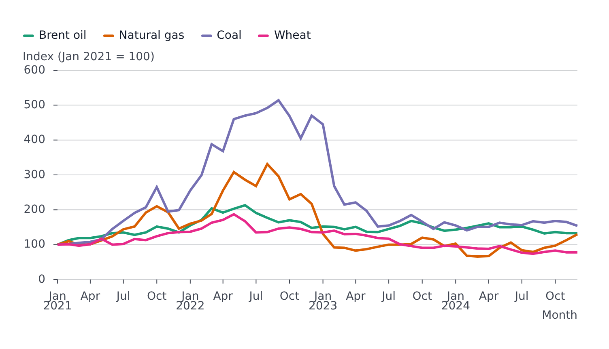

# Scales

`scales` configures how data values become positions and visual properties. It has one entry per channel.

<!-- example: examples/Scales.svelte -->

```svelte
<script lang="ts">
	import { LinePlot } from '@fundar/data-chart-telling';
	import { PRICES } from './data';
</script>

<!-- Axis labels, a fixed domain with gridlines and a color per series. -->
<LinePlot
	width={720}
	height={400}
	data={PRICES}
	x="date"
	y="index"
	color="commodity"
	scales={{
		x: { label: 'Month' },
		y: { label: 'Index (Jan 2021 = 100)', domain: [0, 600], grid: true },
		color: {
			scheme: {
				'Brent oil': '#1b9e77',
				'Natural gas': '#d95f02',
				Coal: '#7570b3',
				Wheat: '#e7298a'
			}
		}
	}}
/>
```

<!-- /example -->



## Axes: `x` and `y`

Each axis takes an `AxisScale`.

| Field                                                                        | Meaning                                                                                                                                                                                                                                                                                                                                                                                         |
| ---------------------------------------------------------------------------- | ----------------------------------------------------------------------------------------------------------------------------------------------------------------------------------------------------------------------------------------------------------------------------------------------------------------------------------------------------------------------------------------------- |
| `type`                                                                       | `'auto'` (default), `'linear'`, `'pow'`, `'sqrt'`, `'log'`, `'symlog'`, `'time'`, `'utc'`, `'band'`, `'point'`, `'ordinal'`, `'categorical'` and the color-oriented types (`'sequential'`, `'diverging'`, `'threshold'`, ...)                                                                                                                                                                   |
| `domain`, `range`                                                            | Explicit input and output extent                                                                                                                                                                                                                                                                                                                                                                |
| `reverse`, `nice`, `zero`, `clamp`, `round`, `percent`                       | Direction, rounding and baseline behaviour                                                                                                                                                                                                                                                                                                                                                      |
| `niceTolerance`                                                              | How far past a tick, as a share of the step, a domain the plot nices itself still ends on it (default `0.05`), so parts adding up to `100.2` stay at `100`. Applies to stacked and ranged axes, axes grown to cover markers or a transform's output, a bar plot's value axis and shared facet/timeline domains; `0` rounds like d3                                                              |
| `edgeTicks`                                                                  | Ticks at the data's first and last values beside the nice ones. `false` turns them off, `true` on, `{ collision: 'drop-nice' \| 'drop-edge' \| 'extend' }` picks what happens when one crowds a nice tick. Defaults to `axis.edgeTicks.x` / `.y` in the [configuration](theming.md#edge-ticks) (on for x, off for y); ignored when the axis sets `ticks`, `tickSpacing`, `interval` or `domain` |
| `label`, `labelAnchor`, `labelOrientation`, `labelPosition`, `titleFontSize` | The axis title (`label: false` hides it)                                                                                                                                                                                                                                                                                                                                                        |
| `ticks`, `tickSpacing`, `tickSize`, `tickPadding`, `tickRotate`              | Tick placement and size                                                                                                                                                                                                                                                                                                                                                                         |
| `tickFormat`                                                                 | `false`, an `Intl.NumberFormatOptions` / `Intl.DateTimeFormatOptions` object, or `(d, index, ticks) => string`                                                                                                                                                                                                                                                                                  |
| `grid`                                                                       | `true` or a stroke style for gridlines                                                                                                                                                                                                                                                                                                                                                          |
| `axisDisplay`                                                                | `'visible'` (default), `'hidden'` (keeps the space, so aligned panels stay aligned) or `'none'`                                                                                                                                                                                                                                                                                                 |
| `padding`, `paddingInner`, `paddingOuter`, `align`                           | Band and point spacing                                                                                                                                                                                                                                                                                                                                                                          |
| `insetLeft`, `insetRight`, `insetTop`, `insetBottom`                         | Pixels kept free at each end                                                                                                                                                                                                                                                                                                                                                                    |
| `interval`, `base`, `constant`, `sort`                                       | Time/discrete intervals, log base, symlog constant, category order                                                                                                                                                                                                                                                                                                                              |

Number and date text defaults follow `axis.locale` and `axis.compactDisplay` in the [configuration](theming.md#locale).

## Color

`scales.color` configures the `color` channel (and a choropleth on a map).

| Field         | Meaning                                                                                                                                                                                        |
| ------------- | ---------------------------------------------------------------------------------------------------------------------------------------------------------------------------------------------- |
| `domain`      | `[min, max]` for a continuous value, or the list of categories                                                                                                                                 |
| `scheme`      | A named [d3-scale-chromatic](https://d3js.org/d3-scale-chromatic) ramp (`'turbo'`, `'blues'`, `'rdylbu'`, case-insensitive), two or more colors to interpolate, or a `Record<category, color>` |
| `schemeRange` | The part of a named `scheme` to use, as `[from, to]` fractions of it (default `[0, 1]`): `[0.3, 1]` skips the near-white start of a ramp like `'blues'`                                        |
| `pivot`       | Splits an array `scheme` into two halves meeting at this value (a diverging ramp)                                                                                                              |
| `unknown`     | Color of a value outside the mapping (default `#ccc`)                                                                                                                                          |

A continuous ramp is set with `scheme: [colorA, colorB]`. Categorical colors come from the configuration's `palette` unless `scheme` is a category-to-color record. Series that follow one another (years, say) read better on a named sequential ramp, which is sampled across the series in order: `scheme: 'blues', schemeRange: [0.3, 1]`.

A marker can carry its own `scales.color`, independent of the plot's, so two ramps can coexist in one plot.

## Grouping

`scales.grouping.reverse` flips which group sorts first, such as which side of a [pyramid](plots.md#pyramidplot) a series sits on.

## Opacity

`scales.opacity` maps a value to an opacity: `domain` (`[min, max]` or categories), `range` (`[minOpacity, maxOpacity]` or a category-to-opacity record), `unknown`.

## Symbol

`scales.symbol` maps categories to shapes: `domain`, `range` (a list of `SymbolType` cycled in order, or a record), `unknown`. The default shape cycle is `symbols` in the configuration.

## Radius and length

`scales.r` (dot radius) and `scales.length` (vector length) take `domain: [min, max]` and `range: [minPx, maxPx]`. The radius scale is a square-root scale, so a dot's area follows its value; hand it raw values, not pre-scaled radii.

## Shared and free scales

[Facets](facets.md) and [timelines](timeline.md) share scales across panels or steps by default so panels stay comparable; each has an option to refit per panel or step.
