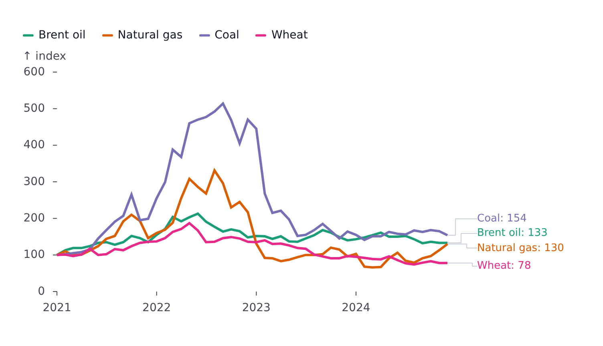
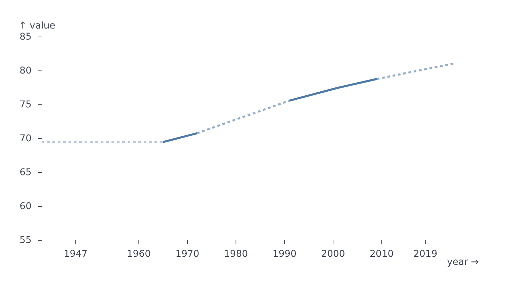
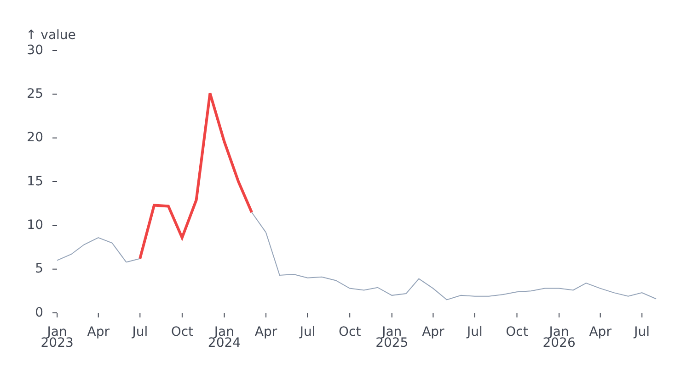
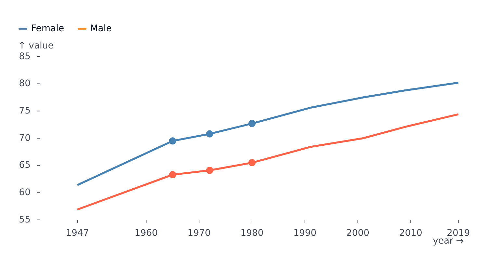
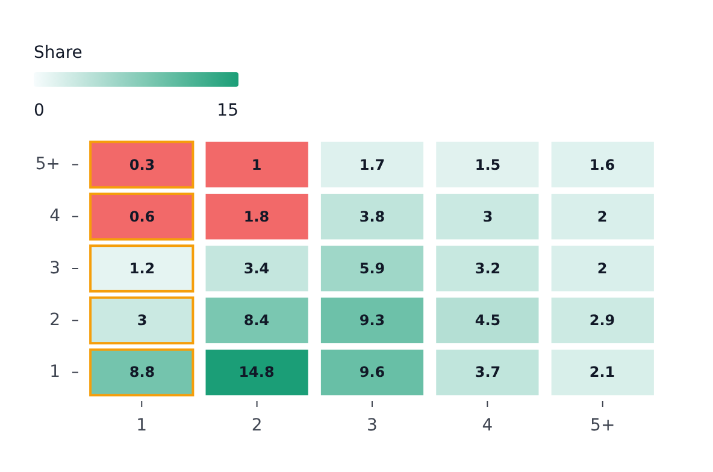
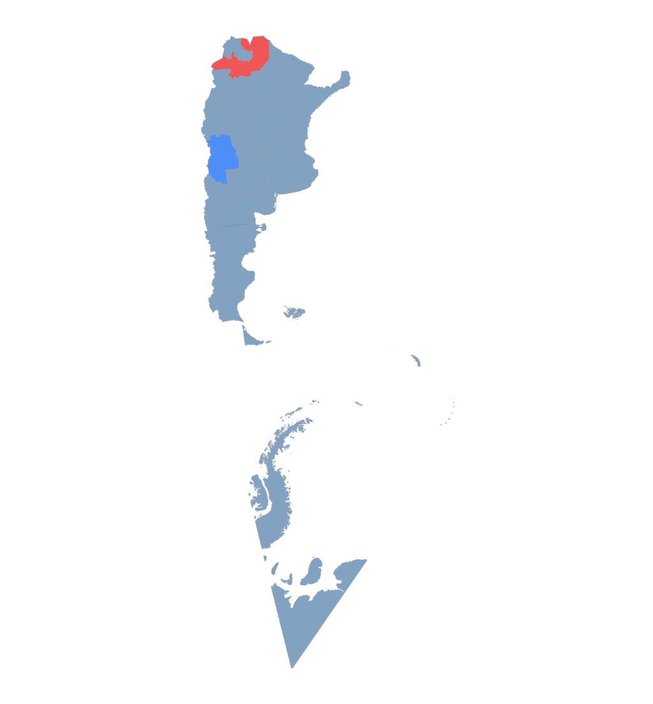

# Styles and segments

`styles` sets plot-wide options; `segments` restyles ranges of the data.

## Styles

`styles` is typed per plot kind, with these fields on the axis-based plots:

| Field    | Plots                                | Purpose                       |
| -------- | ------------------------------------ | ----------------------------- |
| `values` | all axis-based plots                 | Value labels on the marks     |
| `frame`  | all plots                            | A border around the plot area |
| `gaps`   | `LinePlot`, `BarPlot`, `PyramidPlot` | Bridges over missing values   |

`GeoPlot` has its own `styles` (base fill and stroke, tile layer, click handler) - see [Maps](geo.md).

### Value labels

<!-- example: examples/ValueLabels.svelte -->

```svelte
<script lang="ts">
	import { LinePlot } from '@fundar/data-chart-telling';
	import { PRICES } from './datasets';
</script>

<!-- End-of-line value labels with a custom format and font size. -->
<LinePlot
	width={720}
	height={400}
	data={PRICES}
	x="date"
	y="index"
	color="commodity"
	styles={{
		values: {
			show: true,
			format: (value, seriesName) => `${seriesName}: ${value.toFixed(0)}`,
			fontStyle: { fontSize: 13 }
		}
	}}
/>
```

<!-- /example -->



| Field          | Meaning                                                                                                                                                                                                                   |
| -------------- | ------------------------------------------------------------------------------------------------------------------------------------------------------------------------------------------------------------------------- |
| `show`         | Draws the labels. Off by default, except on a heatmap                                                                                                                                                                     |
| `anchor`       | `'outside'`, `'start'`, `'middle'`, `'end'` - where a label sits on its mark                                                                                                                                              |
| `select`       | Which row of each group is labelled: `'first'`, `'last'`, `'min'`, `'max'`, or a list of them. A group is a series on a line or area plot (default `'last'`), a category on the plots that join dots (default: every dot) |
| `series`       | Labels only these series, by name                                                                                                                                                                                         |
| `color`        | `'series'` writes each label in its series' color; any other CSS color writes them all in it (`fontStyle.fill` wins)                                                                                                      |
| `format`       | `(value, seriesName, row) => string`; `row` is the labelled row, for its other fields                                                                                                                                     |
| `hoverIsolate` | Hovering a label dims every other series                                                                                                                                                                                  |
| `fontStyle`    | Text style: `fontSize`, `fill`, `dx`, `dy`, `textAnchor`, `lineAnchor`, `rotate`, `class`, ... Overrides the anchor's placement field by field                                                                            |
| `strokeStyle`  | Style of the connector lines drawn from labels that had to move apart                                                                                                                                                     |

Where the labels go depends on the plot: the end of each series on a line or area plot, one per bar on a bar, pyramid or histogram, one per point on a scatter, one per cell on a heatmap. On lines, overlapping labels spread apart, share one column and are joined to their points by elbow connectors; the right margin grows to fit them when it is `'auto'`. The spread is tuned by `text.declutter` in the [configuration](theming.md).

### Frame

`styles={{ frame: true }}` draws a border around the plot area; an object restyles it (`stroke`, `fill`, `inset`, `insetTop`, ...).

### Gaps

A row whose value is `null`, `undefined` or `NaN` breaks a line. `styles.gaps` bridges the break with a distinct, interpolated stretch. It is keyed by series name, or `'default'` for the series with no entry of their own, and has three zones: `start` (before the first real point), `middle` and `end` (after the last).

<!-- example: examples/Gaps.svelte -->

```svelte
<script lang="ts">
	import { LinePlot } from '@fundar/data-chart-telling';
	import { FEMALE_LIFE_GAPS } from './datasets';
</script>

<!-- Missing values bridged: dashed in the middle, faded at the start, extended to the 2025 projection at the end. -->
<LinePlot
	width={720}
	height={400}
	series={[{ name: 'female', x: 'year', y: 'value', data: FEMALE_LIFE_GAPS }]}
	scales={{ x: { edgeTicks: true }, y: { domain: [55, 85] } }}
	styles={{
		gaps: {
			default: {
				middle: { interpolate: 'linear', style: { stroke: { strokeDasharray: '4 4' } } },
				start: { x: 1940, style: { stroke: { strokeOpacity: 0.4 } } },
				end: { x: 2025, y: 81.1 }
			}
		}
	}}
/>
```

<!-- /example -->



- `middle` bridges holes between real points, `interpolate` is an easing name (default `'linear'`).
- `start` and `end` reach out to the given `x` (required to fill the zone), landing on `y` there (default: the nearest real value).
- On bar plots only the presence of `x` matters.
- Unset styles fall back to `line.gap`, `bar.gap` and `pyramid.gap` in the [configuration](theming.md).

## Segments

`segments` separates data ranges from their styling. It is an object: each key is a series name (a feature id for `GeoPlot`), or `'default'`, mapped to a list of segments.

```ts
type SegmentsConfig<TStyle> = Record<string, Segment<TStyle>[]>;
type Segment<TStyle> = { areas?: Area[]; styles?: TStyle; scales?: ...; legend?: MarkLegend };
type Area = { x?: Range; y?: Range };
type Range = { from?: AxisValue; to?: AxisValue }; // inclusive on both ends
```

- A segment applies to a data point (or heatmap cell) inside **any** of its `areas`.
- An `Area` limits by `x`, `y` or both; leaving one out leaves that axis open.
- A segment without `areas` is a **catch-all**: it matches every point, is evaluated last, and is overridden by any area-specific segment. A catch-all placed first is a baseline that highlighted ranges override.
- `'default'` applies to every series; a named key applies to that series only, and wins over `'default'` where both match.
- `legend` names the segment on the automatic [legend](legend.md).
- `facet` limits the segment to the [facet panels](facets.md#markers-and-segments-in-some-panels) it names - a `by` value or a list of them. Without it the segment applies to every panel.

The style shape depends on the plot:

| Plot                        | Style type                         | Fields                                         |
| --------------------------- | ---------------------------------- | ---------------------------------------------- |
| `LinePlot`                  | `LineSegmentStyle`                 | `stroke` (line style), `dots` (dot style)      |
| `AreaPlot`, `HistogramPlot` | `AreaStyle`                        | `fill`, `fillOpacity`, `stroke`, ...           |
| `BarPlot`, `PyramidPlot`    | `BarSegmentStyle` (`AreaStyle`)    | `fill`, `fillOpacity`, `stroke`, ...           |
| `HeatmapPlot`               | `CellSegmentStyle` (`AreaStyle`)   | `fill`, `fillOpacity`, `stroke`, `strokeWidth` |
| `ScatterPlot`               | `ScatterSegmentStyle` (`DotStyle`) | dot fill, stroke, radius, symbol               |
| `GeoPlot`                   | `GeoSegmentStyle`                  | `fill`, `fillOpacity`, `stroke`, `strokeWidth` |

### Examples

A baseline color with a highlighted range:

<!-- example: examples/SegmentHighlight.svelte -->

```svelte
<script lang="ts">
	import { LinePlot } from '@fundar/data-chart-telling';
	import { REGION_VALUES } from './datasets';

	const gba = REGION_VALUES.filter((row) => row.region === 'GBA');
</script>

<!-- A grey line with the 2023-2024 surge drawn in red. -->
<LinePlot
	width={720}
	height={380}
	series={[{ name: 'GBA', x: 'date', y: 'value', data: gba }]}
	segments={{
		GBA: [
			{ styles: { stroke: { stroke: '#94a3b8', strokeWidth: 1 } } },
			{
				areas: [{ x: { from: new Date('2023-07-01'), to: new Date('2024-03-01') } }],
				styles: { stroke: { stroke: '#ef4444', strokeWidth: 3 } }
			}
		]
	}}
/>
```

<!-- /example -->



Per-series colors, plus dots over a range shared by every series:

<!-- example: examples/SegmentsBySeries.svelte -->

```svelte
<script lang="ts">
	import { LinePlot } from '@fundar/data-chart-telling';
	import { LIFE } from './datasets';
</script>

<!-- Segments per series name, plus `default` for rules shared by every series. -->
<LinePlot
	width={720}
	height={380}
	data={LIFE}
	x="year"
	y="value"
	color="sex"
	scales={{ x: { edgeTicks: true } }}
	segments={{
		female: [{ styles: { stroke: { stroke: 'steelblue' } } }],
		male: [{ styles: { stroke: { stroke: 'tomato' } } }],
		default: [
			{
				areas: [{ x: { from: 1965, to: 1980 } }],
				styles: { dots: { dotRadius: 5, dotSymbol: 'circle' } }
			}
		]
	}}
/>
```

<!-- /example -->



Two areas in one segment, the second with a `y` limit:

```ts
{
	areas: [
		{ x: { from: 2010, to: 2012 } },
		{ x: { from: 2015, to: 2020 }, y: { from: 83.5, to: 84 } }
	],
	styles: { stroke: { strokeDasharray: '6 4' } }
}
```

Heatmap columns and cells:

<!-- example: examples/HeatmapSegments.svelte -->

```svelte
<script lang="ts">
	import { HeatmapPlot } from '@fundar/data-chart-telling';
	import { PENGUIN_COUNTS } from './datasets';
</script>

<!-- Segments on a heatmap: an outlined column and a filled block of cells. -->
<HeatmapPlot
	width={560}
	height={360}
	data={PENGUIN_COUNTS}
	x="island"
	y="species"
	color="count"
	segments={{
		default: [
			{
				areas: [{ x: { from: 'Biscoe', to: 'Biscoe' } }],
				styles: { stroke: '#f59e0b', strokeWidth: 2 }
			},
			{
				areas: [{ x: { from: 'Dream', to: 'Torgersen' }, y: { from: 'Chinstrap', to: 'Gentoo' } }],
				styles: { fill: '#ef4444', fillOpacity: 0.8 }
			}
		]
	}}
/>
```

<!-- /example -->



Map features, keyed by feature id:

```svelte
<GeoPlot
	{width}
	{height}
	data={provinces}
	featureId={(f) => String(f.properties?.nombre)}
	segments={{
		default: [{ styles: { fillOpacity: 0.7, stroke: '#94a3b8' } }],
		Mendoza: [{ styles: { fill: '#3b82f6', fillOpacity: 0.9 } }],
		Salta: [{ styles: { fill: '#ef4444', fillOpacity: 0.9 } }]
	}}
/>
```



A segment typed with `satisfies SegmentsConfig<LineSegmentStyle>` gets completion for its style fields.
