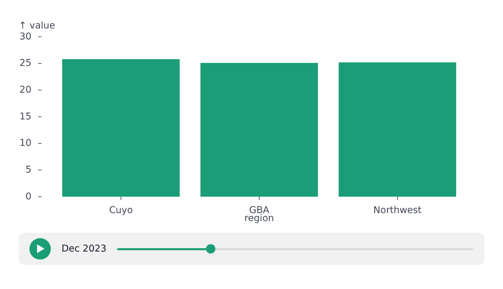
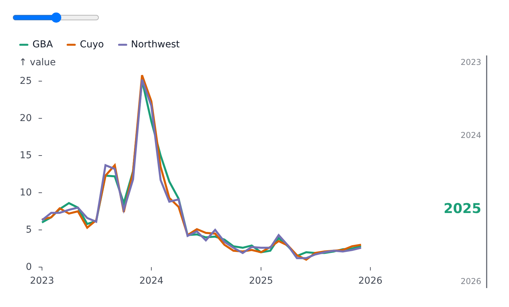

# Timeline

`timeline` steps a plot through its data by a field - usually a year or a date. Each step shows the rows of one value of that field. It draws as a **player** by default - a control bar with play, pause and a slider - or as a **rule**, a guide beside the plot that the page drives (`type: 'rule'`).

<!-- example: examples/TimelinePlayer.svelte -->

```svelte
<script lang="ts">
	import { BarPlot } from '@fundar/data-chart-telling';
	import { REGION_VALUES } from './data';
</script>

<!--
	`timeline` slices the rows by `accessor`. A timeline is a player by default:
	play/pause, the current step and a slider in the chrome. `progress` sets where
	it starts. `type: 'rule'` draws a guide beside the plot with no controls
	instead (see TimelineRule). To build your own widget, read
	`useFigure().timeline` (seek, play, pause, next, ...).
-->
<BarPlot
	width={720}
	height={400}
	data={REGION_VALUES}
	x="region"
	y="value"
	scales={{ y: { domain: [0, 30] } }}
	timeline={{ accessor: 'date', progress: 0.25, player: { autoplay: false, loop: true } }}
/>
```

<!-- /example -->



## Options

| Option                             | Meaning                                                                                                                                                                                                                                                                         |
| ---------------------------------- | ------------------------------------------------------------------------------------------------------------------------------------------------------------------------------------------------------------------------------------------------------------------------------- |
| `accessor`                         | Field (or function) giving each row's step - required. A number (a year, a count), a `Date`, or a date string: ISO (`'2023'`, `'2023-05'`, `'2023-05-17'`, with or without a time), or any other read through `dateFormat`. A row whose value reads as none shows at every step |
| `dateFormat`                       | How a date string that is not ISO reads: the tokens `YYYY`, `MM`, `DD`, `HH`, `mm`, `ss`, anything else literal (`'DD/MM/YYYY'`, `'MM-YYYY'`). A part it leaves out is the first: January, the 1st, midnight                                                                    |
| `type`                             | `'player'` (default) draws a control bar in the chrome; `'rule'` draws a guide with the steps written along it                                                                                                                                                                  |
| `progress`                         | The position, `0`-`1`. A player keeps its own position from there on, until `progress` changes                                                                                                                                                                                  |
| `values`                           | The steps, when not every distinct value of `accessor` - read like `accessor`'s values                                                                                                                                                                                          |
| `filterMode`                       | `'exact'` shows the rows of the current step; `'upTo'` shows every row up to it (a cumulative reveal). `LinePlot` defaults to `'upTo'`                                                                                                                                          |
| `interpolate`                      | Tween values between steps so a scrub is smooth: `true`, or `{ key, value, create, progressEasing, segmentEasing }`. Line and bar plots default to interpolating their value channel                                                                                            |
| `scales`                           | `'shared'` (default): axes span every step, so they hold still while scrubbing; `'free'` refits them to each step                                                                                                                                                               |
| `onprogress`, `onvalue`            | Called with the new position (`0`-`1`) and with the step it lands on - a `Date` on a timeline of dates, else the number                                                                                                                                                         |
| `orientation`, `show`, `thickness` | A rule's direction (`'vertical'` default, beside the plot; `'horizontal'`), visibility and size                                                                                                                                                                                 |

## Player

The player is a bar in the chrome, below the plot by default, placed like any other [chrome block](chrome.md) through `order` (`'timeline'`, or a row such as `'(plot, timeline)'`).

```svelte
<LinePlot
	...
	timeline={{
		accessor: 'year',
		player: {
			controls: ['play', 'value', 'slider', 'speed', 'loop'],
			autoplay: true,
			loop: true,
			speed: 1,
			speeds: [0.5, 1, 2],
			stepDuration: 800,
			format: (year) => `Year ${year}`
		}
	}}
/>
```

| `player` option               | Meaning                                                                                                                                                                                                                                                    |
| ----------------------------- | ---------------------------------------------------------------------------------------------------------------------------------------------------------------------------------------------------------------------------------------------------------- |
| `controls`                    | The controls drawn, in this order: `'play'`, `'value'`, `'slider'`, `'speed'`, `'loop'`                                                                                                                                                                    |
| `autoplay`                    | Start playing as soon as there are steps                                                                                                                                                                                                                   |
| `loop`, `speed`               | Where the player starts; it keeps them from there and tells `onloop` / `onspeed` on change                                                                                                                                                                 |
| `speeds`                      | Speeds the speed control cycles through                                                                                                                                                                                                                    |
| `stepDuration`                | Milliseconds per step at speed `1`                                                                                                                                                                                                                         |
| `format`                      | How a step reads, in the `'value'` control and along a rule. It gets a `Date` on a timeline of dates, else the number. Defaults to the step itself; dates read as dates, as precise as the steps need (`2023`, `ene 2023`, `17 ene 2023`) in `axis.locale` |
| `onplay`, `onspeed`, `onloop` | Change callbacks                                                                                                                                                                                                                                           |

Defaults for `controls`, `speeds` and `stepDuration` come from `timeline.player` in the [configuration](theming.md), together with the bar's colors and sizes.

## Rule

`type: 'rule'` draws a line with its steps written along it, beside the plot. `progress` picks the step, and the page supplies the control (a slider, a button, scroll position):

<!-- example: examples/TimelineRule.svelte -->

```svelte
<script lang="ts">
	import { LinePlot } from '@fundar/data-chart-telling';
	import { REGION_VALUES } from './data';

	// A rule has no controls of its own: the page moves it through `progress` (0 to 1).
	// One step per year; a line plot shows every row up to the current step.
	let progress = $state(0.5);
</script>

<input type="range" min="0" max="1" step="0.001" bind:value={progress} />
<LinePlot
	width={720}
	height={400}
	data={REGION_VALUES}
	x="date"
	y="value"
	color="region"
	timeline={{ accessor: (row) => row.date.getUTCFullYear(), type: 'rule', progress }}
/>
```

<!-- /example -->



A rule's look comes from `timeline.rule` in the [configuration](theming.md) (`fontSize`, `activeFontSize`, `axisWidth`, ...) and `--dct-timeline-*` variables.

## Custom controls

`useFigure().timeline` exposes the timeline's state and actions, to build a widget of your own in place of the player: `steps`, `value`, `index`, `progress`, `playing`, `loop`, `speed`, `speeds`, and `seek`, `seekIndex`, `seekValue`, `next`, `previous`, `play`, `pause`, `toggle`, `setLoop`, `setSpeed`, `cycleSpeed`. On a timeline of dates, `steps` and `value` are `Date`s and `seekValue` takes a `Date` or a date string. See [Reading plot state](state.md).

## One timeline for several plots

A [`PlotComposer`](composer.md) with its own `timeline` drives every panel from one control; plots inside it with a `timeline` follow its `progress`.

## Maps

`GeoPlot` slices both its features (reading a field from each feature's `properties`) and its markers' rows; features or rows without the field are drawn in every step.
