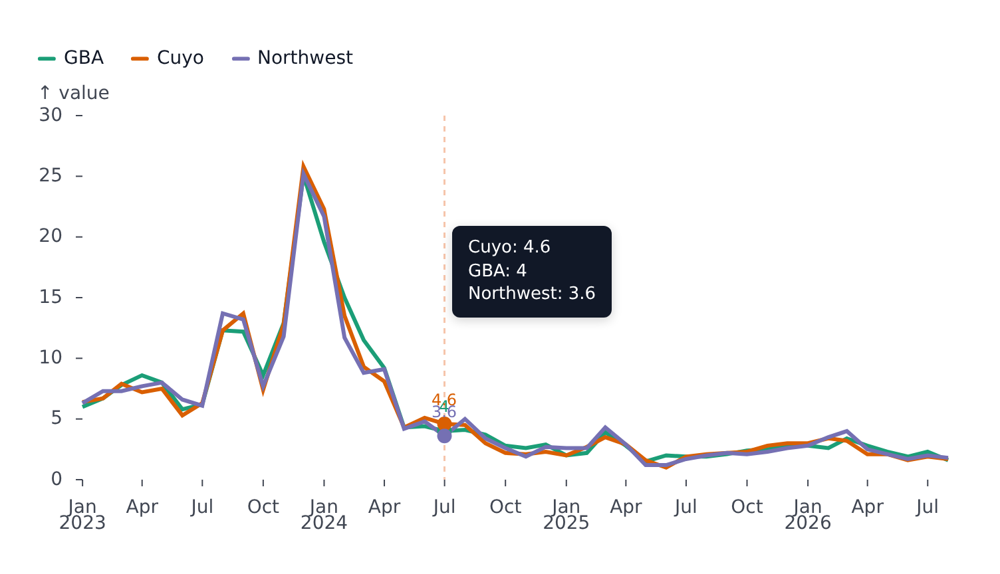
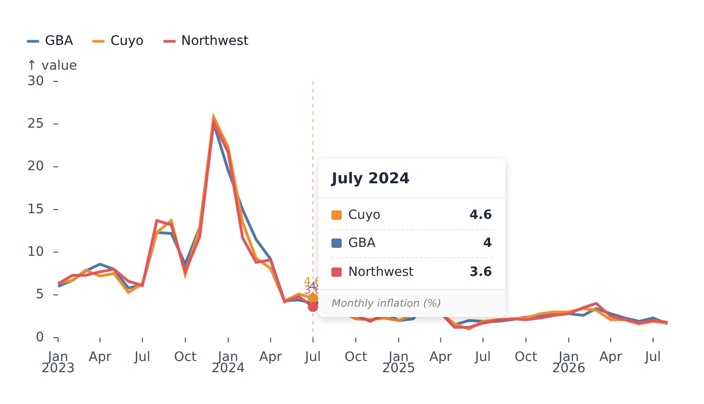

# Tooltip and hover

A plot becomes interactive when it is given a `tooltip`, a `{ type: 'hover' }` marker, or both. Hover is shared by every plot in a figure, so it can drive the other panels of a [facet](facets.md) or [composer](composer.md).

## Tooltip

<!-- example: examples/Tooltip.svelte -->

```svelte
<script lang="ts">
	import { LinePlot } from '@fundar/data-chart-telling';
	import { REGION_VALUES } from './datasets';
</script>

<!--
	`tooltip` turns the floating box on (`true` for the defaults, or an object
	to tune it); a `hover` marker draws the in-plot crosshair, dot and label.
-->
<LinePlot
	width={720}
	height={400}
	data={REGION_VALUES}
	x="date"
	y="value"
	color="region"
	tooltip={{ strategy: 'x', format: (row) => `${row.region}: ${row.value}` }}
	markers={[{ type: 'hover' }]}
/>
```

<!-- /example -->



`tooltip` is `true` for the defaults, or an options object:

| Option               | Meaning                                                                                                                                                                                                                                                                                                                                                            |
| -------------------- | ------------------------------------------------------------------------------------------------------------------------------------------------------------------------------------------------------------------------------------------------------------------------------------------------------------------------------------------------------------------ |
| `strategy`           | How related points are found: `'x'`, `'y'`, `'punctual'` (the exact point) or `'series'` (all points of the hovered series). Defaults per plot kind                                                                                                                                                                                                                |
| `sync`               | Show the highlight in every synced plot too (default `false`)                                                                                                                                                                                                                                                                                                      |
| `format`             | `(row) => string` - the tooltip text for the hovered row (`\n` breaks lines). With several rows, they read from the highest value to the lowest (a stacked row by its own value)                                                                                                                                                                                   |
| `content`            | A snippet `{#snippet content({ rows })}` replacing the text with custom markup. It gets the rows as the hover matched them, unsorted, each one your row plus a `seriesColor`: the one the plot draws it in (the series color, from `scales.color` or the palette). It is drawn in a plain card, so the markup brings its own order, background, colors and spacing |
| `series`             | Only these series appear in the tooltip                                                                                                                                                                                                                                                                                                                            |
| `anchorX`, `anchorY` | Preferred side of the cursor: `'left' \| 'middle' \| 'right'` (default `'right'`) and `'top' \| 'middle' \| 'bottom'` (default `'bottom'`). It moves to the other side when it would overflow                                                                                                                                                                      |

`decimals`, `prefix`, `suffix` and `signDisplay` ([Number format](theming.md#number-format)) write the value the default text shows - the one on the value axis, the `x` of horizontal bars - and a heatmap's color value. A custom `format` gets a second argument, `number`, that writes a number the same way: `format: (row, number) => `${row.region}: ${number(row.value)}``. Its third, `context`, is what the plot knows of the row: the `series`it is drawn in, its`x`, `y`and`value`, and what its kind works out - a [treemap](plots/part-of-a-whole/treemap.md)'s `share`, a histogram's bin edges, a box's quartiles (see [Row context](state.md#row-context)).

<!-- example: examples/CustomTooltip.svelte -->

```svelte
<script lang="ts">
	import { LinePlot, getConfiguration, paletteColor } from '@fundar/data-chart-telling';
	import TooltipCard from './TooltipCard.svelte';
	import { REGION_VALUES, type RegionRow } from './datasets';

	const { palette } = getConfiguration();
	const regions = [...new Set(REGION_VALUES.map((row) => row.region))];
</script>

<!--
	`content` replaces the tooltip text with your own markup, drawn in a plain
	card: TooltipCard brings its own background, colors and spacing. It is given
	every row the hover matched, in no particular order, so it sorts them itself;
	series colors come from the configuration's palette.
-->
{#snippet content({ rows }: { rows: RegionRow[] })}
	<TooltipCard
		heading={rows[0].date.toLocaleDateString('en-US', {
			month: 'long',
			year: 'numeric',
			timeZone: 'UTC'
		})}
		footer="Monthly inflation (%)"
		entries={[...rows]
			.sort((a, b) => b.value - a.value)
			.map((row) => ({
				label: row.region,
				color: paletteColor(regions.indexOf(row.region), palette),
				value: row.value,
				display: String(row.value)
			}))}
	/>
{/snippet}

<LinePlot
	width={720}
	height={400}
	data={REGION_VALUES}
	x="date"
	y="value"
	color="region"
	tooltip={{ strategy: 'x', content }}
	markers={[{ type: 'hover' }]}
/>
```

<!-- /example -->



This is [examples/CustomTooltip.svelte](../examples/CustomTooltip.svelte); the card is [examples/TooltipCard.svelte](../examples/TooltipCard.svelte).

The default strategy follows the plot's axes: it matches along the category (or index) axis - points sharing the hovered `x` when the value axis is vertical, sharing `y` when it is horizontal - and `punctual` (the exact point) on heatmaps and scatter plots.

## In-plot hover

`markers={[{ type: 'hover' }]}` draws the plot's own hover inside the SVG: markers behind its shapes, markers in front of them, and a new look for the shapes the hover reaches. What each plot kind draws:

| Plot                                                                       | Behind (`back`)                                                                                                     | In front (`front`)  |
| -------------------------------------------------------------------------- | ------------------------------------------------------------------------------------------------------------------- | ------------------- |
| `LinePlot`, `AreaPlot`, `DensityPlot`                                      | a dashed crosshair along each axis the strategy matches along: `x`, `y`, both for `'punctual'`, none for `'series'` | a dot and the value |
| `ScatterPlot`                                                              | a crosshair along both axes, through the hovered point                                                              | the value           |
| `SlopePlot`, `ClevelandPlot`, `DumbbellPlot`, `ForestPlot`, `LollipopPlot` | a rule along the value axis, at the hovered point                                                                   | a dot and the value |
| `BarPlot`, `BulletPlot`, `BoxPlot`, `ViolinPlot`, `PyramidPlot`            | the hovered category's band (a series' slice, when grouped and alone)                                               | -                   |
| `HistogramPlot`                                                            | the hovered bin's span                                                                                              | -                   |
| `SparklinePlot`                                                            | -                                                                                                                   | a dot               |
| `TreemapPlot`, `HeatmapPlot`                                               | - (the hovered tile or cell is outlined, in the configuration's `hover.active`)                                     | -                   |

What a plot draws follows the strategy in force as it is shown: a [composer](composer.md)'s `hover={{ strategy }}` changed from one step of a story to the next changes the crosshair a line plot draws, with no new `hover` marker. `GeoPlot` has a hover of its own, the `geo-hover` marker (see [Maps](#maps)).

Use it with a tooltip for the usual result:

```svelte
<LinePlot ... tooltip markers={[{ type: 'hover' }]} />
```

The marker's own fields are laid over the plot's:

- `back` and `front` are lists of markers - any but another `hover`, a `component` too - that replace the plot's when set; `back: []` draws nothing behind.
- `active` and `others` restyle the shapes (see [Restyling the hovered shapes](#restyling-the-hovered-shapes)), field by field over the plot's.
- `strategy`, `sync`, `series` and `scope` say what it reaches, as for a tooltip, and the number fields `decimals`, `prefix`, `suffix` and `signDisplay` (or `format(point, number)`) write each point's label.

```svelte
<!-- A band behind the hovered category, and a dot and its value on each bar. -->
<BarPlot
	{data}
	x="province"
	y="value"
	markers={[
		{
			type: 'hover',
			back: [{ type: 'band', axis: 'x' }],
			front: [{ type: 'dot' }, { type: 'text' }]
		}
	]}
/>
```

### The markers it draws

A marker in `back` or `front` draws the hovered points, unless it has `data` of its own. Each point is a row with its `x`, `y`, `label` (the value, written as the hover marker's number fields ask), `series`, `color` (its series'), `areaInset` (its series' slice of a grouped band) and `row` (the plot's row it stands for). What a marker leaves unset comes from the hover:

- `x` and `y` are the point's;
- a `rule` sits at each point along its `axis`, and a `band` around it, in its series' slice;
- a `text` writes the point's `label`;
- each takes the look of `hover` in the [configuration](theming.md) (`rule`, `area` for a `band` and a `rect`, `dot`, `font`), and a `dot` and a `text` the point's series color.

`points` picks which of the points a marker draws: `'all'` (the default), `'active'` (the one nearest the pointer of those the hover reaches - moving the pointer up and down a category moves it from one series' point to another's - so a crosshair is drawn once, not once per series) or a function of the point that keeps some. On a pyramid, two labels each on their side of zero:

```ts
front: [
	{ type: 'dot' },
	{ type: 'text', points: (p) => Number(p.x) >= 0, styles: { textAnchor: 'start', dx: 10, dy: 0 } },
	{ type: 'text', points: (p) => Number(p.x) < 0, styles: { textAnchor: 'end', dx: -10, dy: 0 } }
];
```

On a grouped bar plot a point sits in its series' slice of the band, and each marker is drawn there - but a `band`, which takes the slice itself and covers the whole band where the hover matches every series of it.

## Restyling the hovered shapes

`active` and `others` on the `hover` marker restyle the shapes themselves: the ones the hover matches take `active`, every other one `others`, while the hover is on. Each takes `fill`, `fillOpacity`, `stroke`, `strokeWidth`, `strokeOpacity` and `strokeDasharray`, a value for every shape or a function of its row, and each value replaces the shape's own.

```svelte
<TreemapPlot
	{data}
	value="value"
	grouping="sector.branch"
	markers={[{ type: 'hover', active: { fillOpacity: 1 }, others: { fillOpacity: 0.3 } }]}
/>
```

- What is hovered is what the hover already matches: its `strategy` decides. A treemap tile or a heatmap cell is one shape (`punctual`); on a `BarPlot` the bars of the hovered category (`'x'`), of the hovered series (`'series'`) or the one bar (`'punctual'`).
- The shapes of a plot's own kind are linked to it: a `TreemapPlot`'s tiles, a `HeatmapPlot`'s cells, the bars of a `BarPlot`, a `BulletPlot` and a `PyramidPlot`, a `HistogramPlot`'s bins, a `ScatterPlot`'s dots and the dots of a `ClevelandPlot`, a `DumbbellPlot`, a `ForestPlot` and a `LollipopPlot`. On a dot, `fill`, `stroke` and the rest are its `dotFill`, `dotStroke`... A line or an area has no shape of a row to restyle: its point is the dot its hover draws in `front`. A marker of yours is linked with `hover: true` (it also hovers the row of the shape under the pointer, see [Markers](markers.md#hover-highlight)) or `hover: 'style'` (it only takes the styles).
- The shape is restyled, nothing is drawn over it: a label inside it stays on top and, with no `fill` of its own, is written in the color that reads best on the shape's new color.
- A `series` on the marker restyles that series' shapes only.

The styles a shape is drawn with, from the weakest: the kind's defaults and the configuration, `styles` (`styles.area`), `segments`, then `others` or `active`. The [legend](legend.md) goes over all of them:

- A series it dims (`mode: 'dim'`, the default, or another series isolated) stays hoverable: it is matched, shows in the tooltip and takes `active` or `others`, but keeps its dimmed `fill`, `fillOpacity` and `strokeOpacity`, so the hover never brings it back to full strength. An outline (`stroke`, `strokeWidth`, `strokeDasharray`) still applies.
- A series it hides, omits or rescales away is out of the hover: never matched, never restyled.

## Bars

On a `BarPlot` a hover candidate is the bar's whole band (or its series' slice, when grouped), so the tooltip triggers anywhere along the column.

## Syncing across plots

- In a [facet](facets.md) or a [`PlotComposer`](composer.md), `tooltip.sync: true` (or `hover.sync` on the composer) shows the hovered point's highlight, and the tooltip, in every panel. That replication is the feature: the same x is highlighted across panels.
- A composer's `hover={{ strategy, sync }}` sets the strategy and sync for all its panels.

## Maps

`GeoPlot` takes `tooltip` too (the row is the hovered feature) and the `{ type: 'geo-hover' }` marker, which restyles the hovered feature. See [Maps](geo.md).

## Reading hover from code

`useFigure().hover` and `usePlot().hover` expose `activeX`, `activeY`, `activeSeries`, `strategy`, `sync`, `source` and, for a plot, `points`, `activePoint` and `tooltip`. See [Reading plot state](state.md).
