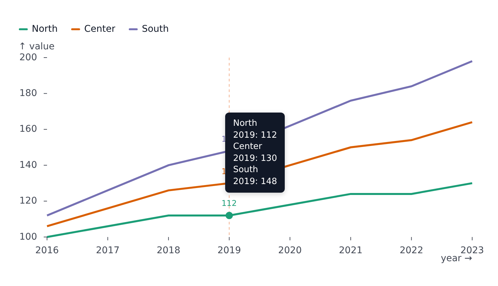
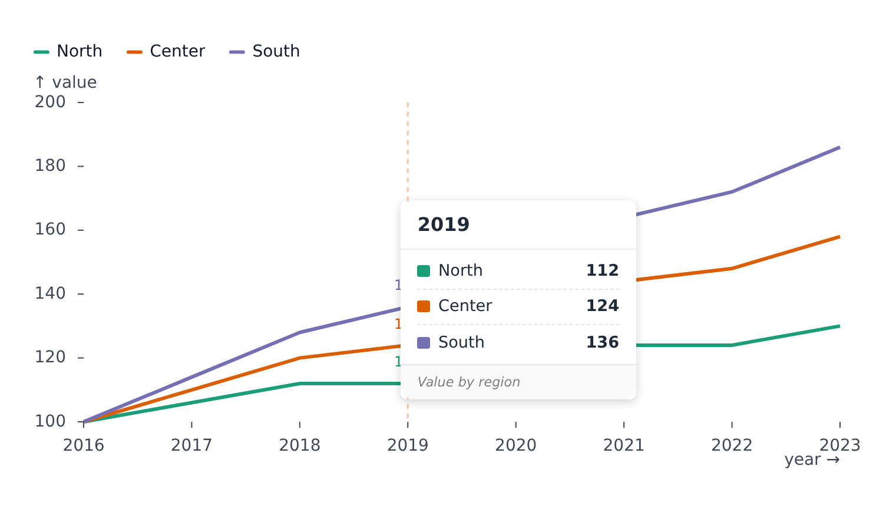

# Tooltip and hover

A plot becomes interactive when it is given a `tooltip`, a `{ type: 'hover' }` marker, or both. Hover is shared by every plot in a figure, so it can drive the other panels of a [facet](facets.md) or [composer](composer.md).

## Tooltip

```svelte
<LinePlot {width} {height} data={rows} x="year" y="value" color="region" tooltip />
```



`tooltip` is `true` for the defaults, or an options object:

| Option               | Meaning                                                                                                                                                                                       |
| -------------------- | --------------------------------------------------------------------------------------------------------------------------------------------------------------------------------------------- |
| `strategy`           | How related points are found: `'x'`, `'y'`, `'punctual'` (the exact point) or `'series'` (all points of the hovered series). Defaults per plot kind                                           |
| `sync`               | Show the highlight in every synced plot too (default `false`)                                                                                                                                 |
| `format`             | `(row) => string` - the tooltip text for the hovered row (`\n` breaks lines)                                                                                                                  |
| `content`            | A snippet `{#snippet content({ rows })}` replacing the text with custom markup. It is drawn in a plain card, so the markup brings its own background, colors and spacing                      |
| `series`             | Only these series appear in the tooltip                                                                                                                                                       |
| `anchorX`, `anchorY` | Preferred side of the cursor: `'left' \| 'middle' \| 'right'` (default `'right'`) and `'top' \| 'middle' \| 'bottom'` (default `'bottom'`). It moves to the other side when it would overflow |

```svelte
{#snippet content({ rows })}
	<TooltipCard
		heading={String(rows[0].year)}
		footer="Value by region"
		entries={rows.map((row) => ({
			label: row.region,
			color: colorOf(row.region),
			value: row.value,
			display: String(row.value)
		}))}
	/>
{/snippet}

<LinePlot
	{width}
	{height}
	data={rows}
	x="year"
	y="value"
	color="region"
	tooltip={{ strategy: 'x', content }}
/>
```



[examples/CustomTooltip.svelte](../examples/CustomTooltip.svelte) is the runnable version, with the card in [examples/TooltipCard.svelte](../examples/TooltipCard.svelte).

The default strategy follows the plot's axes: it matches along the category (or index) axis - points sharing the hovered `x` when the value axis is vertical, sharing `y` when it is horizontal - and `punctual` (the exact point) on heatmaps and scatter plots.

## In-plot hover

`markers={[{ type: 'hover' }]}` draws a dashed rule, a dot and a value label at the hovered point, inside the SVG. Its look comes from `hover` in the [configuration](theming.md) and can be overridden per marker (`rule`, `dot`, `text`, `area`). On band scales `areaX` / `areaY` highlight the whole band instead of a thin rule.

Use both together for the usual result:

```svelte
<LinePlot ... tooltip markers={[{ type: 'hover' }]} />
```

## Bars

On a `BarPlot` a hover candidate is the bar's whole band (or its series' slice, when grouped), so the tooltip triggers anywhere along the column.

## Syncing across plots

- In a [facet](facets.md) or a [`PlotComposer`](composer.md), `tooltip.sync: true` (or `hover.sync` on the composer) shows the hovered point's highlight, and the tooltip, in every panel. That replication is the feature: the same x is highlighted across panels.
- A composer's `hover={{ strategy, sync }}` sets the strategy and sync for all its panels.

## Maps

`GeoPlot` takes `tooltip` too (the row is the hovered feature) and the `{ type: 'geo-hover' }` marker, which restyles the hovered feature. See [Maps](geo.md).

## Reading hover from code

`useFigure().hover` and `usePlot().hover` expose `activeX`, `activeY`, `activeSeries`, `strategy`, `sync`, `source` and, for a plot, `points`, `activePoint` and `tooltip`. See [Reading plot state](state.md).
