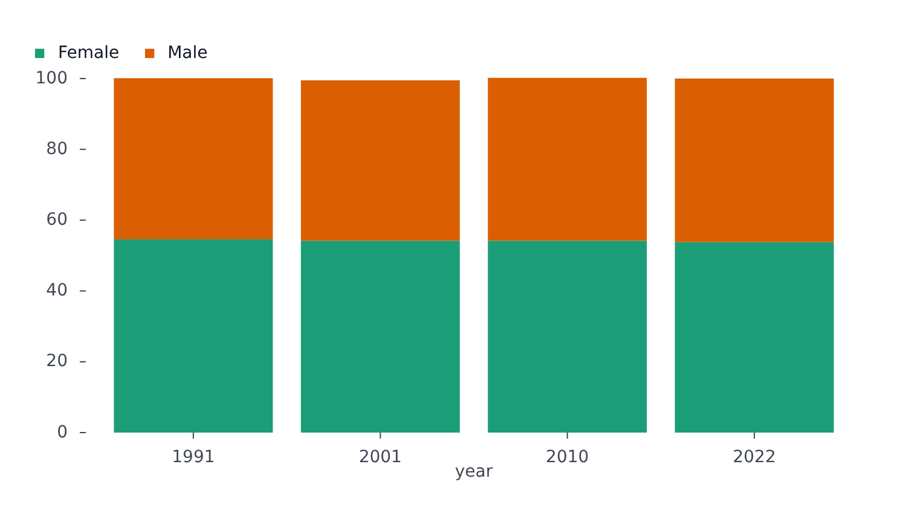
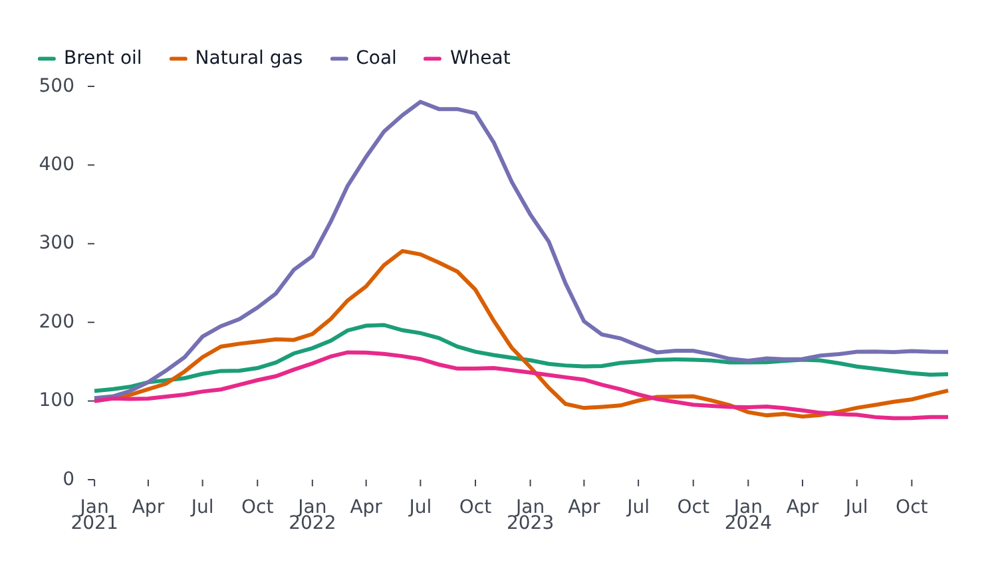
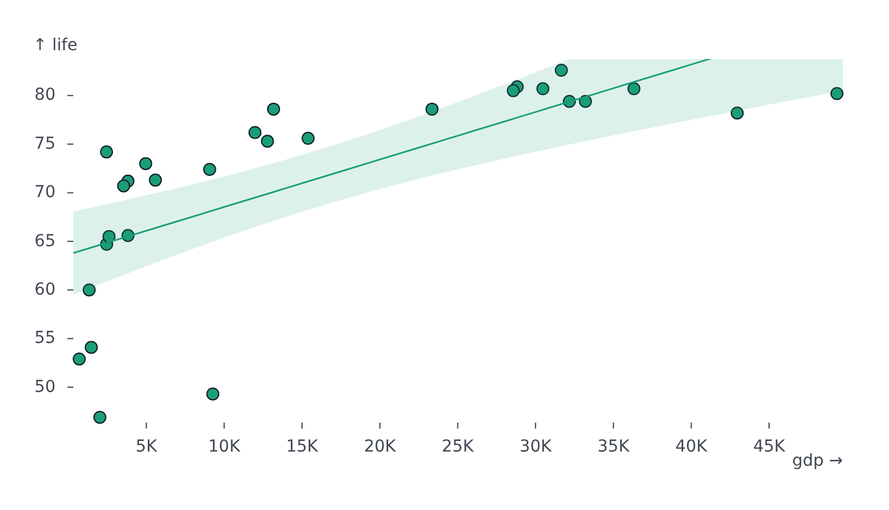

# Transforms and statistics

Both derive rows from the data before drawing. A **transform** reshapes the rows themselves (stack, bin, smooth, sort, filter). A **statistic** computes a summary of the data (regression, moving average, density) and draws it as an extra mark.

## Transforms

`transforms` is an array of flat objects: `type` picks the transform and the other fields are its channels and options, named as in [svelteplot's transforms](https://svelteplot.dev). It exists on a plot (it then runs once over all the plot's series) and on each [marker](markers.md) (over the marker's rows).

<!-- example: examples/StackedBars.svelte -->

```svelte
<script lang="ts">
	import { BarPlot } from '@fundar/data-chart-telling';
	import { SEX_SHARES } from './datasets';
</script>

<!-- Each sex's share of the population per census, stacked with `stackY` so a bar adds up to 100%. -->
<BarPlot
	width={720}
	height={400}
	data={SEX_SHARES}
	x="year"
	y="share"
	color="sex"
	transforms={[{ type: 'stackY' }]}
/>
```

<!-- /example -->



<!-- example: examples/MovingAverage.svelte -->

```svelte
<script lang="ts">
	import { LinePlot } from '@fundar/data-chart-telling';
	import { PRICES } from './datasets';
</script>

<!-- A 6-month moving average, run on the plot's rows. -->
<LinePlot
	width={720}
	height={400}
	data={PRICES}
	x="date"
	y="index"
	color="commodity"
	transforms={[{ type: 'windowY', k: 6, reduce: 'mean' }]}
/>
```

<!-- /example -->



| Family    | `type`                                                                                        | Does                                                                                                                                                                                                                             |
| --------- | --------------------------------------------------------------------------------------------- | -------------------------------------------------------------------------------------------------------------------------------------------------------------------------------------------------------------------------------- |
| Stack     | `stackX`, `stackY`, `stackMosaicX`, `stackMosaicY`                                            | Cumulative stacking. Options: `offset` (`'none'`, `'wiggle'`, `'center'`, `'normalize'`, `'diverging'`), `order`, `reverse`                                                                                                      |
| Bin       | `binX`, `binY`, `bin`                                                                         | Count or reduce rows into bins. Options: `thresholds` (a count, a list, or `'auto'`, `'scott'`, `'sturges'`, `'freedman-diaconis'`), `interval`, `domain`, `cumulative`; reducers by channel (`y: 'count'`, `fill: 'mean'`, ...) |
| Group     | `groupX`, `groupY`, `groupZ`, `group`                                                         | Reduce rows per category with named reducers (`count`, `sum`, `mean`, `p25`, ...) or functions                                                                                                                                   |
| Window    | `windowX`, `windowY`                                                                          | Sliding window: `k` (size), `reduce` (`'mean'`, `'median'`, `'sum'`, `'max'`, ...), `anchor`, `strict`                                                                                                                           |
| Bollinger | `bollingerX`, `bollingerY`                                                                    | Moving average and band: `n`, `k`                                                                                                                                                                                                |
| Normalize | `normalizeX`, `normalizeY`, `normalizeParallelX`, `normalizeParallelY`                        | Rebase to a reference: `basis` (`'first'`, `'last'`, `'min'`, `'max'`, `'mean'`, `'median'`, `'sum'`, `'deviation'`)                                                                                                             |
| Map       | `mapX`, `mapY`                                                                                | `map`: `'cumsum'`, `'rank'`, `'quantile'` or a function                                                                                                                                                                          |
| Interval  | `intervalX`, `intervalY`                                                                      | Turn a value into an `[x1, x2]` interval of a given size                                                                                                                                                                         |
| Jitter    | `jitterX`, `jitterY`                                                                          | Random offset: `width`, `std`, `distribution` (`'uniform'`, `'normal'`), `seed`                                                                                                                                                  |
| Shift     | `shiftX`, `shiftY`                                                                            | Move by `by` (a number, or a string offset)                                                                                                                                                                                      |
| Density   | `densityX`, `densityY`                                                                        | Kernel density estimate: `kernel`, `bandwidth`                                                                                                                                                                                   |
| Sort      | `sort`, `shuffle`, `reverse`                                                                  | Reorder rows (matters for the path a line takes and which dot lands on top)                                                                                                                                                      |
| Filter    | `filter`                                                                                      | Keep rows a test holds for                                                                                                                                                                                                       |
| Select    | `select`, `selectFirst`, `selectLast`, `selectMinX`, `selectMaxX`, `selectMinY`, `selectMaxY` | Keep one row per group, such as each series' last point or peak                                                                                                                                                                  |

Bar stacking is always `stackY`, also for horizontal bars. A transform on a `HistogramPlot` is merged over the plot's default binning, so `{ type: 'binX', thresholds: 20 }` changes the bins and the rest stays.

## Statistics

`statistics` is an array of derived summaries drawn as extra marks. On a plot it computes one per series by default; on a marker it applies to that marker's own rows.

<!-- example: examples/Regression.svelte -->

```svelte
<script lang="ts">
	import { ScatterPlot } from '@fundar/data-chart-telling';
	import { COUNTRIES_AT_2007 } from './datasets';
</script>

<!-- A linear regression with its 95% confidence band. -->
<ScatterPlot
	width={720}
	height={400}
	data={COUNTRIES_AT_2007}
	x="gdp"
	y="life"
	statistics={[{ type: 'regression', regressionType: 'linear', confidence: 0.95 }]}
/>
```

<!-- /example -->



| `type`          | Draws                                                                    | Options                                                                                                                                                                                                                                                                                                                                      |
| --------------- | ------------------------------------------------------------------------ | -------------------------------------------------------------------------------------------------------------------------------------------------------------------------------------------------------------------------------------------------------------------------------------------------------------------------------------------- |
| `regression`    | A fitted curve with a confidence band                                    | `regressionType` (`'linear'`, `'quad'`, `'poly'`, `'exp'`, `'log'`, `'pow'`, `'loess'`), `order`, `base`, `span`, `confidence` (`false` omits the band), `styles`                                                                                                                                                                            |
| `movingAverage` | A smoothed line                                                          | `k` (required), `reduce`, `styles`                                                                                                                                                                                                                                                                                                           |
| `bollinger`     | Moving average and a band of `k` standard deviations                     | `n`, `k`, `styles`                                                                                                                                                                                                                                                                                                                           |
| `density`       | A 1D density curve over `x`                                              | `kernel`, `bandwidth`, `styles`                                                                                                                                                                                                                                                                                                              |
| `density2d`     | 2D density contour bands                                                 | `bandwidth`, `thresholds`, `styles`                                                                                                                                                                                                                                                                                                          |
| `box`           | A box plot per category                                                  | the options of the [`box` marker](markers.md)                                                                                                                                                                                                                                                                                                |
| `deviation`     | A rule at an estimator and a band around it, along the plot's value axis | `estimator` (`'mean'`, `'median'`, `'midrange'`), `spread` (`'stdev'`, `'mad'`), `k` (band half-width in spreads, default 1), `rule` and `band` (styles, or `false` to omit), each with a `label` (`true`, or `{ text, styles }` with a `FontStyle`; the band's also `edge` (`'lower'`, `'upper'`) and `position` (`'inside'`, `'outside'`)) |

Which series a statistic runs over:

- omitted: one statistic per series;
- `series: ['a', 'b']`: only the named series;
- `pooled: true`: one statistic over all series combined.

The same summaries are available as markers (`regression`, `bollinger`, `density`, `box`, ...) when more control over the mark is needed.
